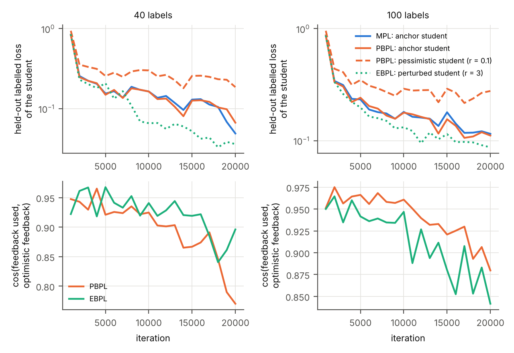
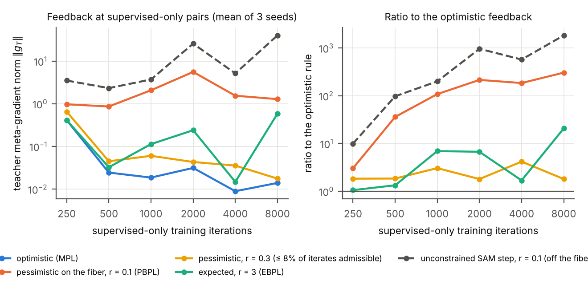

# Báo cáo: trust-region bilevel pseudo-labeling (PBPL / EBPL) trên FashionMNIST

> Trạng thái: bảng chính (60 run) và chẩn đoán suy biến đã xong; ablation, lưới tinh chỉnh
> FixMatch và đợt nhân bản (seed 6–10) đang chạy. Mọi số liệu lấy từ `results/`.

## 1. Thiết lập thực nghiệm

**Dữ liệu.** FashionMNIST (60k train / 10k test). Từ 60k ảnh train: 5 000 ảnh làm tập
validation (chỉ dùng để chọn siêu tham số, không bao giờ huấn luyện), 55 000 ảnh còn lại là
tập không nhãn; tập có nhãn gồm $n$ ảnh/lớp lấy cân bằng từ 55 000 ảnh đó ($n=4$: 40 nhãn,
$n=10$: 100 nhãn). Seed quyết định cả tập có nhãn; seed 0 dùng để chọn siêu tham số, seed 1–5
dùng để báo cáo (FixMatch, MPL, PBPL: 5 seed; các phương pháp khác: seed 1–3), seed 6–10 là
đợt nhân bản quyết định *sau* khi xem bảng chính và được báo cáo riêng. Kết quả là accuracy trên 10k ảnh test của mô hình EMA tại vòng lặp
cuối cùng (không chọn checkpoint theo test).

**Mô hình và huấn luyện (chung cho mọi phương pháp).** CNN kiểu VGG 6 lớp conv + BN +
LeakyReLU, 0.157M tham số. SGD Nesterov momentum 0.9, lr 0.03 cosine (lịch FixMatch), weight
decay 5e-4, batch 64 ảnh có nhãn + 448 ảnh không nhãn ($\mu=7$), 20 000 vòng lặp, EMA 0.999,
fp16 autocast. Augment trên GPU: yếu = dịch ngẫu nhiên 4px + lật ngang; mạnh = yếu +
RandAugment(2 phép, mỗi phép xác suất 0.5, cường độ 0.1–0.9) + Cutout 14px.

**Baseline.** Supervised (chỉ dữ liệu có nhãn), Pseudo-Label (ngưỡng 0.95), Mean Teacher
(MSE, $\lambda=50$, warm-up tuyến tính 40%), FixMatch ($\tau=0.95$, $\lambda_u=1$), FlexMatch
(ngưỡng theo lớp, warm-up). Siêu tham số baseline lấy mặc định từ bài gốc / USB, không tinh
chỉnh.

**Phương pháp đề xuất.** Teacher = mô hình triển khai, huấn luyện bằng CE + FixMatch +
$\lambda_m L_{\rm meta}$; student phụ cùng kiến trúc, không bao giờ thấy ảnh có nhãn, học từ
pseudo-label mềm của teacher trên ảnh augment mạnh. $L_{\rm meta}$ là feedback bilevel một
bước (Mục 3 của `docs/theory.md`):
- **MPL** (optimistic): $v=\nabla L_l(\theta')$;
- **PBPL** (pessimistic, bán kính cứng $r$): $v=\nabla L_l(\theta'+\varepsilon)$, $\varepsilon$
  là adversary giữ trạng thái trên fiber của student;
- **EBPL** (expected): $v=\nabla L_l(\theta'+\xi)$, $\xi$ nhiễu đẳng hướng được co về fiber.

Siêu tham số của ba biến thể bilevel ($\lambda_m$, $r$, cách chuẩn hóa feedback) được chọn
theo accuracy validation ở seed 0, 40 nhãn, 10k vòng lặp, cùng ngân sách cho cả ba.

**Ablation (40 nhãn).** SAM-feedback ($\varepsilon$ reset mỗi bước = một bước SAM từ 0, mù
với $X_u$), PBPL một mạng (look-ahead của chính teacher), FixMatch + fiber-SAM (PBPL tâm tại
teacher, một mạng), FixMatch + SAM trên labeled loss, PBPL + FlexMatch.

**Chẩn đoán suy biến (Prop. N2 trên CNN thật, `checks/degeneracy_static.py`).** Huấn luyện
một mạng chỉ trên dữ liệu có nhãn; tại các checkpoint $w_k$ lập cặp supervised-only
(teacher = student = $w_k$, input sạch, 448 ảnh không nhãn không giao tập có nhãn, BN dùng
thống kê của chính batch như feedback lúc huấn luyện), nên cặp tự nhất quán chính xác
($\theta'=\theta$). Đo chuẩn meta-gradient của teacher $\|g_T\|$ khi $w_k$ khớp dần nhãn, cho:
optimistic ($\varepsilon=0$); pessimistic ($\varepsilon$ = iterate *chấp nhận được* tốt nhất của
60 bước ascent-rồi-co, K = 5 bước co, KL trung bình tới anchor trên $X$ ≤ 2·10⁻³, $r\in\{0.1,0.3\}$);
expected (16 hướng ngẫu nhiên bán kính 3 co về fiber); và đối chứng SAM không ràng buộc
($\varepsilon=r\,g/\|g\|$, rời fiber). 3 seed, 100 nhãn, checkpoint 250…8000 vòng. Bản động
(khởi đầu từ cặp supervised-only rồi chạy động học với meta-gradient không chuẩn hóa,
$\lambda_m=30$) đã bị loại: bước meta quá lớn phá teacher ngay sau warm-up ở cả ba biến thể.

## 2. Pilot và ba lỗi thiết kế được phát hiện

1. **Feedback không held-out.** Bản đầu cho student dùng toàn bộ tập không nhãn (chứa cả 40
   ảnh có nhãn, theo quy ước FixMatch). Student học thuộc chúng qua pseudo-label đúng của
   teacher, labeled loss của student xuống 0.015 và feedback MPL triệt tiêu; ảnh có nhãn
   cũng ghim fiber nên PBPL mất "khoảng pessimistic". Kết quả (40 nhãn, seed 0, 20k vòng):
   FixMatch 72.5%, MPL 71.4%, PBPL 68.3%. Sửa: nhánh student loại ảnh có nhãn
   (`--stu_excl_lab 1`, Remark 2.6 trong `docs/theory.md`).
2. **Bộ giải bài toán trong.** Một bước ascent chuẩn hóa trên $L_l-\beta\,\mathrm{KL}$ không
   tìm được nghiệm trên fiber: trên toy MLP, cos với hướng nghiệm đúng chỉ 0.10–0.46 (β = 10…1000).
   Bộ giải "ascent rồi co về fiber" (K bước giảm KL với bước Rayleigh) đạt cos 0.61–0.68 với
   KL tới anchor 6·10⁻⁶ (`checks/check_nondegeneracy.py`).
3. **Chẩn đoán tĩnh phải ở lại trên fiber.** Bản đầu của chẩn đoán suy biến dùng BN ở eval
   mode và K = 2: adversary "pessimistic" rời fiber (KL tới anchor 0.11 với $r=0.1$, 1.17 với
   $r=0.3$), tức không còn là student chấp nhận được, nên bị hủy. Với BN theo batch (như lúc
   huấn luyện) và K = 5, mọi iterate $r=0.1$ đều có KL ≤ 2·10⁻³ (thử trên 1 seed: KL
   7–8·10⁻⁴); với K = 2 chỉ 13–19% iterate chấp nhận được. Lúc huấn luyện K = 2 là đủ vì
   adversary được giữ trạng thái qua các vòng lặp (KL ≈ 2·10⁻³ trong bảng sàng lọc).

## 3. Chọn siêu tham số (validation, seed 0, 40 nhãn, 10k vòng)

| cấu hình | val | test | pseudo-label đúng (trong mask) |
|---|---|---|---|
| FixMatch | 74.08 | 74.87 | 78.4 |
| FlexMatch | 73.48 | 73.57 | 75.4 |
| MPL, λ_m = 0.1 (tốt nhất trong 6 cấu hình) | 73.80 | 74.08 | 79.9 |
| **PBPL, λ_m = 0.1, r = 0.1 (tốt nhất trong 12)** | **76.50** | **75.12** | **80.6** |
| EBPL, λ_m = 0.3, r = 3 (tốt nhất trong 6) | 73.40 | 72.10 | 77.5 |

Xu hướng rõ nhất: λ_m ≥ 0.3 làm hại cả ba biến thể (ví dụ PBPL r = 0.3: 73.9 → 72.3 → 68.5 khi
λ_m = 0.1 → 0.3 → 1.0); thang meta-gradient chính xác (không chuẩn hóa) kém hơn chuẩn hóa
RMS chạy. Bán kính quá lớn (r = 1) đẩy adversary ra khỏi fiber (KL 0.1–0.2, labeled loss của
student pessimistic tăng tới 3.4). Trên một seed, ưu thế của PBPL trên test chỉ +0.25 điểm;
vì vậy bảng chính dùng 5 seed và so sánh cặp.

Chẩn đoán khớp lý thuyết: với PBPL, labeled loss held-out của anchor giảm 0.86 → 0.10 trong
khi labeled loss của student pessimistic ($r=0.1$) dừng ở ≈ 0.30 — feedback optimistic gần
như tắt, feedback pessimistic thì không. Với EBPL ($r=3$) nhiễu ngẫu nhiên gần như không đổi
labeled loss (0.04 so với 0.04) và feedback gần trùng MPL (cos 0.90): biến thể expected yếu
như dự đoán bậc $s^2$.

## 4. Kết quả chính (20k vòng, mô hình EMA ở vòng lặp cuối)

FixMatch, MPL và PBPL chạy 5 seed (1–5) để so sánh cặp; các phương pháp còn lại 3 seed (1–3).
Dữ liệu: `results/fmnist-ssl-main-{a,b}`; bảng sinh bởi `analysis/main_table.py`
(`docs/main_table.md`).

| phương pháp | 40 nhãn | 100 nhãn |
|---|---|---|
| Supervised | 56.88 ± 1.23 (n=3) | 69.50 ± 0.70 (n=3) |
| Pseudo-Label | 64.18 ± 1.29 (n=3) | 74.71 ± 1.32 (n=3) |
| Mean Teacher | 58.16 ± 0.59 (n=3) | 67.45 ± 1.08 (n=3) |
| FixMatch | 70.96 ± 3.69 (n=5) | 79.68 ± 3.76 (n=5) |
| FlexMatch | 71.11 ± 2.32 (n=3) | 77.88 ± 1.55 (n=3) |
| MPL + FixMatch (optimistic) | 71.06 ± 4.11 (n=5) | 81.65 ± 3.35 (n=5) |
| **EBPL + FixMatch (expected)** | **73.00 ± 3.49** (n=3) | **81.88 ± 1.54** (n=3) |
| **PBPL + FixMatch (pessimistic)** | **72.98 ± 3.38** (n=5) | 81.34 ± 4.08 (n=5) |

Độ lệch chuẩn giữa các seed lớn (3–4 điểm) vì seed quyết định *tập có nhãn*; so sánh có ý
nghĩa là so sánh cặp trên cùng seed:

| so với FixMatch, cùng seed | 40 nhãn | 100 nhãn |
|---|---|---|
| MPL (optimistic) | +0.10 ± 2.62, thắng 2/5, p = 0.94 | +1.97 ± 4.16, 3/5, p = 0.35 |
| EBPL (expected) | +2.36 ± 1.32, thắng 3/3, p = 0.09 | +4.36 ± 4.80, 2/3, p = 0.26 |
| **PBPL (pessimistic)** | **+2.02 ± 1.18, thắng 5/5, p = 0.019** | +1.66 ± 3.99, 2/5, p = 0.41 |
| FlexMatch | +0.46 ± 3.54, 1/3 | +0.36 ± 2.72, 1/3 |

(p: t-test cặp hai phía; với 5/5 seed, sign test hai phía cho p = 0.0625.) Các baseline cổ
điển kém xa: tính theo trung bình (không cặp), PBPL hơn Pseudo-Label 8.8 / 6.6 điểm, Mean
Teacher 14.8 / 13.9, Supervised 16.1 / 11.8 điểm (40 / 100 nhãn).

Đọc kết quả:

- **40 nhãn.** PBPL + FixMatch hơn FixMatch trên cả 5 seed (+0.7 đến +3.3 điểm). EBPL hơn
  trên cả 3 seed. MPL (cùng kiến trúc hai mạng, cùng λ_m, chỉ khác quy tắc feedback) thì
  không (+0.1, 2/5). So trực tiếp PBPL với MPL: +1.93 ± 3.64 (3/5, p = 0.30); EBPL với MPL:
  +2.86 (3/3, p = 0.14). Hướng đúng như lý thuyết, nhưng với 5 seed thì chưa có ý nghĩa thống kê.
- **100 nhãn.** Cả ba biến thể bilevel hơn FixMatch trung bình 1.7–4.4 điểm, nhưng phần lớn
  nhờ seed 3, nơi FixMatch chỉ đạt 75.0 (mọi biến thể bilevel +8 điểm). Ở các seed còn lại
  PBPL và MPL nằm trong khoảng −1.3 đến +2.7 điểm; EBPL +5.9 ở seed 2, −1.0 ở seed 1. PBPL không hơn MPL (−0.31, 1/5). Ở mức 100 nhãn, lợi ích
  (nếu có) là của *bilevel feedback nói chung*; không thấy riêng phần pessimistic.
- **Chi phí** (một T4, 20k vòng): FixMatch 11.3 phút, MPL 27.9, EBPL 37.9, PBPL 40.6
  (3.6× FixMatch). Phần thêm là student phụ, JVP và K = 2 bước co về fiber mỗi vòng lặp.

### 4.1 Lợi thế ở 40 nhãn đến từ đâu: chống suy giảm cuối huấn luyện

Trung bình 5 seed, FixMatch (40 nhãn) đạt đỉnh 72.8% ở vòng 7k rồi giảm còn 71.0% ở vòng
20k. Accuracy của pseudo-label vượt ngưỡng giảm từ 78.1% xuống 73.9%: đây là confirmation
bias. Mức giảm từ đỉnh đến cuối theo từng seed là 2.9 / 9.1 / 2.8 / 0 / 0 điểm. PBPL không
suy giảm như vậy: giảm trung bình 1.0 điểm, pseudo-label giữ ở 77%, test tăng đến cuối. EBPL
giảm 0.2 điểm. MPL ít suy giảm (0.9) nhưng đỉnh thấp hơn (71.1%).

Hệ quả cần nói rõ: nếu được phép **dừng sớm theo validation** (chọn checkpoint có val
accuracy cao nhất trên 5 000 ảnh validation có nhãn), FixMatch đạt 73.84 ± 3.99 so với
73.90 ± 3.44 của PBPL ở 40 nhãn. Chênh lệch +0.05, thắng 3/5, p = 0.98, nên lợi thế biến mất
(100 nhãn: +1.46, 3/5, p = 0.35; `main_table.py --select val`). Vậy ở 40 nhãn, PBPL **không
nâng đỉnh accuracy** mà **giữ được đỉnh đến cuối huấn luyện**. Trong SSL thật không có tập
validation có nhãn lớn gấp 125 lần tập huấn luyện để dừng sớm, nên giao thức vòng lặp cuối
(như FixMatch/USB) là giao thức chính. Dù vậy, cách diễn giải đúng là "ổn định hơn", không
phải "tốt hơn ở mọi giao thức".

### 4.2 Feedback trong lúc huấn luyện

- **PBPL** (cam): labeled loss held-out của student pessimistic dừng ở khoảng 0.2–0.3 sau
  vòng 5k, trong khi của anchor giảm còn 0.07 (40 nhãn) / 0.11 (100 nhãn). Chuẩn feedback thô
  $\|c_{\rm pess}\|/\|c_{\rm opt}\|$ (cùng anchor) tăng từ 1.2 (vòng 1k) lên 2.8 (vòng 20k) ở
  40 nhãn (100 nhãn: 1.1 → 1.8). Cosine giữa feedback pessimistic và optimistic giảm từ 0.95
  xuống 0.77 (100 nhãn: 0.95 → 0.88). Đúng như Prop. N3:
  khi anchor khớp dần dữ liệu có nhãn, phần feedback mà MPL không có (gradient của phần
  labeled gradient "vô hình" với dữ liệu không nhãn) ngày càng chiếm ưu thế.
- **MPL** (xanh dương): chuẩn feedback thô giảm từ 22 xuống 12.5 ở 40 nhãn (100 nhãn: không
  giảm, 24 → 25), không triệt tiêu. Student held-out không bao giờ khớp hết nhãn (labeled loss 0.05 ở vòng 20k), nên
  huấn luyện thật còn xa điểm bất động chính xác của Prop. N2. Phép thử sạch là chẩn đoán
  tĩnh ở Mục 5.
- **EBPL** (xanh lá): labeled loss của student nhiễu ≈ của anchor (0.036 so với 0.025), cosine
  với feedback optimistic 0.84–0.97. Tín hiệu bậc $s^2$ nhỏ như dự đoán, nên **cơ chế
  không suy biến không giải thích được** việc EBPL bằng PBPL về accuracy (3 seed). Các khác
  biệt khác với MPL là λ_m = 0.3 (gấp 3 MPL; feedback đã chuẩn hóa RMS nên đây là bước meta
  lớn gấp 3) và nhiễu ngẫu nhiên trong hướng feedback. Chưa có ablation tách hai yếu tố này.

## 5. Chẩn đoán suy biến trên CNN thật (Prop. N2, tĩnh)

Giao thức ở Mục 1 (`checks/degeneracy_static.py`, 3 seed, chạy CPU; dữ liệu
`results/local/degeneracy_static_s{1,2,3}.json`). Giá trị trung bình 3 seed:

| vòng | $L_l(w_k)$ | $\|g_T\|$ opt | pess r=0.1 | KL | pess r=0.3 | tỉ lệ iterate hợp lệ (r=0.3) | exp r=3 | KL | SAM r=0.1 | KL |
|---|---|---|---|---|---|---|---|---|---|---|
| 250 | 2.0e-02 | 0.411 | 0.968 | 7.1e-04 | 0.65 | 0.05 | 0.411 | 6.1e-03 | 3.49 | 0.13 |
| 500 | 1.2e-03 | 0.0243 | 0.86 | 6.5e-04 | 0.0447 | 0.04 | 0.0324 | 9.2e-03 | 2.32 | 0.15 |
| 1000 | 4.4e-04 | 0.0185 | 2.06 | 1.2e-03 | 0.06 | 0.03 | 0.113 | 2.5e-02 | 3.70 | 0.16 |
| 2000 | 2.4e-04 | 0.0312 | 5.55 | 1.5e-03 | 0.043 | 0.03 | 0.239 | 3.6e-02 | 25.5 | 0.41 |
| 4000 | 1.9e-04 | 0.00888 | 1.54 | 1.6e-03 | 0.0354 | 0.04 | 0.0147 | 9.6e-03 | 5.13 | 0.21 |
| 8000 | 1.1e-04 | 0.0139 | 1.28 | 1.7e-03 | 0.0175 | 0.03 | 0.584 | 3.1e-02 | 39.9 | 0.39 |

- **Optimistic suy biến như Prop. N2(a).** Khi $L_l(w_k)$ giảm từ 2·10⁻² xuống 1·10⁻⁴,
  $\|g_T\|$ optimistic giảm từ 0.16–0.71 (vòng 250) xuống 0.003–0.03 (vòng 8000) theo
  $\|\nabla L_l\|$.
- **Pessimistic không suy biến như N2(b)**, với student *chấp nhận được* (KL tới anchor
  ≤ 2·10⁻³). Ở $r=0.1$, $\|g_T\|$ giữ ở 0.4–9 suốt quá trình (trừ một ngoại lệ dưới đây). Sau vòng 250, tỉ lệ so với
  optimistic là 24–679 lần ở 14/15 cặp (seed, checkpoint), trung vị 134 lần. Ngoại lệ là
  seed 3 ở vòng 8000: chỉ 7% iterate của bộ giải hợp lệ, iterate hợp lệ tốt nhất nằm gần
  điểm xuất phát, tỉ lệ chỉ 2 lần. Đây là giới hạn của bộ giải (fiber cong mạnh, K = 5 bước co
  không đủ), không phải feedback triệt tiêu.
- **r = 0.3 không kiểm định được N2(b).** Chỉ 2–8% iterate hợp lệ, iterate hợp lệ tốt nhất
  gần điểm xuất phát (một điểm ngẫu nhiên trên fiber), tỉ lệ 1–6 lần. Bán kính này vượt quá
  vùng mà bộ giải ascent-rồi-co giữ được trên fiber, phù hợp với việc sàng lọc chọn r = 0.1
  (Mục 3: r = 1 cho KL 0.1–0.2).
- **Expected nhỏ như N2(d)** (bậc $s^2$): trung vị 2.4 lần optimistic. Mẫu chỉ hợp lệ xấp xỉ
  (KL 5·10⁻³–6.5·10⁻²); các giá trị lớn (ví dụ 55 lần ở seed 3, vòng 8000) đi kèm KL lớn,
  tức có rò rỉ ra khỏi fiber.
- **Đối chứng SAM không ràng buộc** cho $\|g_T\|$ lớn nhất (1.3–107) nhưng KL 0.09–0.73. Nó
  đổi dự đoán của student trên $X$ rất nhiều, nên không phải student chấp nhận được. Đây
  chính là feedback "mù với $X_u$" mà ràng buộc fiber loại bỏ (lỗ hổng A4 của review).

Tóm lại, trên CNN thật, tại các cặp supervised-only (điểm bất động của MPL), feedback
pessimistic trên fiber lớn hơn feedback optimistic hai bậc độ lớn và không giảm khi mạng khớp
nhãn. Đây là phiên bản thực nghiệm của định lý không suy biến, với điều kiện bộ giải trong ở
lại trên fiber.

## 6. Ablation (40 nhãn, seed 1–3)

_(kernel `fmnist-ssl-ablate-{a,b}` đang chạy)_
