# Báo cáo: trust-region bilevel pseudo-labeling (PBPL / EBPL) trên FashionMNIST

> Trạng thái: hoàn tất. Đã xong bảng chính (60 run), chẩn đoán suy biến, ablation, lưới tinh
> chỉnh FixMatch, Figure 1, đợt nhân bản seed 6–10, việc đưa EBPL cùng các đối chứng lên 10 seed,
> và cặp một mạng ở thang meta-gradient chính xác (`rep-a` đến `rep-f`). Mọi số liệu lấy từ
> `results/`.
>
> **Kết luận (Mục 9, 10):** ở 40 nhãn, trên 10 seed:
> - PBPL, EBPL, MPL (hai mạng), FixMatch và FixMatch tinh chỉnh cách nhau dưới 1 điểm, không có
>   khác biệt nào có ý nghĩa thống kê. Ưu thế của PBPL ở seed 1–5 (+2.02, p = 0.019) không được
>   nhân bản.
> - Chỉ hai biến thể hơn FixMatch với p < 0.05 (chưa hiệu chỉnh nhiều phép so sánh), và cả hai
>   đều *không* phải pessimistic:
>   - SAM trên labeled loss (không bilevel): +3.05 điểm, p = 0.014;
>   - MPL một mạng (optimistic): +1.98 điểm, p = 0.041.
> - Hiệu chỉnh Holm qua 9 phép so sánh thì không biến thể nào còn có ý nghĩa thống kê.
> - So với optimistic trên cùng seed, pessimistic không khác có ý nghĩa ở cấu hình nào:
>   - hai mạng: +0.04 (10 seed);
>   - một mạng: −0.48 (10 seed);
>   - một mạng ở thang meta-gradient chính xác: +0.13 (5 seed, p = 0.93). Ở thang này độ lớn
>     không bị chuẩn hóa, và bước meta pessimistic gộp cả quá trình lớn gấp 2–6 lần bước
>     optimistic.

## 1. Thiết lập thực nghiệm

**Dữ liệu.** FashionMNIST (60k train / 10k test). Từ 60k ảnh train: 5 000 ảnh làm tập
validation (chỉ dùng để chọn siêu tham số, không bao giờ huấn luyện), 55 000 ảnh còn lại là
tập không nhãn; tập có nhãn gồm $n$ ảnh/lớp lấy cân bằng từ 55 000 ảnh đó ($n=4$: 40 nhãn,
$n=10$: 100 nhãn). Seed quyết định cả tập có nhãn; seed 0 dùng để chọn siêu tham số, seed 1–5
dùng để báo cáo (FixMatch, MPL, PBPL: 5 seed; các phương pháp khác: seed 1–3), seed 6–10 là
đợt nhân bản quyết định *sau* khi xem bảng chính và được báo cáo riêng. Kết quả là accuracy trên 10k ảnh test của mô hình EMA tại vòng lặp
cuối cùng (không chọn checkpoint theo test).

**Mô hình và huấn luyện (chung cho mọi phương pháp).** CNN kiểu VGG 6 lớp conv + BN +
LeakyReLU, 0.157M tham số. SGD Nesterov momentum 0.9, lr 0.03 cosine (lịch FixMatch), weight
decay 5e-4, batch 64 ảnh có nhãn + 448 ảnh không nhãn ($\mu=7$), 20 000 vòng lặp, EMA 0.999,
fp16 autocast. Augment trên GPU: yếu = dịch ngẫu nhiên 4px + lật ngang; mạnh = yếu +
RandAugment(2 phép, mỗi phép xác suất 0.5, cường độ 0.1–0.9) + Cutout 14px.

**Baseline.** Supervised (chỉ dữ liệu có nhãn), Pseudo-Label (ngưỡng 0.95), Mean Teacher
(MSE, $\lambda=50$, warm-up tuyến tính 40%), FixMatch ($\tau=0.95$, $\lambda_u=1$), FlexMatch
(ngưỡng theo lớp, warm-up). Siêu tham số baseline lấy mặc định từ bài gốc / USB, không tinh
chỉnh.

**Phương pháp đề xuất.** Teacher = mô hình triển khai, huấn luyện bằng CE + FixMatch +
$\lambda_m L_{\rm meta}$; student phụ cùng kiến trúc, không bao giờ thấy ảnh có nhãn, học từ
pseudo-label mềm của teacher trên ảnh augment mạnh. $L_{\rm meta}$ là feedback bilevel một
bước (Mục 3 của `docs/theory.md`):
- **MPL** (optimistic): $v=\nabla L_l(\theta')$;
- **PBPL** (pessimistic, bán kính cứng $r$): $v=\nabla L_l(\theta'+\varepsilon)$, $\varepsilon$
  là adversary giữ trạng thái trên fiber của student;
- **EBPL** (expected): $v=\nabla L_l(\theta'+\xi)$, $\xi$ nhiễu đẳng hướng được co về fiber.

Siêu tham số của ba biến thể bilevel ($\lambda_m$, $r$, cách chuẩn hóa feedback) được chọn
theo accuracy validation ở seed 0, 40 nhãn, 10k vòng lặp, cùng ngân sách cho cả ba.

**Ablation (40 nhãn).** SAM-feedback ($\varepsilon$ reset mỗi bước = một bước SAM từ 0, mù
với $X_u$), PBPL một mạng (look-ahead của chính teacher), FixMatch + fiber-SAM (PBPL tâm tại
teacher, một mạng), FixMatch + SAM trên labeled loss, PBPL + FlexMatch.

**Chẩn đoán suy biến (Prop. N2 trên CNN thật, `checks/degeneracy_static.py`).** Huấn luyện
một mạng chỉ trên dữ liệu có nhãn; tại các checkpoint $w_k$ lập cặp supervised-only
(teacher = student = $w_k$, input sạch, 448 ảnh không nhãn không giao tập có nhãn, BN dùng
thống kê của chính batch như feedback lúc huấn luyện), nên cặp tự nhất quán chính xác
($\theta'=\theta$). Đo chuẩn meta-gradient của teacher $\|g_T\|$ khi $w_k$ khớp dần nhãn, cho:
optimistic ($\varepsilon=0$); pessimistic ($\varepsilon$ = iterate *chấp nhận được* tốt nhất của
60 bước ascent-rồi-co, K = 5 bước co, KL trung bình tới anchor trên $X$ ≤ 2·10⁻³, $r\in\{0.1,0.3\}$);
expected (16 hướng ngẫu nhiên bán kính 3 co về fiber); và đối chứng SAM không ràng buộc
($\varepsilon=r\,g/\|g\|$, rời fiber). 3 seed, 100 nhãn, checkpoint 250…8000 vòng. Bản động
(khởi đầu từ cặp supervised-only rồi chạy động học với meta-gradient không chuẩn hóa,
$\lambda_m=30$) đã bị loại: bước meta quá lớn phá teacher ngay sau warm-up ở cả ba biến thể.

## 2. Pilot và ba lỗi thiết kế được phát hiện

1. **Feedback không held-out.** Bản đầu cho student dùng toàn bộ tập không nhãn (chứa cả 40
   ảnh có nhãn, theo quy ước FixMatch). Student học thuộc chúng qua pseudo-label đúng của
   teacher, labeled loss của student xuống 0.015 và feedback MPL triệt tiêu; ảnh có nhãn
   cũng ghim fiber nên PBPL mất "khoảng pessimistic". Kết quả (40 nhãn, seed 0, 20k vòng):
   FixMatch 72.5%, MPL 71.4%, PBPL 68.3%. Sửa: nhánh student loại ảnh có nhãn
   (`--stu_excl_lab 1`, Remark 2.6 trong `docs/theory.md`).
2. **Bộ giải bài toán trong.** Một bước ascent chuẩn hóa trên $L_l-\beta\,\mathrm{KL}$ không
   tìm được nghiệm trên fiber: trên toy MLP, cos với hướng nghiệm đúng chỉ 0.10–0.46 (β = 10…1000).
   Bộ giải "ascent rồi co về fiber" (K bước giảm KL với bước Rayleigh) đạt cos 0.61–0.68 với
   KL tới anchor 6·10⁻⁶ (`checks/check_nondegeneracy.py`).
3. **Chẩn đoán tĩnh phải ở lại trên fiber.** Bản đầu của chẩn đoán suy biến dùng BN ở eval
   mode và K = 2: adversary "pessimistic" rời fiber (KL tới anchor 0.11 với $r=0.1$, 1.17 với
   $r=0.3$), tức không còn là student chấp nhận được, nên bị hủy. Với BN theo batch (như lúc
   huấn luyện) và K = 5, mọi iterate $r=0.1$ đều có KL ≤ 2·10⁻³ (thử trên 1 seed: KL
   7–8·10⁻⁴); với K = 2 chỉ 13–19% iterate chấp nhận được. Lúc huấn luyện K = 2 là đủ vì
   adversary được giữ trạng thái qua các vòng lặp (KL ≈ 2·10⁻³ trong bảng sàng lọc).

## 3. Chọn siêu tham số (validation, seed 0, 40 nhãn, 10k vòng)

| cấu hình | val | test | pseudo-label đúng (trong mask) |
|---|---|---|---|
| FixMatch | 74.08 | 74.87 | 78.4 |
| FlexMatch | 73.48 | 73.57 | 75.4 |
| MPL, λ_m = 0.1 (tốt nhất trong 6 cấu hình) | 73.80 | 74.08 | 79.9 |
| **PBPL, λ_m = 0.1, r = 0.1 (tốt nhất trong 12)** | **76.50** | **75.12** | **80.6** |
| EBPL, λ_m = 0.3, r = 3 (tốt nhất trong 6) | 73.40 | 72.10 | 77.5 |

Xu hướng rõ nhất: λ_m ≥ 0.3 làm hại cả ba biến thể (ví dụ PBPL r = 0.3: 73.9 → 72.3 → 68.5 khi
λ_m = 0.1 → 0.3 → 1.0); thang meta-gradient chính xác (không chuẩn hóa) kém hơn chuẩn hóa
RMS chạy. Bán kính quá lớn (r = 1) đẩy adversary ra khỏi fiber (KL 0.1–0.2, labeled loss của
student pessimistic tăng tới 3.4). Trên một seed, ưu thế của PBPL trên test chỉ +0.25 điểm;
vì vậy bảng chính dùng 5 seed và so sánh cặp.

Chẩn đoán khớp lý thuyết: với PBPL, labeled loss held-out của anchor giảm 0.86 → 0.10 trong
khi labeled loss của student pessimistic ($r=0.1$) dừng ở ≈ 0.30 — feedback optimistic gần
như tắt, feedback pessimistic thì không. Với EBPL ($r=3$) nhiễu ngẫu nhiên gần như không đổi
labeled loss (0.04 so với 0.04) và feedback gần trùng MPL (cos 0.90): biến thể expected yếu
như dự đoán bậc $s^2$.

## 4. Kết quả chính (20k vòng, mô hình EMA ở vòng lặp cuối)

FixMatch, MPL và PBPL chạy 5 seed (1–5) để so sánh cặp; các phương pháp còn lại 3 seed (1–3).
Dữ liệu: `results/fmnist-ssl-main-{a,b}`; bảng sinh bởi `analysis/main_table.py`
(`docs/main_table.md`).

| phương pháp | 40 nhãn | 100 nhãn |
|---|---|---|
| Supervised | 56.88 ± 1.23 (n=3) | 69.50 ± 0.70 (n=3) |
| Pseudo-Label | 64.18 ± 1.29 (n=3) | 74.71 ± 1.32 (n=3) |
| Mean Teacher | 58.16 ± 0.59 (n=3) | 67.45 ± 1.08 (n=3) |
| FixMatch | 70.96 ± 3.69 (n=5) | 79.68 ± 3.76 (n=5) |
| FlexMatch | 71.11 ± 2.32 (n=3) | 77.88 ± 1.55 (n=3) |
| MPL + FixMatch (optimistic) | 71.06 ± 4.11 (n=5) | 81.65 ± 3.35 (n=5) |
| **EBPL + FixMatch (expected)** | **73.00 ± 3.49** (n=3) | **81.88 ± 1.54** (n=3) |
| **PBPL + FixMatch (pessimistic)** | **72.98 ± 3.38** (n=5) | 81.34 ± 4.08 (n=5) |

Độ lệch chuẩn giữa các seed lớn (3–4 điểm) vì seed quyết định *tập có nhãn*; so sánh có ý
nghĩa là so sánh cặp trên cùng seed:

| so với FixMatch, cùng seed | 40 nhãn | 100 nhãn |
|---|---|---|
| MPL (optimistic) | +0.10 ± 2.62, thắng 2/5, p = 0.94 | +1.97 ± 4.16, 3/5, p = 0.35 |
| EBPL (expected) | +2.36 ± 1.32, thắng 3/3, p = 0.09 | +4.36 ± 4.80, 2/3, p = 0.26 |
| **PBPL (pessimistic)** | **+2.02 ± 1.18, thắng 5/5, p = 0.019** | +1.66 ± 3.99, 2/5, p = 0.41 |
| FlexMatch | +0.46 ± 3.54, 1/3 | +0.36 ± 2.72, 1/3 |

(p: t-test cặp hai phía; với 5/5 seed, sign test hai phía cho p = 0.0625.) **Dòng PBPL ở 40
nhãn không được nhân bản:** trên seed 6–10 chênh lệch là −0.87 ± 3.87 (2/5), gộp 10 seed
+0.58 ± 3.10 (7/10, p = 0.57); xem Mục 9. **Dòng EBPL cũng vậy:** seed 4 và 5 cho −0.88 và +1.10
điểm (5 seed: +1.46 ± 1.70, 4/5, p = 0.13), seed 6–10 cho −1.47 ± 4.04 (2/5); gộp 10 seed
−0.01 ± 3.30 (6/10, p = 0.996). Các baseline cổ
điển kém xa: tính theo trung bình (không cặp), PBPL hơn Pseudo-Label 8.8 / 6.6 điểm, Mean
Teacher 14.8 / 13.9, Supervised 16.1 / 11.8 điểm (40 / 100 nhãn).


Đọc kết quả:

- **40 nhãn.** PBPL + FixMatch hơn FixMatch trên cả 5 seed (+0.7 đến +3.3 điểm). EBPL hơn
  trên cả 3 seed. MPL (cùng kiến trúc hai mạng, cùng λ_m, chỉ khác quy tắc feedback) thì
  không (+0.1, 2/5). So trực tiếp PBPL với MPL: +1.93 ± 3.64 (3/5, p = 0.30); EBPL với MPL:
  +2.86 (3/3, p = 0.14). Hướng đúng như lý thuyết, nhưng với 5 seed thì chưa có ý nghĩa thống kê,
  và **đợt nhân bản không xác nhận cả hai điều**: trên seed 6–10, PBPL kém FixMatch 0.87 điểm
  và kém MPL 1.84 điểm; EBPL trên 10 seed bằng FixMatch (−0.01) và kém MPL 0.54 điểm (Mục 9).
- **100 nhãn.** Cả ba biến thể bilevel hơn FixMatch trung bình 1.7–4.4 điểm, nhưng phần lớn
  nhờ seed 3, nơi FixMatch chỉ đạt 75.0 (mọi biến thể bilevel +8 điểm). Ở các seed còn lại
  PBPL và MPL nằm trong khoảng −1.3 đến +2.7 điểm; EBPL +5.9 ở seed 2, −1.0 ở seed 1. PBPL không hơn MPL (−0.31, 1/5). Ở mức 100 nhãn, lợi ích
  (nếu có) là của *bilevel feedback nói chung*; không thấy riêng phần pessimistic.
- **Chi phí** (một T4, 20k vòng): FixMatch 11.3 phút, MPL 27.9, EBPL 37.9, PBPL 40.6
  (3.6× FixMatch). Phần thêm là student phụ, JVP và K = 2 bước co về fiber mỗi vòng lặp.

### 4.1 Lợi thế ở 40 nhãn đến từ đâu: chống suy giảm cuối huấn luyện

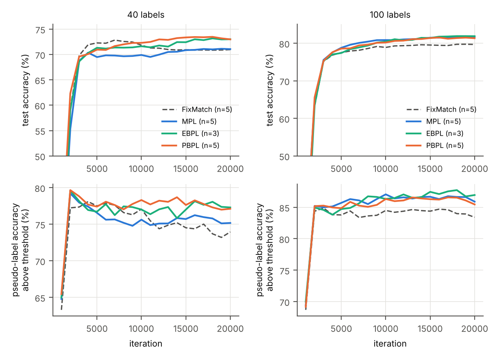

Trung bình 5 seed, FixMatch (40 nhãn) đạt đỉnh 72.8% ở vòng 7k rồi giảm còn 71.0% ở vòng
20k. Accuracy của pseudo-label vượt ngưỡng giảm từ 78.1% xuống 73.9%: đây là confirmation
bias. Mức giảm từ đỉnh đến cuối theo từng seed là 2.9 / 9.1 / 2.8 / 0 / 0 điểm. PBPL không
suy giảm như vậy: giảm trung bình 1.0 điểm, pseudo-label giữ ở 77%, test tăng đến cuối. EBPL
giảm 0.2 điểm. MPL ít suy giảm (0.9) nhưng đỉnh thấp hơn (71.1%).

Hệ quả cần nói rõ: nếu được phép **dừng sớm theo validation** (chọn checkpoint có val
accuracy cao nhất trên 5 000 ảnh validation có nhãn), FixMatch đạt 73.84 ± 3.99 so với
73.90 ± 3.44 của PBPL ở 40 nhãn. Chênh lệch +0.05, thắng 3/5, p = 0.98, nên lợi thế biến mất
(100 nhãn: +1.46, 3/5, p = 0.35; `main_table.py --select val`). Vậy ở 40 nhãn, PBPL **không
nâng đỉnh accuracy** mà **giữ được đỉnh đến cuối huấn luyện**. Trong SSL thật không có tập
validation có nhãn lớn gấp 125 lần tập huấn luyện để dừng sớm, nên giao thức vòng lặp cuối
(như FixMatch/USB) là giao thức chính. Dù vậy, cách diễn giải đúng là "ổn định hơn", không
phải "tốt hơn ở mọi giao thức".

**Cập nhật sau nhân bản (Mục 9):** ngay cả "ổn định hơn" cũng không đứng vững. Trên 10 seed,
mức giảm từ đỉnh đến cuối trung bình là FixMatch 1.84, PBPL 1.24, FixMatch tinh chỉnh
($\lambda_u=2$) 0.79, MPL 0.63 điểm. Mức giảm lớn của FixMatch tập trung ở seed 1–5 (2.96 điểm
trung bình, so với 0.72 ở seed 6–10), tức đúng nhóm seed mà bảng chính dùng.

### 4.2 Feedback trong lúc huấn luyện


- **PBPL** (cam): labeled loss held-out của student pessimistic dừng ở khoảng 0.2–0.3 sau
  vòng 5k, trong khi của anchor giảm còn 0.07 (40 nhãn) / 0.11 (100 nhãn). Chuẩn feedback thô
  $\|c_{\rm pess}\|/\|c_{\rm opt}\|$ (cùng anchor) tăng từ 1.2 (vòng 1k) lên 2.8 (vòng 20k) ở
  40 nhãn (100 nhãn: 1.1 → 1.8). Cosine giữa feedback pessimistic và optimistic giảm từ 0.95
  xuống 0.77 (100 nhãn: 0.95 → 0.88). Đúng như Prop. N3:
  khi anchor khớp dần dữ liệu có nhãn, phần feedback mà MPL không có (gradient của phần
  labeled gradient "vô hình" với dữ liệu không nhãn) ngày càng chiếm ưu thế.
- **MPL** (xanh dương): chuẩn feedback thô giảm từ 22 xuống 12.5 ở 40 nhãn (100 nhãn: không
  giảm, 24 → 25), không triệt tiêu. Student held-out không bao giờ khớp hết nhãn (labeled loss 0.05 ở vòng 20k), nên
  huấn luyện thật còn xa điểm bất động chính xác của Prop. N2. Phép thử sạch là chẩn đoán
  tĩnh ở Mục 5.
- **EBPL** (xanh lá): labeled loss của student nhiễu ≈ của anchor (0.036 so với 0.025), cosine
  với feedback optimistic 0.84–0.97. Tín hiệu bậc $s^2$ nhỏ như dự đoán. Trên 3 seed đầu EBPL
  bằng PBPL về accuracy, điều mà cơ chế không suy biến không giải thích được. Trên 10 seed thì
  không còn gì để giải thích: EBPL bằng FixMatch (−0.01 điểm), kém PBPL 0.58 và kém MPL 0.54
  điểm (Mục 9), đúng với một feedback gần trùng MPL.

## 5. Chẩn đoán suy biến trên CNN thật (Prop. N2, tĩnh)

Giao thức ở Mục 1 (`checks/degeneracy_static.py`, 3 seed, chạy CPU; dữ liệu
`results/local/degeneracy_static_s{1,2,3}.json`). Giá trị trung bình 3 seed:

| vòng | $L_l(w_k)$ | $\|g_T\|$ opt | pess r=0.1 | KL | pess r=0.3 | tỉ lệ iterate hợp lệ (r=0.3) | exp r=3 | KL | SAM r=0.1 | KL |
|---|---|---|---|---|---|---|---|---|---|---|
| 250 | 2.0e-02 | 0.411 | 0.968 | 7.1e-04 | 0.65 | 0.05 | 0.411 | 6.1e-03 | 3.49 | 0.13 |
| 500 | 1.2e-03 | 0.0243 | 0.86 | 6.5e-04 | 0.0447 | 0.04 | 0.0324 | 9.2e-03 | 2.32 | 0.15 |
| 1000 | 4.4e-04 | 0.0185 | 2.06 | 1.2e-03 | 0.06 | 0.03 | 0.113 | 2.5e-02 | 3.70 | 0.16 |
| 2000 | 2.4e-04 | 0.0312 | 5.55 | 1.5e-03 | 0.043 | 0.03 | 0.239 | 3.6e-02 | 25.5 | 0.41 |
| 4000 | 1.9e-04 | 0.00888 | 1.54 | 1.6e-03 | 0.0354 | 0.04 | 0.0147 | 9.6e-03 | 5.13 | 0.21 |
| 8000 | 1.1e-04 | 0.0139 | 1.28 | 1.7e-03 | 0.0175 | 0.03 | 0.584 | 3.1e-02 | 39.9 | 0.39 |


- **Optimistic suy biến như Prop. N2(a).** Khi $L_l(w_k)$ giảm từ 2·10⁻² xuống 1·10⁻⁴,
  $\|g_T\|$ optimistic giảm từ 0.16–0.71 (vòng 250) xuống 0.003–0.03 (vòng 8000) theo
  $\|\nabla L_l\|$.
- **Pessimistic không suy biến như N2(b)**, với student *chấp nhận được* (KL tới anchor
  ≤ 2·10⁻³). Ở $r=0.1$, $\|g_T\|$ giữ ở 0.4–9 suốt quá trình (trừ một ngoại lệ dưới đây). Sau vòng 250, tỉ lệ so với
  optimistic là 24–679 lần ở 14/15 cặp (seed, checkpoint), trung vị 134 lần. Ngoại lệ là
  seed 3 ở vòng 8000: chỉ 7% iterate của bộ giải hợp lệ, iterate hợp lệ tốt nhất nằm gần
  điểm xuất phát, tỉ lệ chỉ 2 lần. Đây là giới hạn của bộ giải (fiber cong mạnh, K = 5 bước co
  không đủ), không phải feedback triệt tiêu.
- **r = 0.3 không kiểm định được N2(b).** Chỉ 2–8% iterate hợp lệ, iterate hợp lệ tốt nhất
  gần điểm xuất phát (một điểm ngẫu nhiên trên fiber), tỉ lệ 1–6 lần. Bán kính này vượt quá
  vùng mà bộ giải ascent-rồi-co giữ được trên fiber, phù hợp với việc sàng lọc chọn r = 0.1
  (Mục 3: r = 1 cho KL 0.1–0.2).
- **Expected nhỏ như N2(d)** (bậc $s^2$): trung vị 2.4 lần optimistic. Mẫu chỉ hợp lệ xấp xỉ
  (KL 5·10⁻³–6.5·10⁻²); các giá trị lớn (ví dụ 55 lần ở seed 3, vòng 8000) đi kèm KL lớn,
  tức có rò rỉ ra khỏi fiber.
- **Đối chứng SAM không ràng buộc** cho $\|g_T\|$ lớn nhất (1.3–107) nhưng KL 0.09–0.73. Nó
  đổi dự đoán của student trên $X$ rất nhiều, nên không phải student chấp nhận được. Đây
  chính là feedback "mù với $X_u$" mà ràng buộc fiber loại bỏ (lỗ hổng A4 của review).

Tóm lại, trên CNN thật, tại các cặp supervised-only (điểm bất động của MPL), feedback
pessimistic trên fiber lớn hơn feedback optimistic hai bậc độ lớn và không giảm khi mạng khớp
nhãn. Đây là phiên bản thực nghiệm của định lý không suy biến, với điều kiện bộ giải trong ở
lại trên fiber.

## 6. Ablation (40 nhãn, seed 1–3)

Dữ liệu `results/fmnist-ssl-ablate-{a,b}`; bảng sinh bởi `analysis/ablation_table.py` (đỉnh,
mức giảm cuối, chẩn đoán trung bình 3 lần đánh giá cuối) và `analysis/main_table.py --ref pbpl`
(so sánh cặp). Bảng dưới là 3 seed đầu, dùng để chọn đối chứng nào đáng chạy tiếp. Mọi biến
thể sau đó được đưa lên 10 seed (`rep-c` đến `rep-e`); bảng 10 seed ở Mục 9.2 là bảng cần đọc.

| biến thể (40 nhãn, seed 1–3) | cuối | đỉnh | giảm cuối | chọn theo val | − FixMatch (cặp) | − PBPL (cặp) | $L_l$ student bị đẩy | cos(c, c_opt) | phút/run |
|---|---|---|---|---|---|---|---|---|---|
| FixMatch | 70.65 | 72.54 | 1.90 | 72.54 | — | −2.36 ± 1.32, 0/3 | — | — | 11.3 |
| MPL (optimistic) | 70.15 | 71.22 | 1.07 | 71.18 | −0.50 ± 1.96, 1/3 | −2.86 ± 3.08, 1/3 | 0.082 (= anchor) | 1 | 27.7 |
| **PBPL** | 73.01 | 74.02 | 1.01 | 73.98 | +2.36 ± 1.32, 3/3, p = 0.09 | — | 0.271 (anchor 0.124) | 0.83 | 40.5 |
| SAM-feedback ($\varepsilon=r\,g/\|g\|$ reset mỗi bước, không co về fiber) | 74.06 | 74.18 | 0.12 | 74.14 | +3.41 ± 0.41, 3/3, p = 0.005 | +1.05 ± 1.37, 2/3, p = 0.31 | 0.457 (anchor 0.150) | 0.80 | 29.2 |
| PBPL một mạng (look-ahead của chính teacher) | 73.37 | 74.37 | 1.00 | 74.37 | +2.72 ± 1.39, 3/3, p = 0.08 | +0.36 ± 0.72, 2/3, p = 0.47 | 0.057 (anchor 0.0016) | 0.33 | 38.9 |
| FixMatch + SAM trên labeled loss (một mạng, không bilevel, $r=0.1$) | 74.74 | 74.83 | 0.08 | 74.62 | +4.10 ± 4.95, 2/3, p = 0.29 | +1.74 ± 5.01, 2/3, p = 0.61 | teacher 0.0017 | — | 13.6 |
| FixMatch + fiber-SAM (bước pessimistic trên fiber, tâm tại teacher, không student) | 75.09 | 75.18 | 0.10 | 75.08 | +4.44 ± 6.17, 2/3, p = 0.34 | +2.08 ± 6.07, 2/3, p = 0.61 | teacher 0.0013 | — | 22.7 |
| PBPL + FlexMatch (so với FlexMatch 71.11) | 73.59 | 75.06 | 1.46 | 75.02 | +2.48 ± 5.96 so với FlexMatch, 2/3, p = 0.55 | +0.59 ± 3.77, 2/3, p = 0.81 | 0.295 (anchor 0.128) | 0.83 | 38.9 |

Đọc kết quả:

- **Ràng buộc fiber không cần cho accuracy.** Ở SAM-feedback, student được đẩy một bước bán
  kính $r=0.1$ theo hướng gradient labeled loss, reset mỗi vòng lặp và không co về fiber, tức
  *không* phải student chấp nhận được. Biến thể này ít nhất bằng PBPL (+1.05 ± 1.37 điểm,
  2/3 seed, p = 0.31), rẻ hơn (29 so với 41 phút) và cũng không suy giảm cuối huấn luyện
  (giảm 0.12 điểm). Vậy ở 40 nhãn, cái chống suy giảm là *lấy feedback tại một student bị đẩy
  về phía labeled loss cao hơn*, không phải tính chấp nhận được mà định nghĩa pessimistic đòi
  hỏi. Điều này khớp với chẩn đoán tĩnh (Mục 5): SAM-feedback cũng không triệt tiêu tại các cặp
  supervised-only, chỉ là nó rời fiber. Trong huấn luyện, việc rời fiber với $r=0.1$ không gây hại.
  Trên 10 seed (Mục 9.2), SAM-feedback vẫn ít nhất bằng PBPL (hơn PBPL 0.53 ± 2.12 điểm, 7/10,
  p = 0.45). Nhưng ưu thế của nó trên FixMatch ở seed 1–5 (+2.38) không lặp lại ở seed 6–10
  (−0.16 ± 2.49, 2/5); gộp 10 seed là +1.11 ± 2.73 (6/10, p = 0.23). Nhận xét "không suy giảm"
  cũng không giữ được: ở seed 5 nó giảm từ 74.0 xuống 66.7, và mức giảm cuối trung bình 10 seed
  là 1.20 điểm.
- **Một mạng là đủ.** PBPL dạng look-ahead của chính teacher (không có student phụ) ngang PBPL
  hai mạng (+0.36 ± 0.72). Ở đây anchor là teacher đã thấy dữ liệu có nhãn, nên labeled loss
  của anchor chỉ 0.0016: đúng vùng feedback optimistic suy biến (Prop. N2a). Feedback
  pessimistic lớn gấp 39 lần và gần trực giao với optimistic (cos 0.33). Đối chứng optimistic
  một mạng (`abl_selfopt`) là phép thử trực tiếp lập luận không suy biến *trong lúc huấn
  luyện*, vì ở cấu hình hai mạng student held-out không bao giờ khớp hết nhãn (Mục 4.2). Kết
  quả ở Mục 6.1: trên 10 seed hai bản ngang nhau (optimistic hơn 0.48 điểm, p = 0.64), kể cả
  khi bỏ chuẩn hóa feedback.
- Nếu chọn checkpoint theo validation, mọi biến thể có feedback bị đẩy (PBPL, SAM-feedback,
  một mạng) nằm trong 73.98–74.37, hơn FixMatch 1.4–1.8 điểm (2/3 hoặc 3/3 seed, p ≥ 0.24).

- **Một regularizer không bilevel làm được điều tương tự.** SAM trên labeled loss của chính
  teacher không có student, không có feedback qua pseudo-label, chi phí 1.2× FixMatch. Nó đạt
  74.74 trung bình và không suy giảm cuối huấn luyện (0.08 điểm), cao hơn PBPL 1.7 điểm. Phương
  sai lớn: theo seed, so với FixMatch là +4.5 / +8.8 / −1.1 điểm, còn PBPL là +0.9 / +3.3 / +2.9.
  Fiber-SAM (bước pessimistic có ràng buộc fiber nhưng tâm tại teacher) cho kết quả gần như SAM
  thường (+4.4 / +10.6 / −1.7). Ba seed không đủ để xếp hạng ba phương pháp. Điều chắc chắn là
  **dữ liệu không cho phép quy lợi ích của PBPL ở 40 nhãn cho feedback bilevel**: một bước SAM
  trên labeled loss, rẻ hơn 3 lần, cho lợi ích ít nhất tương đương.
  **Trên 10 seed (Mục 9) điều này rõ hơn.** SAM trên labeled loss là biến thể tốt nhất của cả
  nghiên cứu: 75.79 ± 2.55, hơn FixMatch +3.05 ± 3.19 điểm (thắng 8/10 seed, p = 0.014), hơn
  PBPL +2.47 (8/10, p = 0.053). Lợi ích của nó trải đều chứ không chỉ ở seed FixMatch sụp đổ, và
  độ lệch chuẩn giữa các seed thấp (2.55, so với 3.76 của FixMatch). Fiber-SAM thì không giữ được
  ưu thế (+1.53 ± 4.42, 5/10, p = 0.30; seed 5 chỉ đạt 65.6) và kém SAM thường 1.52 điểm (7/10,
  p = 0.18). Như vậy ràng buộc fiber cũng không giúp khi đặt ở teacher.
- **PBPL + FlexMatch** hơn FlexMatch +2.48 ± 5.96 điểm (2/3 seed). Regularizer chuyển được sang
  base khác, cùng lưu ý về phương sai; ở seed 2 nó kém FlexMatch (66.0 so với 70.4).

### 6.1 Đối chứng optimistic một mạng: phép thử lý thuyết trong lúc huấn luyện

`abl_selfopt` giống hệt PBPL một mạng (`abl_self`), chỉ khác quy tắc feedback: $v=\nabla
L_l(\theta')$ thay cho $\nabla L_l(\theta'+\varepsilon)$, cùng $\lambda_m=0.1$ và cùng chuẩn
hóa. Ở cấu hình này anchor là chính teacher, mạng đã thấy dữ liệu có nhãn, nên đây là nơi điều
kiện của Prop. N2 (anchor khớp nhãn) thực sự xảy ra. Dữ liệu `results/fmnist-ssl-{ablate-a,rep-b,
rep-c,rep-d,rep-e,rep-f}`; độ lớn feedback theo seed: `analysis/feedback_dynamics.py`.

| một mạng, 40 nhãn | n | cuối | đỉnh | giảm cuối | chọn theo val | − FixMatch (cặp, vòng cuối) | $L_l$ anchor, vòng 20k | $\|c\|$ thô | phút/run |
|---|---|---|---|---|---|---|---|---|---|
| optimistic (`abl_selfopt`) | 10 | 74.73 | 75.67 | 0.94 | 75.56 | +1.98 ± 2.64, 7/10, p = 0.041 | 3·10⁻⁴–2·10⁻³ | co 12–39 lần từ vòng 1k đến 20k (trung vị 20) | 27.8 |
| pessimistic (`abl_self`) | 10 | 74.25 | 74.99 | 0.73 | 74.98 | +1.51 ± 2.55, 8/10, p = 0.094 | 5·10⁻⁴–2·10⁻³ | vòng 1k / vòng 20k chỉ 0.4–3.1 lần (trung vị 0.7); ở vòng 20k gấp 12–65 lần feedback optimistic trên cùng anchor | 39.3 |
| FixMatch (tham chiếu) | 10 | 72.75 | 74.58 | 1.84 | 74.52 | — | — | — | 11.1 |

Optimistic − pessimistic trên cùng seed: +0.48 ± 3.07 điểm (5/10, p = 0.64; khoảng tin cậy
95% −1.7 đến +2.7); chọn theo val +0.58 ± 2.54 (6/10, p = 0.49).

- **Về độ lớn feedback, lý thuyết đúng.** Anchor khớp nhãn (labeled loss 3·10⁻⁴–2·10⁻³ ở vòng
  20k), và chuẩn feedback optimistic thô co 12–39 lần trong lúc huấn luyện, đúng như N2(a).
  Feedback pessimistic thì không co theo cách đó (tỉ lệ vòng 1k / vòng 20k 0.4–3.1, trung vị
  0.7): ở vòng 20k nó lớn gấp 12–65 lần feedback optimistic tính trên cùng anchor (N2(b)), với
  cos giữa hai hướng 0.14–0.64.
- **Về accuracy, hai biến thể ngang nhau.** Trên 10 seed, bản optimistic hơn bản pessimistic
  0.48 điểm (p = 0.64). Ưu thế +1.86 của bản optimistic trên 6 seed đầu không giữ được: ở seed
  7–10 bản pessimistic hơn 1.61 điểm (3/4). Cả hai hơn FixMatch về danh nghĩa (optimistic +1.98,
  p = 0.041; pessimistic +1.51, 8/10, p = 0.094), không bản nào còn ý nghĩa sau hiệu chỉnh Holm
  (Mục 9.2). Feedback optimistic suy biến không làm phương pháp sụp về FixMatch.
- **Giải thích phù hợp với log: chuẩn hóa RMS chạy (`--meta_norm 2`).** Feedback được chia cho
  RMS chạy của chính nó trước khi vào $L_{\rm meta}$. Cách chuẩn hóa này được chọn ở Mục 3 vì
  tốt hơn thang meta-gradient chính xác. Khi feedback optimistic co lại, RMS chạy co theo,
  nên bước meta vẫn có độ lớn cỡ 1. Từ vòng 9k đến 20k, trung vị của $L_{\rm meta}$ sau chuẩn
  hóa là −0.19 đến −0.02 ở bản optimistic và −0.18 đến +0.01 ở bản pessimistic (10 seed mỗi
  bản), dù chuẩn thô chênh nhau hàng chục lần (optimistic 0.16–14, pessimistic 6.5–64).
  Như vậy chuẩn hóa xóa đúng thứ mà N2(a) nói tới, tức độ lớn tiến về 0. Chỉ còn *hướng* của
  feedback, và hướng gradient labeled loss tại một mạng gần khớp nhãn vẫn mang thông tin. Với
  cài đặt này, định lý không suy biến không phân biệt được hai biến thể về accuracy.
- **Thang meta-gradient chính xác (`--meta_norm 0`): sàng lọc trên seed 0.** Ở thang này độ
  lớn không bị chuẩn hóa, nên bất đối xứng mà định lý dự đoán đi thẳng vào bước meta. Lượt sàng
  lọc dùng 10k vòng, chọn theo val, cùng giao thức Mục 3 (`results/fmnist-ssl-rep-d`):

  | seed 0, 10k vòng: val / test | optimistic | pessimistic | $\|c\|$ thô ở vòng 10k: optimistic; pessimistic (feedback optimistic trên cùng anchor) |
  |---|---|---|---|
  | chuẩn hóa RMS chạy, $\lambda_m=0.1$ | 76.62 / 76.74 | 76.20 / 76.17 | 0.75; 28.6 (1.08) |
  | thang chính xác, $\lambda_m=3$ | 75.98 / 76.38 | 76.32 / 76.22 | 1.49; 24.7 (0.94) |
  | thang chính xác, $\lambda_m=10$ | 74.84 / 74.75 | 74.60 / 74.70 | 1.60; 10.4 (0.54) |
  | FixMatch (cùng giao thức) | 74.08 / 74.87 | | |

  Ở thang chính xác với $\lambda_m=3$, bước meta của bản pessimistic lớn gấp khoảng 16 lần bản
  optimistic ở vòng 10k. Dù vậy, bốn cấu hình với $\lambda_m\le 3$ cách nhau không quá 0.7 điểm
  val (75.98–76.62) và đều hơn FixMatch khoảng 2 điểm. $\lambda_m=10$ làm hại cả hai như nhau.
  $\lambda_m=3$ được giữ cho phép thử trên seed 1–5.
- **Thang meta-gradient chính xác trên seed 1–5 (`rep-f`, $\lambda_m=3$, 20k vòng): phép thử
  quyết định.** Hai quy tắc chạy ở thang chính xác trên seed 1–5. Bảng đặt cạnh chúng hai bản
  chuẩn hóa ở trên, trên cùng seed:

  | seed 1–5, vòng cuối (EMA) | optimistic | pessimistic | pessimistic − optimistic (cặp) |
  |---|---|---|---|
  | chuẩn hóa RMS chạy, $\lambda_m=0.1$ | 74.25 | 72.48 | −1.77 ± 3.26, 2/5, p = 0.29 |
  | thang chính xác, $\lambda_m=3$ | 73.17 | 73.30 | +0.13 ± 3.26, 3/5, p = 0.93 |
  | thang chính xác − chuẩn hóa (cặp) | −1.08 ± 1.45, 1/5, p = 0.17 | +0.82 ± 2.10, 3/5, p = 0.43 | +1.90 ± 2.61, 4/5, p = 0.18 |

  FixMatch trên cùng seed đạt 70.96. Chọn theo val, ở thang chính xác pessimistic − optimistic
  là −0.79 ± 3.81 (2/5, p = 0.67). Giảm cuối: 1.66 điểm (optimistic) và 0.80 (pessimistic).
  Chi phí: 28.4 và 40.1 phút/run.

  - *Độ lớn đi vào bước cập nhật đúng như định lý.* Feedback optimistic thô co 2.4–34 lần từ
    vòng 1k đến 20k (trung vị 4.8), ít hơn mức co 12–39 lần của bản chuẩn hóa; labeled loss của
    anchor ở vòng 20k cũng cao hơn ($6\cdot10^{-4}$–$3\cdot10^{-3}$). Feedback pessimistic không
    co (vòng 1k / vòng 20k 0.3–1.7 lần), và ở vòng 20k gấp 16–64 lần feedback optimistic trên
    cùng anchor. Hai run có cùng $\lambda_m$ và cùng lịch learning rate, nên tỉ lệ $\|c\|$ giữa
    chúng chính là tỉ lệ độ lớn bước meta. Tỉ lệ này (trung vị qua 5 seed) tăng từ 1.4 lần ở
    vòng 1k lên khoảng 10 lần ở vòng 17k–20k. Gộp cả quá trình ($\sum_k\eta_k\|c_k\|$), bước
    meta pessimistic lớn gấp 2.0–5.9 lần bước optimistic (trung vị 4.0).
  - *Về accuracy, độ lớn đó không thành lợi ích:* +0.13 điểm, p = 0.93. Khoảng tin cậy 95% là
    −3.9 đến +4.2 điểm, nên 5 seed chỉ loại trừ được một hiệu ứng lớn.
  - *Có một tín hiệu yếu theo hướng lý thuyết.* Bỏ chuẩn hóa làm bản optimistic giảm 1.08 điểm
    (chỉ 1/5 seed tốt hơn) và bản pessimistic tăng 0.82 điểm. Vì vậy khoảng cách pessimistic −
    optimistic dịch từ −1.77 sang +0.13 (hiệu +1.90, 4/5, p = 0.18). Đó là điều N2 gợi ý: khi
    độ lớn được giữ nguyên, feedback optimistic suy biến yếu đi còn feedback pessimistic thì
    không. Nhưng hiệu này không có ý nghĩa thống kê trên 5 seed. Hơn nữa, bản pessimistic ở thang
    chính xác (73.30) vẫn kém bản optimistic chuẩn hóa trên cùng seed (74.25).
  - Cả bốn cấu hình một mạng hơn FixMatch trên seed 1–5 (+1.5 đến +3.3; ở thang chính xác 5/5
    seed). Tuy vậy, seed 1–5 là các seed FixMatch yếu (70.96, so với 74.54 ở seed 6–10), nên
    mức hơn FixMatch ở đây bị phóng đại. Cái cần đọc là so sánh cặp giữa các biến thể.

  Tóm lại, cấu hình một mạng là nơi duy nhất điều kiện của N2 xảy ra trong huấn luyện. Ở đó
  định lý đúng về độ lớn feedback, nhưng độ lớn ấy không thành accuracy, dù feedback có chuẩn
  hóa (10 seed) hay không (5 seed).

## 7. Tinh chỉnh FixMatch: đối chứng công bằng

Bảng chính dùng FixMatch mặc định ($\tau=0.95$, $\lambda_u=1$), trong khi PBPL được chọn trong 12
cấu hình. Để cân bằng, lưới $\tau\in\{0.8, 0.9, 0.95\}\times\lambda_u\in\{1, 2\}$ (6 cấu hình,
gồm mặc định) được chạy theo đúng giao thức đã dùng để chọn PBPL: seed 0, 40 nhãn, 10k vòng,
chọn theo val ở vòng cuối.

| cấu hình (seed 0, 40 nhãn, 10k vòng) | val | test |
|---|---|---|
| **FixMatch, τ = 0.95, λ_u = 2** | **78.04** | **77.71** |
| PBPL đã chọn (λ_m = 0.1, r = 0.1; phần FixMatch mặc định) | 76.50 | 75.12 |
| FixMatch, τ = 0.8, λ_u = 2 | 74.46 | 75.06 |
| FixMatch, τ = 0.9, λ_u = 2 | 74.42 | 75.25 |
| FixMatch, τ = 0.8, λ_u = 1 | 74.32 | 75.25 |
| FixMatch, τ = 0.95, λ_u = 1 (mặc định, bảng chính) | 74.08 | 74.87 |
| FixMatch, τ = 0.9, λ_u = 1 | 72.52 | 72.43 |

Trên chính giao thức đã dùng để chọn PBPL, FixMatch với $\lambda_u=2$ vượt cấu hình PBPL được
chọn (val +1.5, test +2.6 điểm). Đây chỉ là một seed, trong khi độ lệch giữa các seed ở 40
nhãn là 3–4 điểm, nên chưa đủ để kết luận. Nhưng nó cho thấy bảng chính đặt PBPL đã tinh chỉnh
cạnh FixMatch chưa tinh chỉnh. Cấu hình này ("FixMatch tinh chỉnh") đã chạy theo giao thức
chính trên seed 1–10 (`results/fmnist-ssl-rep-b`):

| 40 nhãn, seed 1–10 | vòng cuối | chọn theo val | giảm cuối | phút/run |
|---|---|---|---|---|
| FixMatch mặc định ($\lambda_u=1$) | 72.75 ± 3.76 | 74.52 ± 3.46 | 1.84 | 11.1 |
| FixMatch tinh chỉnh ($\lambda_u=2$) | 73.71 ± 3.66 | 74.41 ± 3.68 | 0.79 | 10.9 |
| PBPL + FixMatch mặc định | 73.32 ± 3.10 | 74.46 ± 2.93 | 1.24 | 40.3 |

- **FixMatch tinh chỉnh − FixMatch:** +0.96 ± 1.52 điểm ở vòng cuối (6/10, p = 0.078); theo
  val −0.10 ± 1.98 (5/10). Tinh chỉnh không nâng đỉnh mà giảm suy giảm cuối huấn luyện (1.84 →
  0.79 điểm). Đây đúng là kiểu lợi ích mà Mục 4.1 từng gán cho PBPL, nhưng với chi phí của
  FixMatch.
- **PBPL − FixMatch tinh chỉnh:** −0.38 ± 3.43 (5/10, p = 0.73); theo val +0.05 ± 3.54 (6/10,
  p = 0.97).
- PBPL trên base đã tinh chỉnh ($\lambda_u=2$, giữ $\lambda_m$, $r$) không được chạy. PBPL đã
  không hơn chính base của nó trên 10 seed, nên ngân sách đợt cuối được dành cho việc đưa các
  biến thể còn lại lên 10 seed (Mục 9.2).

## 8. Figure 1 của bản thảo theo giao thức của review

`checks/figure1_fmnist.py` (giao thức Sec. 6.2 của review; dữ liệu
`results/fmnist-ssl-ablate-b/results/figure1.json`; 161 phút trên một T4):

1. pseudo-label = nhãn thật, lật ngẫu nhiên một tỉ lệ ρ, làm mềm (độ tin 0.9);
2. anchor $a$ huấn luyện *chỉ* trên $L_u$ từ một init cố định (1 500 bước Adam, 2 000 ảnh không nhãn);
3. student pessimistic / optimistic = projected ascent / descent trên $\pm L_l-\beta L_u$
   ($\beta=10$) trong $B(a, r)$, $r=0.3\,\|a-\theta_0\|$, 2 lần khởi động × 300 bước;
4. chỉ nhận iterate có $L_u\le 2\,L_u(a)$.

3 seed × 6 mức ρ. 3/18 ô có anchor không khớp pseudo-label ($L_u(a)$ = 0.14–2.4) bị loại, vì
ở đó dung sai $2L_u(a)$ nhận cả những student xa fiber.

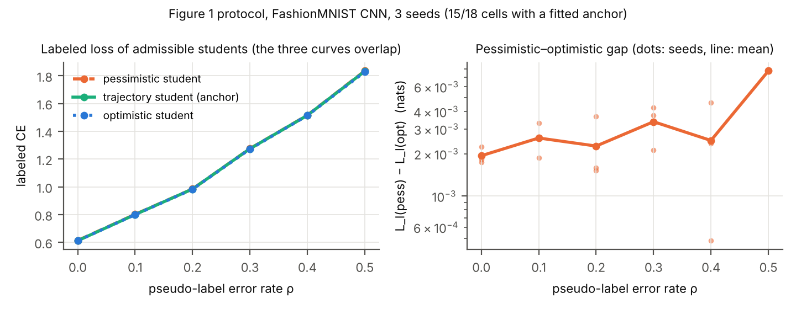

- Labeled loss của anchor tăng đều theo ρ (0.61 → 1.83). Nhiễu pseudo-label truyền sang
  labeled loss của trajectory student như dự đoán.
- **Khoảng pessimistic–optimistic gần như bằng 0:** $L_l$(pess) − $L_l$(opt) = 2–7·10⁻³ nats ở
  mọi ρ, và iterate được nhận cách anchor 0–0.24, tức ≤ 6% bán kính. Với dung sai $2L_u(a)$
  ($L_u(a)\approx 10^{-3}$), tập chấp nhận được mà bộ giải bậc nhất nhìn thấy gần như chỉ là
  chính anchor. Hình 1 của bản thảo (khoảng cách lớn giữa student pessimistic và optimistic,
  tăng theo ρ) **không tái lập được** với giao thức này.
- Điều này không mâu thuẫn với Mục 5. Không suy biến là về *gradient* của giá trị pessimistic:
  nó khác 0 với mọi $r>0$, kể cả khi giá trị chỉ tăng chút ít. Mục 5 cũng dùng dung sai lỏng hơn
  (KL tới anchor ≤ 2·10⁻³ trên batch, BN theo batch) và bộ giải ascent-rồi-co. Ở đây dùng bộ giải
  penalty của review, bộ giải mà pilot (Mục 2, lỗi 2) đã thấy là không đáng tin. Chưa thử giao
  thức này với bộ giải ascent-rồi-co.

## 9. Mười seed ở 40 nhãn: nhân bản và so sánh đầy đủ

### 9.1 Nhân bản bảng chính trên seed 6–10

Seed 6–10 chưa từng được xem trước khi quyết định đợt này; cấu hình giữ nguyên như bảng chính.
Dữ liệu `results/fmnist-ssl-rep-a` (PBPL, MPL), `results/fmnist-ssl-rep-b` (FixMatch,
FixMatch tinh chỉnh) và `results/fmnist-ssl-rep-c` (EBPL). Bảng: `main_table.py ... --seeds 6-10`
và `--seeds 1-10`.

| 40 nhãn, vòng cuối | seed 6 | 7 | 8 | 9 | 10 | trung bình |
|---|---|---|---|---|---|---|
| FixMatch | 71.4 | 74.2 | 79.8 | 72.7 | 74.6 | 74.54 ± 3.20 |
| FixMatch tinh chỉnh ($\lambda_u=2$) | 71.2 | 75.5 | 80.6 | 72.7 | 74.4 | 74.88 ± 3.60 |
| MPL (optimistic) | 74.5 | 72.4 | 77.8 | 74.8 | 78.1 | 75.51 ± 2.43 |
| PBPL (pessimistic) | 70.5 | 71.9 | 73.6 | 73.6 | 78.8 | 73.67 ± 3.14 |
| EBPL (expected) | 75.0 | 70.8 | 73.1 | 70.5 | 75.9 | 73.07 ± 2.43 |

Gộp seed 1–10, so sánh cặp (điểm phần trăm):

| 40 nhãn, 10 seed | vòng cuối | chọn checkpoint theo val |
|---|---|---|
| PBPL − FixMatch | +0.58 ± 3.10, thắng 7/10, p = 0.57 | −0.05 ± 3.77, 7/10, p = 0.97 |
| PBPL − FixMatch tinh chỉnh | −0.38 ± 3.43, 5/10, p = 0.73 | +0.05 ± 3.54, 6/10, p = 0.97 |
| PBPL − MPL | +0.04 ± 3.47, 4/10, p = 0.97 | +0.68 ± 2.92, 7/10, p = 0.48 |
| MPL − FixMatch | +0.54 ± 2.54, 5/10, p = 0.52 | −0.74 ± 2.33, 2/10, p = 0.34 |
| FixMatch tinh chỉnh − FixMatch | +0.96 ± 1.52, 6/10, p = 0.078 | −0.10 ± 1.98, 5/10, p = 0.88 |
| EBPL − FixMatch | −0.01 ± 3.30, 6/10, p = 0.996 | −0.54 ± 3.08, 6/10, p = 0.60 |
| EBPL − MPL | −0.54 ± 3.11, 5/10, p = 0.60 | +0.20 ± 2.49, 7/10, p = 0.81 |
| EBPL − PBPL | −0.58 ± 2.36, 4/10, p = 0.45 | −0.48 ± 2.58, 4/10, p = 0.57 |

Trung bình 10 seed (cuối / đỉnh / giảm cuối): FixMatch 72.75 / 74.58 / 1.84; FixMatch tinh
chỉnh 73.71 / 74.50 / 0.79; MPL 73.28 / 73.91 / 0.63; PBPL 73.32 / 74.57 / 1.24; EBPL 72.74 /
74.15 / 1.40.


- **Kết quả chính của Mục 4 ở 40 nhãn không được nhân bản.** Trên seed 6–10, PBPL − FixMatch
  = −0.87 ± 3.87 điểm (2/5, p = 0.64). Gộp 10 seed, mọi khác biệt giữa FixMatch, FixMatch
  tinh chỉnh, MPL và PBPL đều dưới 1 điểm và không cái nào có ý nghĩa thống kê, ở cả hai giao
  thức. Ưu thế +2.02 (5/5, p = 0.019) ở seed 1–5 trùng với nhóm seed mà FixMatch suy giảm mạnh
  cuối huấn luyện (2.96 điểm trung bình, so với 0.72 ở seed 6–10). Ở seed 6–10, FixMatch không
  có suy giảm nào đáng kể để PBPL sửa.
- **PBPL không hơn MPL.** Trên seed 6–10, PBPL − MPL = −1.84 ± 2.21 điểm (thắng 1/5, p = 0.14).
  Gộp 10 seed: +0.04 ± 3.47 (4/10, p = 0.97). Hướng "pessimistic > optimistic" ở seed 1–5
  (+1.93) là nhiễu.
- **EBPL cũng không.** Trên seed 6–10 EBPL kém FixMatch 1.47 điểm (2/5) và kém MPL 2.44 điểm
  (1/5, p = 0.06). Gộp 10 seed: bằng FixMatch (−0.01), kém MPL 0.54 và kém PBPL 0.58 điểm. Mức
  giảm cuối huấn luyện 0.2 điểm ở 3 seed đầu cũng không còn (1.40 trên 10 seed).
- **Lần này PBPL suy giảm cuối huấn luyện** (đỉnh − cuối = 1.51 điểm trung bình; 2.7 điểm ở
  seed 7), còn MPL thì không (0.40). Vì vậy "PBPL chống được suy giảm cuối huấn luyện" (Mục 4.1)
  cũng không đứng vững như một tính chất riêng của PBPL. FixMatch tinh chỉnh còn ổn định hơn
  PBPL trên 10 seed (giảm 0.79 so với 1.24 điểm).
- Chẩn đoán feedback giống seed 1–5: labeled loss của student pessimistic 0.25 so với anchor
  0.07, $\|c\|/\|c_{\rm opt}\|$ = 2.5, cos 0.80, KL tới anchor 1.6·10⁻³. Feedback pessimistic
  vẫn không suy biến và khác hẳn feedback optimistic. Chỉ là sự khác biệt đó không chuyển thành
  accuracy.

### 9.2 Mọi biến thể trên 10 seed

Sau đợt nhân bản, mọi biến thể còn lại được đưa lên cùng seed 1–10 (`rep-c` đến `rep-e`) và so
cặp với các run FixMatch mặc định đã có. Quyết định chạy tiếp một đối chứng được đưa ra sau khi
xem 2–3 seed đầu của nó, nên phần kiểm định xác nhận thực sự là các seed chưa xem lúc quyết định
(ý thứ ba của phần đọc kết quả). Bảng sinh bởi `analysis/tenseed_table.py results/fmnist-ssl-*`
(t-test cặp, Wilcoxon signed-rank, Holm qua 9 phép so sánh với FixMatch ở vòng cuối). Cặp một
mạng ở thang meta-gradient chính xác chỉ có seed 1–5 (`rep-f`). Nó là phép thử lý thuyết của
Mục 6.1, nằm ngoài họ 9 phép so sánh, và chỉ xuất hiện ở bảng so sánh cặp.

| 40 nhãn, seed 1–10 | n | cuối | − FixMatch, vòng cuối | p (t-test / Wilcoxon / Holm) | − FixMatch, chọn theo val | giảm cuối | phút/run |
|---|---|---|---|---|---|---|---|
| FixMatch | 10 | 72.75 | — | — | — | 1.84 | 11.1 |
| FixMatch tinh chỉnh ($\lambda_u=2$) | 10 | 73.71 | +0.96 ± 1.52, 6/10 | 0.078 / 0.113 / 0.54 | −0.10 ± 1.98, 5/10, p = 0.88 | 0.79 | 10.9 |
| MPL hai mạng (optimistic) | 10 | 73.28 | +0.54 ± 2.54, 5/10 | 0.521 / 0.492 / 1.00 | −0.74 ± 2.33, 2/10, p = 0.34 | 0.63 | 28.2 |
| PBPL hai mạng (pessimistic) | 10 | 73.32 | +0.58 ± 3.10, 7/10 | 0.570 / 0.447 / 1.00 | −0.05 ± 3.77, 7/10, p = 0.96 | 1.24 | 40.3 |
| EBPL hai mạng (expected) | 10 | 72.74 | −0.01 ± 3.30, 6/10 | 0.996 / 0.770 / 1.00 | −0.54 ± 3.08, 6/10, p = 0.60 | 1.40 | 39.3 |
| SAM-feedback (hai mạng, $\varepsilon$ reset mỗi bước) | 10 | 73.86 | +1.11 ± 2.73, 6/10 | 0.231 / 0.193 / 1.00 | +0.42 ± 2.55, 8/10, p = 0.61 | 1.20 | 29.2 |
| MPL một mạng (optimistic) | 10 | 74.73 | +1.98 ± 2.64, 7/10 | 0.041 / 0.064 / 0.33 | +1.04 ± 2.60, 8/10, p = 0.24 | 0.94 | 27.8 |
| PBPL một mạng (pessimistic) | 10 | 74.25 | +1.51 ± 2.55, 8/10 | 0.094 / 0.105 / 0.57 | +0.47 ± 3.34, 7/10, p = 0.67 | 0.73 | 39.3 |
| FixMatch + fiber-SAM (không bilevel) | 10 | 74.28 | +1.53 ± 4.42, 5/10 | 0.303 / 0.492 / 1.00 | +0.73 ± 4.75, 6/10, p = 0.64 | 1.03 | 23.2 |
| FixMatch + SAM trên labeled loss (không bilevel) | 10 | 75.79 | +3.05 ± 3.19, 8/10 | 0.014 / 0.020 / 0.13 | +1.75 ± 2.58, 7/10, p = 0.06 | 0.59 | 13.9 |

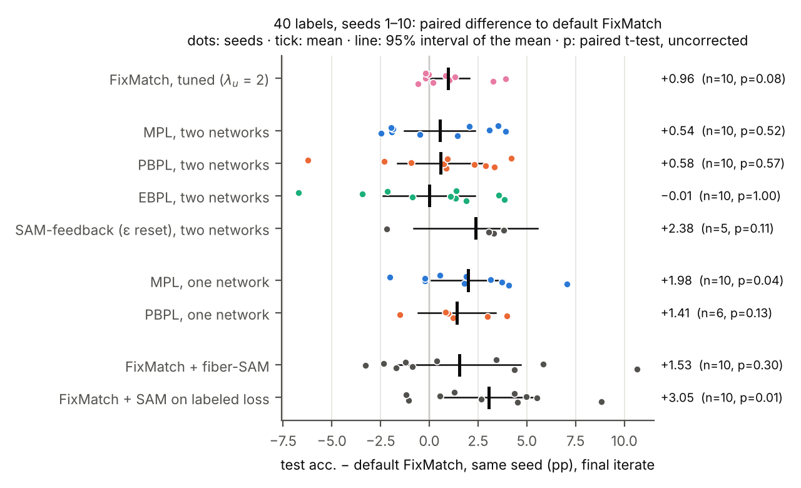

So sánh trực tiếp giữa các biến thể chỉ khác nhau đúng một thành phần (không hiệu chỉnh nhiều
phép so sánh):

| so sánh, cùng seed | câu hỏi | n | vòng cuối | chọn theo val |
|---|---|---|---|---|
| PBPL − MPL | pessimistic so với optimistic, hai mạng | 10 | +0.04 ± 3.47, 4/10, p = 0.97 | +0.68 ± 2.92, 7/10, p = 0.48 |
| PBPL một mạng − MPL một mạng | pessimistic so với optimistic, một mạng | 10 | −0.48 ± 3.07, 5/10, p = 0.64 | −0.58 ± 2.54, 4/10, p = 0.49 |
| PBPL − MPL một mạng, thang chính xác | pessimistic so với optimistic, một mạng, thang meta-gradient chính xác (seed 1–5, Mục 6.1) | 5 | +0.13 ± 3.26, 3/5, p = 0.93 | −0.79 ± 3.81, 2/5, p = 0.67 |
| EBPL − MPL | expected so với optimistic, hai mạng | 10 | −0.54 ± 3.11, 5/10, p = 0.60 | +0.20 ± 2.49, 7/10, p = 0.81 |
| PBPL − SAM-feedback | fiber + $\varepsilon$ giữ trạng thái so với một bước SAM (A4) | 10 | −0.53 ± 2.12, 3/10, p = 0.45 | −0.48 ± 1.87, 2/10, p = 0.44 |
| fiber-SAM − SAM labeled | ràng buộc fiber ở teacher | 10 | −1.52 ± 3.33, 3/10, p = 0.18 | −1.02 ± 3.11, 4/10, p = 0.33 |
| MPL một mạng − MPL | một mạng so với hai mạng (optimistic) | 10 | +1.45 ± 3.67, 6/10, p = 0.24 | +1.78 ± 2.51, 7/10, p = 0.05 |
| PBPL một mạng − PBPL | một mạng so với hai mạng (pessimistic) | 10 | +0.93 ± 2.30, 7/10, p = 0.23 | +0.52 ± 2.04, 7/10, p = 0.44 |
| SAM labeled − MPL một mạng | không bilevel so với bilevel tốt nhất | 10 | +1.06 ± 2.24, 8/10, p = 0.17 | +0.71 ± 1.72, 8/10, p = 0.22 |

Đọc kết quả:

- **Không biến thể pessimistic hay expected nào hơn FixMatch có ý nghĩa thống kê.** Với hai
  mạng: PBPL +0.58, EBPL −0.01. Tốt nhất trong nhóm là PBPL một mạng: +1.51, thắng 8/10,
  p = 0.094 (Wilcoxon 0.105, Holm 0.57).
- **Hai biến thể hơn FixMatch với p < 0.05 chưa hiệu chỉnh, và cả hai đều không pessimistic.**
  - SAM trên labeled loss: +3.05 điểm, thắng 8/10, t-test p = 0.014, Wilcoxon p = 0.020.
  - MPL một mạng: +1.98, thắng 7/10, p = 0.041, Wilcoxon p = 0.064.

  Sau hiệu chỉnh Holm qua 9 phép so sánh, p là 0.13 và 0.33: không biến thể nào hơn FixMatch có
  ý nghĩa ở mức 5%. Khi chọn checkpoint theo val, SAM trên labeled loss vẫn hơn +1.75 (7/10,
  t-test p = 0.06, Wilcoxon p = 0.027), MPL một mạng +1.04 (p = 0.24).
- **Trên các seed chưa xem lúc quyết định, chỉ SAM trên labeled loss giữ được ưu thế:** seed
  4–10, +2.59 ± 2.51, thắng 6/7, p = 0.034. Các biến thể khác đều yếu đi:
  - MPL một mạng, seed 3–10: +1.08 ± 1.92, 5/8, p = 0.16; con số 10 seed của nó dựa nhiều vào
    seed 1–2;
  - PBPL một mạng, seed 4–10: +0.99 ± 2.83, 5/7, p = 0.39;
  - fiber-SAM, seed 4–10: +0.28, 3/7;
  - SAM-feedback, seed 4–10: +0.12, 3/7.
- **Pessimism không giúp, ở mọi cấu hình.** PBPL − MPL (cùng seed) là:
  - +0.04 với hai mạng;
  - −0.48 với một mạng;
  - +0.13 với một mạng ở thang meta-gradient chính xác (5 seed).

  Cấu hình một mạng là nơi feedback optimistic thực sự suy biến (Mục 6.1). Ở thang chính xác,
  bước meta pessimistic gộp cả quá trình lớn gấp 2–6 lần bước optimistic, vậy mà accuracy như
  nhau.
- **Ràng buộc fiber không giúp.** Một bước SAM từ 0, rời fiber (SAM-feedback), ít nhất bằng
  PBPL: hơn 0.53 điểm, 7/10, rẻ hơn 28%. SAM thường trên labeled loss hơn fiber-SAM 1.52 điểm
  (7/10).
- **Một mạng tốt hơn hai mạng, với chi phí tương đương.** Một mạng − hai mạng:
  - MPL: +1.45 ở vòng cuối, +1.78 khi chọn theo val (7/10, p = 0.05);
  - PBPL: +0.93 (7/10, p = 0.23).
- **Không cần bilevel.** Phương pháp tốt nhất là SAM trên labeled loss: không student, không
  feedback qua pseudo-label, chi phí 1.25× FixMatch. Nó hơn:
  - MPL một mạng 1.06 điểm (8/10, p = 0.17);
  - PBPL một mạng 1.54 điểm (7/10, p = 0.20);
  - PBPL hai mạng 2.47 điểm (8/10, p = 0.053).

## 10. Kết luận và giới hạn

Câu hỏi ban đầu là liệu một dạng pessimistic / expected trust-region bilevel pseudo-labeling
có thể vừa không suy biến theo lý thuyết, vừa vượt các baseline SSL truyền thống trên
FashionMNIST hay không.

**Lý thuyết: đạt, và được kiểm chứng ở cả ba mức.** Feedback được lấy tại student xấu nhất
(PBPL) hoặc trung bình (EBPL) trong tập student *chấp nhận được* (fiber: student giữ nguyên dự
đoán của anchor trên dữ liệu không nhãn). Tại các cặp supervised-only, tức điểm bất động của
MPL, feedback optimistic triệt tiêu, feedback pessimistic thì không (N2(b)), còn expected chỉ
có bậc $s^2$ (N2(d)). Kiểm chứng số:
1. toy MLP (`checks/check_nondegeneracy.py`);
2. CNN thật, chẩn đoán tĩnh (Mục 5): pessimistic lớn hơn optimistic trung vị 134 lần;
3. trong lúc huấn luyện một mạng (Mục 6.1): feedback optimistic thô co 12–39 lần (trung vị 20,
   10 seed), còn feedback pessimistic thì không co như vậy, và ở vòng 20k lớn gấp 12–65 lần
   feedback optimistic tính trên cùng anchor. Ở thang meta-gradient chính xác, bước meta
   pessimistic gộp cả quá trình lớn gấp 2–6 lần bước optimistic (5 seed).

**Thực nghiệm: không biến thể pessimistic hay expected nào vượt baseline mạnh.**
- So với Supervised, Pseudo-Label, Mean Teacher: PBPL hơn 6.6–16.1 điểm (Mục 4). Nhưng gần như toàn
  bộ khoảng cách đó là của FixMatch, phần base mà regularizer được gắn vào.
- So với FixMatch, 40 nhãn, 10 seed (Mục 9): PBPL +0.58 điểm (p = 0.57), EBPL −0.01 (p = 0.996),
  MPL +0.54; khi chọn checkpoint theo val cũng không khác. So với FixMatch tinh chỉnh, PBPL
  −0.38. Ưu thế của PBPL ở seed 1–5 (+2.02, p = 0.019) và của EBPL ở seed 1–3 (+2.36) không
  được nhân bản.
- 100 nhãn, 5 seed: PBPL hơn FixMatch +1.66 (p = 0.41), không hơn MPL (−0.31).
- Hai biến thể hơn FixMatch với p < 0.05 chưa hiệu chỉnh, không cái nào pessimistic:
  - SAM trên labeled loss, không bilevel: +3.05, p = 0.014; trên seed 4–10 chưa xem lúc quyết
    định vẫn +2.59, p = 0.034;
  - MPL một mạng: +1.98, p = 0.041; trên seed 3–10 chỉ còn +1.08, p = 0.16.

  Sau hiệu chỉnh Holm qua 9 phép so sánh, không biến thể nào còn có ý nghĩa ở mức 5%. Cập nhật ở
  Mục 12: khi mốc FixMatch là trung bình hai run mỗi seed, SAM trên labeled loss qua được Holm
  qua 12 phép so sánh (+2.65, p Holm = 0.048).
- Biến thể pessimistic tốt nhất là PBPL một mạng: +1.51 so với FixMatch (8/10, p = 0.094). Trên
  seed 4–10, chưa xem lúc quyết định, nó chỉ còn +0.99 (p = 0.39).
- Pessimistic so với optimistic, cùng cấu hình, cùng seed: +0.04 (hai mạng), −0.48 (một mạng),
  +0.13 (một mạng, thang meta-gradient chính xác, 5 seed). Không có khác biệt nào.

**Vì sao không suy biến không chuyển thành accuracy.** Có ba lý do, mỗi lý do có số liệu đi kèm:
1. *Cấu hình hai mạng không chạm tới điều kiện của định lý.* Student held-out không bao giờ khớp
   hết nhãn, nên feedback MPL không triệt tiêu và không có gì để pessimism sửa (Mục 4.2, 9).
2. *Ở cấu hình một mạng, suy biến có xảy ra nhưng không làm hại bản optimistic.* Chuẩn hóa RMS
   chạy đưa bước meta của hai quy tắc về cùng cỡ, nên chỉ còn hướng có tác dụng. Khi đó hai quy
   tắc ngang nhau (−0.48 điểm cho pessimistic, 10 seed). Ở thang meta-gradient chính xác, độ lớn
   được giữ nguyên và feedback optimistic thực sự tắt dần: bước meta pessimistic lớn gấp 2–6
   lần, vậy mà accuracy vẫn như nhau (+0.13, p = 0.93, 5 seed). Tín hiệu duy nhất theo hướng lý
   thuyết là bỏ chuẩn hóa làm hại bản optimistic 1.08 điểm và giúp bản pessimistic 0.82 điểm
   (hiệu +1.90, 4/5, p = 0.18; Mục 6.1). Tín hiệu này yếu, và không đủ để đưa bản pessimistic
   vượt bản optimistic chuẩn hóa.
3. *Lợi ích quan sát được ở seed 1–5 là chống suy giảm cuối huấn luyện của FixMatch.* Tinh chỉnh
   $\lambda_u$ hoặc một bước SAM cũng chữa được hiện tượng này, và nó gần như không xuất hiện ở
   seed 6–10 (Mục 4.1, 7, 9).

**Điều thực sự giúp ở 40 nhãn** là điều chỉnh cách mạng khớp 40 ảnh có nhãn, không phải
pessimism. Hai biến thể tốt nhất đều tác động trực tiếp lên labeled loss của chính mạng triển
khai:
- SAM tìm nghiệm phẳng của labeled loss;
- feedback một mạng chọn pseudo-label sao cho bước học trên dữ liệu không nhãn làm giảm labeled
  loss của chính teacher.

Cả hai đều không cần fiber, student phụ hay student xấu nhất.

**Giới hạn của nghiên cứu.**
- Một tập dữ liệu, một CNN nhỏ (0.157M tham số), 20k vòng lặp (FixMatch gốc dùng $2^{20}$ vòng),
  40 và 100 nhãn.
- Phương sai giữa các seed lớn (3–4 điểm, vì seed quyết định tập có nhãn). Với 10 seed, sai số
  chuẩn của chênh lệch cặp khoảng 1 điểm, nên chỉ phát hiện được hiệu ứng từ khoảng 2–3 điểm trở
  lên. Một hiệu ứng thật cỡ 0.5 điểm không bị loại trừ.
- Siêu tham số được chọn trên một seed (seed 0, 10k vòng). Bán kính bị bộ giải giới hạn ở
  $r=0.1$: với $r\ge0.3$ bộ giải ascent-rồi-co bậc nhất ($K=2$) không ở lại được trên fiber.
- "Chấp nhận được" chỉ theo nghĩa xấp xỉ: KL tới anchor ≈ 2·10⁻³ trên batch.
- Figure 1 của bản thảo không tái lập được với giao thức và bộ giải penalty của review (Mục 8).
- Chi phí so với FixMatch: PBPL 3.6×, EBPL 3.5×, PBPL một mạng 3.5×, MPL 2.5×, MPL một mạng
  2.5×, SAM trên labeled loss 1.25×.
- Phép thử ở thang meta-gradient chính xác chỉ có 5 seed, lại là seed 1–5, nơi FixMatch yếu.
  Khoảng tin cậy 95% của hiệu pessimistic − optimistic là −3.9 đến +4.2 điểm, nên nó chỉ loại
  trừ được hiệu ứng lớn.
- Giao thức chọn checkpoint theo val dùng 5 000 ảnh có nhãn, tức là một oracle; nó chỉ là giao
  thức phụ.
- Các đối chứng được chọn để chạy tiếp sau khi xem 2–3 seed đầu của chúng. Vì vậy con số 10 seed
  của biến thể tốt nhất có thiên lệch chọn lọc; phần xác nhận sạch là các seed chạy sau quyết định
  (Mục 9.2). Nhiều phép so sánh trên cùng một FixMatch cũng làm tăng tỉ lệ dương tính giả. Sau
  hiệu chỉnh Holm, không kết quả nào còn ý nghĩa ở mức 5%.

**Hướng tiếp theo.**
- Một phép thử lý thuyết mạnh hơn ở thang meta-gradient chính xác cần hai điều. Thứ nhất là
  nhiều seed hơn: khoảng tin cậy hiện tại rộng khoảng 8 điểm. Thứ hai là huấn luyện dài hơn,
  để giai đoạn anchor khớp nhãn chiếm phần lớn quá trình; đó là giai đoạn duy nhất mà hai quy
  tắc khác nhau.
- Gắn feedback bilevel một mạng vào một base đã có SAM trên labeled loss, thay vì vào FixMatch
  trơn. Bản hai mạng của phép gộp này đã chạy ở Mục 12: feedback làm hại SAM (−1.1 đến −2.5
  điểm). Bản một mạng, gộp hai thành phần tốt nhất, chưa được chạy.
- Dùng bài toán mà FixMatch có confirmation bias mạnh và ổn định giữa các seed (ví dụ CIFAR-10
  với 40 nhãn, huấn luyện dài hơn). Ở đó việc giữ được tín hiệu từ dữ liệu có nhãn có nhiều chỗ
  để tạo khác biệt hơn.

## 11. Pool student: chẩn đoán (seed 0, 40 nhãn, 20k vòng)

**Thiết kế.** k = 3 student held-out: không học từ ảnh có nhãn, chỉ học pseudo-label mềm của
teacher. Mỗi student j tính feedback optimistic c_j tại chính nó, sau bước học của nó. Teacher
nhận feedback gộp theo labeled loss sau bước học của từng student:
- O = student có loss thấp nhất;
- E = trung bình;
- P = student có loss cao nhất;
- CVaR_m = trung bình m student tệ nhất.

Teacher EMA là mô hình triển khai. Cuối run, từng student và ensemble được finetune 1000 vòng
trên nhãn; bước này chỉ để đo, không ảnh hưởng teacher. Cả hai run chẩn đoán dẫn teacher bằng
E (`--pool_agg mean --lam_m 0.1`), nhưng ghi lại cả bốn cách gộp ở mỗi bước log.

Hai nguồn đa dạng:
- *same*: các student chỉ khác nhau ở khởi tạo;
- *bag*: thêm augmentation mạnh độc lập cho từng student và một tập con cố định 63% của X_u cho
  mỗi student (`--pool_aug indep --pool_bag 0.63`).

Mỗi run mất 65–67 phút trên T4. Ở seed 0, FixMatch mất 31 phút và MPL hai mạng mất 65 phút.

Lệnh: `python3 analysis/pool_diag.py results/fmnist-ssl-pool-diag`. Bảng dưới là median trên
nửa sau huấn luyện.

| thống kê | same | bag |
|---|---|---|
| cos feedback hai student (cùng batch) | 0.59 | 0.23 |
| cos một student trên hai view mạnh (mốc nhiễu augmentation) | 0.54 | 0.56 |
| cos(P, E) | 0.86 | 0.75 |
| cos(O, P) | 0.61 | 0.23 |
| cos(CVaR_2, E) | 0.97 | 0.92 |
| ‖E‖ / trung bình ‖c_j‖ (1 nếu cùng hướng, 0.58 nếu trực giao) | 0.85 | 0.70 |
| (max − min) / mean của labeled loss các student | 0.28 | 0.35 |
| tỷ lệ bước log mà student tệ nhất đổi | 0.8 | 0.5 |
| tỷ lệ student tệ nhất là student 0 / 1 / 2 | 0.26 / 0.42 / 0.32 | 0.42 / 0.18 / 0.40 |
| bất đồng dự đoán giữa các student trên val | 2.5% | 2.9% |
| RMS feedback gộp, vòng 1k → 20k | 23.5 → 15.3 | 11.2 → 7.1 |

| test % (vòng cuối, EMA) | same | bag |
|---|---|---|
| teacher (triển khai) | 73.93 | 74.33 |
| student (min–max) | 73.81–73.91 | 74.10–74.33 |
| ensemble 3 student | 73.83 | 74.41 |
| student sau finetune (min–max) | 74.02–74.24 | 73.51–73.84 |
| ensemble sau finetune | 74.21 | 73.67 |

Mốc tham chiếu ở seed 0 (cùng 20k vòng): FixMatch 72.47, FlexMatch 74.61, MPL hai mạng
(λ_m = 0.3) 71.40. Seed 0 là seed chọn siêu tham số, chỉ có một seed, nên các con số này
không phải bằng chứng về độ chính xác.

**Đọc kết quả.**
- **Hướng feedback đủ đa dạng để P khác E.**
  - cos(P, E) là 0.86 với *same* và 0.75 với *bag*. Với *bag*, O và P gần như khác hướng
    (cos 0.23).
  - CVaR_2 của 3 student gần như trùng E (cos 0.92–0.97), nên với k = 3 không cần nhánh này.
  - Với *same*, hai student trên cùng một view lệch nhau gần bằng một student trên hai view
    (0.59 so với 0.54). Phần riêng của từng student vì thế cỡ nhiễu augmentation.
- **Nhưng đa dạng về hàm số thì nhỏ.**
  - Các student đồng ý trên 97% ảnh val.
  - Ensemble chỉ hơn trung bình các student 0.0–0.1 điểm.
  - Student tệ nhất đổi ở 50–80% bước log, và không student nào tệ nhất liên tục. P vì thế
    giống một lựa chọn student xoay vòng hơn là một đối thủ ổn định.
- **Đảm bảo N2(b) không chuyển sang pool, và số liệu khớp với điều đó.**
  - Student held-out không thấy nhãn nhưng vẫn khớp nhãn vì teacher khớp nhãn: labeled loss cuối
    run là 0.007–0.07.
  - Khi mọi student đều khớp nhãn, feedback của cả ba cùng nhỏ đi. P trên pool không có bước
    ascent nào giữ cho feedback lớn như P trên fiber.
  - RMS feedback gộp giảm 1.5–1.6 lần trong cả run.
- **Finetune student trên nhãn không giúp ổn định.** So với teacher: +0.31 điểm với *same*,
  −0.49 với *bag*. Triển khai teacher không mất gì. Điều này khớp với kết quả trước: trong
  thiết kế này student là bản chưng cất của teacher.

## 12. SAM trên labeled loss kết hợp feedback bilevel hai mạng, có finetune cuối (10 seed, 40 nhãn)

**Câu hỏi.** SAM trên labeled loss là biến thể tốt nhất của Mục 9.2. Liệu feedback PBPL / EBPL
(hay MPL) hai mạng có cộng thêm được gì khi đặt lên trên nó? Và nếu triển khai student sau khi
finetune trên nhãn thay vì teacher, so sánh có công bằng với baseline cũng được finetune không?

**Thiết kế** (`sweeps/make_sweeps.py wave5`, kernel `rep-g` cho seed 1–5 và `rep-h` cho seed 6–10,
50 run, 350 + 362 phút GPU).
- Ba tổ hợp: SAM trên $L_l$ (ρ = 0.1) cộng MPL / PBPL / EBPL hai mạng (Algorithm 1). Mỗi thành
  phần giữ đúng siêu tham số đã chọn: MPL λ_m = 0.1; PBPL λ_m = 0.1, r = 0.1; EBPL λ_m = 0.3,
  r = 3.0. Tổ hợp không được tinh chỉnh lại. Cờ `--lab_radius 0.1` tách bán kính SAM khỏi bán
  kính fiber, vì EBPL dùng r = 3.0.
- Finetune cuối run, giống hệt cho mọi mô hình triển khai: teacher của mọi phương pháp và
  student của các bản hai mạng (`--ft_iters 1000`, hàm `finetune_deployed`).
  - Mỗi lần finetune lấy một bản sao của mô hình EMA. Nó chạy 1000 bước chỉ trên CE của 40 ảnh
    có nhãn (batch 64, weak augmentation, cosine LR, weight decay 5·10⁻⁴).
  - Con số báo cáo là EMA (0.99) của quỹ đạo finetune.
  - Lưới thử: lr ∈ {0.001, 0.003, 0.01} × BatchNorm {giữ nguyên thống kê, cập nhật}. Mọi mô hình
    và mọi cấu hình thấy cùng một chuỗi batch ngẫu nhiên.
  - Cấu hình được chọn theo val, riêng cho từng run và từng mô hình. Mục 12.3 kiểm tra lại với
    cấu hình cố định.
- FixMatch và FixMatch + SAM được chạy lại với cùng bước finetune (`fixmatchft`, `labsamft`), để
  student đã finetune được so với baseline cũng đã finetune.
- Trên CPU, mã huấn luyện cho lịch sử trùng từng bit với mã của các run gốc (commit `6e88445`).
  Kiểm tra gồm FixMatch, SAM trên $L_l$, PBPL và MPL; có cả một cấu hình τ = 0.2 để nhánh
  pseudo-label có mask được chạy. Finetune chỉ chạy sau vòng cuối, trên bản sao, nên không đổi
  phần huấn luyện.

Hai bảng sinh bởi `analysis/tenseed_table.py results/fmnist-ssl-* --tex` và
`analysis/finetune_table.py results/fmnist-ssl-* --tex`.

### 12.1 Bảng 10 seed mở rộng (teacher EMA, vòng cuối)

Holm giờ tính qua 12 phép so sánh với FixMatch (thay vì 9 như Mục 9.2), nên p Holm của các hàng
cũ tăng lên.

| 40 nhãn, seed 1–10 | cuối | − FixMatch, vòng cuối | p (t-test / Wilcoxon / Holm 12) | − FixMatch, chọn theo val | giảm cuối | phút/run |
|---|---|---|---|---|---|---|
| FixMatch | 72.75 ± 3.76 | — | — | — | 1.84 | 11.1 |
| FixMatch tinh chỉnh ($\lambda_u=2$) | 73.71 ± 3.66 | +0.96 ± 1.52, 6/10 | 0.078 / 0.113 / 0.78 | −0.10 | 0.79 | 10.9 |
| MPL hai mạng | 73.28 ± 3.96 | +0.54 ± 2.54, 5/10 | 0.52 / 0.49 / 1.00 | −0.74 | 0.63 | 28.2 |
| PBPL hai mạng | 73.32 ± 3.10 | +0.58 ± 3.10, 7/10 | 0.57 / 0.45 / 1.00 | −0.05 | 1.24 | 40.3 |
| EBPL hai mạng | 72.74 ± 2.51 | −0.01 ± 3.30, 6/10 | 1.00 / 0.77 / 1.00 | −0.54 | 1.40 | 39.3 |
| SAM-feedback ($\varepsilon$ reset mỗi bước) | 73.86 ± 3.88 | +1.11 ± 2.73, 6/10 | 0.23 / 0.19 / 1.00 | +0.42 | 1.20 | 29.2 |
| **MPL hai mạng + SAM trên $L_l$** | 74.66 ± 3.20 | +1.91 ± 3.42, 8/10 | 0.111 / 0.13 / 0.89 | +1.33 | 1.28 | 29.9 |
| **PBPL hai mạng + SAM trên $L_l$** | 73.67 ± 3.47 | +0.92 ± 2.43, 6/10 | 0.26 / 0.56 / 1.00 | +1.07 | 1.99 | 41.4 |
| **EBPL hai mạng + SAM trên $L_l$** | 73.26 ± 2.54 | +0.52 ± 2.95, 6/10 | 0.59 / 0.70 / 1.00 | −0.47 | 0.88 | 40.6 |
| MPL một mạng | 74.73 ± 2.97 | +1.98 ± 2.64, 7/10 | 0.041 / 0.064 / 0.45 | +1.04 | 0.94 | 27.8 |
| PBPL một mạng | 74.25 ± 3.34 | +1.51 ± 2.55, 8/10 | 0.094 / 0.105 / 0.85 | +0.47 | 0.73 | 39.3 |
| FixMatch + fiber-SAM | 74.28 ± 4.42 | +1.53 ± 4.42, 5/10 | 0.30 / 0.49 / 1.00 | +0.73 | 1.03 | 23.2 |
| FixMatch + SAM trên $L_l$ | 75.79 ± 2.55 | +3.05 ± 3.19, 8/10 | 0.014 / 0.020 / 0.17 | +1.75 | 0.59 | 13.9 |

Tổ hợp so với từng thành phần của nó (teacher EMA, cùng seed, không hiệu chỉnh nhiều phép so
sánh). "SAM, 2 run" là trung bình mỗi seed của `abl_labsam` và `labsamft`:

| so sánh | vòng cuối | chọn theo val |
|---|---|---|
| MPL + SAM − SAM, 2 run | −1.09 ± 2.15, 3/10, p = 0.14 (W 0.16) | −0.24 ± 1.22, 2/10, p = 0.55 |
| PBPL + SAM − SAM, 2 run | −2.08 ± 3.28, 3/10, p = 0.076 (W 0.105) | −0.51 ± 1.80, 4/10, p = 0.40 |
| EBPL + SAM − SAM, 2 run | −2.49 ± 2.48, 2/10, p = 0.011 (W 0.014) | −2.04 ± 2.58, 2/10, p = 0.034 |
| EBPL + SAM − SAM, run gốc | −2.53 ± 2.11, 0/10, p = 0.004 | −2.22 ± 2.11, 1/10, p = 0.009 |
| MPL + SAM − MPL | +1.38 ± 2.48, 6/10, p = 0.11 | +2.07 ± 2.55, 8/10, p = 0.030 |
| PBPL + SAM − PBPL | +0.35 ± 3.31, 6/10, p = 0.75 | +1.12 ± 3.24, 8/10, p = 0.30 |
| EBPL + SAM − EBPL | +0.52 ± 2.22, 6/10, p = 0.48 | +0.07 ± 1.93, 5/10, p = 0.91 |
| PBPL + SAM − MPL + SAM | −0.99 ± 2.80, 3/10, p = 0.29 | −0.27 ± 1.29, 6/10, p = 0.53 |
| EBPL + SAM − MPL + SAM | −1.40 ± 1.92, 2/10, p = 0.047 | −1.80 ± 1.97, 2/10, p = 0.018 |
| MPL + SAM − MPL một mạng | −0.07 ± 3.50, 5/10, p = 0.95 | +0.29 ± 1.78, 6/10, p = 0.62 |

### 12.2 Mô hình triển khai: teacher, student, trước và sau finetune

Cấu hình finetune chọn theo val, 10 seed. FixMatch và FixMatch + SAM ở đây là các run chạy lại
cùng đợt, có finetune. Các hàng MPL / PBPL / EBPL không SAM là run cũ, không có finetune.

| | teacher EMA | student EMA | teacher finetune | student finetune |
|---|---|---|---|---|
| FixMatch (chạy lại) | 73.54 ± 2.32 | — | 73.72 ± 2.43 | — |
| FixMatch + SAM trên $L_l$ (chạy lại) | 75.71 ± 3.12 | — | 75.92 ± 3.06 | — |
| MPL + SAM | 74.66 ± 3.20 | 74.83 ± 3.30 | 74.89 ± 3.34 | 75.08 ± 3.06 |
| PBPL + SAM | 73.67 ± 3.47 | 73.74 ± 3.50 | 73.85 ± 3.51 | 74.28 ± 3.22 |
| EBPL + SAM | 73.26 ± 2.54 | 73.44 ± 2.58 | 73.45 ± 2.54 | 73.89 ± 2.56 |
| MPL (run cũ) | 73.28 ± 3.96 | 73.16 ± 3.80 | — | — |
| PBPL (run cũ) | 73.32 ± 3.10 | 73.49 ± 3.18 | — | — |
| EBPL (run cũ) | 72.74 ± 2.51 | 72.81 ± 2.71 | — | — |

So sánh công bằng: mô hình đã finetune so với baseline đã finetune, mô hình chưa finetune so với
EMA của FixMatch cùng đợt. Paired qua 10 seed, Holm qua các phương pháp của mỗi cột:

| | student finetune − FixMatch finetune | student finetune − (FixMatch + SAM) finetune | student EMA − FixMatch EMA |
|---|---|---|---|
| MPL + SAM | +1.36 ± 3.05, 7/10, 0.19 / 0.13 / 0.58 | −0.84 ± 2.39, 3/10, 0.30 / 0.19 / 0.30 | +1.28 ± 3.34, 6/10, p = 0.26 |
| PBPL + SAM | +0.56 ± 3.74, 5/10, 0.65 / 0.77 / 1.00 | −1.64 ± 3.30, 2/10, 0.15 / 0.105 / 0.30 | +0.20 ± 4.03, 5/10, p = 0.88 |
| EBPL + SAM | +0.18 ± 2.61, 6/10, 0.84 / 0.92 / 1.00 | −2.02 ± 2.98, 2/10, 0.060 / 0.064 / 0.18 | −0.10 ± 2.72, 4/10, p = 0.91 |

Trong cùng run (không hiệu chỉnh nhiều phép so sánh):

| | student EMA − teacher EMA | teacher finetune − teacher EMA | student finetune − teacher finetune |
|---|---|---|---|
| FixMatch | — | +0.17 ± 0.18, 9/10, p = 0.013 | — |
| FixMatch + SAM | — | +0.20 ± 0.33, 7/10, p = 0.082 | — |
| MPL + SAM | +0.17 ± 0.40, 6/10, p = 0.22 | +0.23 ± 0.38, 7/10, p = 0.092 | +0.19 ± 0.54, 5/10, p = 0.30 |
| PBPL + SAM | +0.07 ± 0.18, 5/10, p = 0.25 | +0.18 ± 0.22, 8/10, p = 0.026 | +0.42 ± 0.52, 7/10, p = 0.031 |
| EBPL + SAM | +0.17 ± 0.41, 7/10, p = 0.21 | +0.19 ± 0.33, 7/10, p = 0.11 | +0.44 ± 0.31, 10/10, p = 0.002 |

### 12.3 Độ vững

**Cấu hình finetune cố định thay vì chọn theo val.**
- Val thường chọn lr 0.01 với BN cập nhật (6–8/10 run cho student). Cố định cấu hình đó, các
  con số gần như không đổi:
  - student finetune − FixMatch finetune: +1.40, +0.52, +0.12;
  - student finetune − teacher finetune: +0.36 (8/10, p = 0.026), +0.39 (p = 0.050), +0.41
    (9/10, p = 0.004).
- Với lr 0.001 và BN giữ nguyên, finetune gần như không làm gì: thay đổi trung bình từ −0.05 đến
  +0.06 điểm.

**Chạy lại cùng seed: nhiễu GPU lớn cỡ hiệu ứng cần đo.**
- FixMatch chạy lại trừ run gốc, theo seed 1–10: +1.32, +7.45, +0.20, −3.53, +1.77, +3.30,
  +0.06, −2.17, +1.36, −1.80. Trung bình +0.80 ± 3.11 (p = 0.44), tương ứng nhiễu khoảng 2.2
  điểm trên mỗi run.
- FixMatch + SAM chạy lại: −0.08 ± 1.56, khoảng 1.1 điểm trên mỗi run. Seed 5 lệch −3.98, các
  seed khác lệch trong khoảng ±1.8.
- Mã huấn luyện trùng từng bit trên CPU, nên độ lệch đến từ tính không tất định của GPU
  (`cudnn.benchmark`, AMP), được khuếch đại bởi động lực pseudo-label ở 40 nhãn.
- Hệ quả: ghép cặp theo seed chỉ cố định tập có nhãn, không cố định nhiễu huấn luyện. Một run
  FixMatch duy nhất mỗi seed làm mốc mang theo khoảng 2 điểm nhiễu.

**Mốc FixMatch ít nhiễu hơn** (`--ref_avg fixmatch,fixmatchft`: trung bình hai run FixMatch mỗi
seed; Holm qua cùng 12 phép so sánh). SAM trên $L_l$ là biến thể duy nhất qua được Holm ở mức 5%:

| mốc so sánh cho SAM trên $L_l$ (run gốc) | chênh lệch | p (t / Wilcoxon / Holm 12) |
|---|---|---|
| FixMatch gốc | +3.05 ± 3.19, 8/10 | 0.014 / 0.020 / 0.17 |
| FixMatch chạy lại | +2.25 ± 2.06, 9/10 | 0.007 / 0.010 / 0.086 |
| trung bình hai run FixMatch | +2.65 ± 2.18, 8/10 | 0.004 / 0.014 / **0.048** |
| hai run SAM so với hai run FixMatch (cả hai phía đều lấy trung bình) | +2.61 ± 2.22, 8/10 | t 0.005, W 0.014 |

Với mốc trung bình này, các hàng khác:
- MPL một mạng: +1.58 (t 0.039, Holm 0.43);
- MPL + SAM: +1.52 (p = 0.14);
- PBPL + SAM: +0.53;
- EBPL + SAM: +0.12;
- PBPL hai mạng: +0.18.

### 12.4 Đọc kết quả

- **Gộp không cộng dồn: feedback bilevel làm hại SAM.** Thêm feedback hai mạng vào SAM trên
  $L_l$ làm accuracy thấp hơn SAM đơn thuần:
  - MPL −1.09 (3/10);
  - PBPL −2.08 (3/10, p = 0.076);
  - EBPL −2.49 (2/10, p = 0.011; so với run SAM gốc 0/10, p = 0.004).

  Khi chọn checkpoint theo val, phần thiếu hụt của MPL + SAM và PBPL + SAM thu nhỏ còn −0.24 và
  −0.51: phần lớn là suy giảm cuối huấn luyện (PBPL + SAM có mức giảm cuối lớn nhất bảng, 1.99
  điểm). EBPL + SAM thì kém cả khi chọn theo val (−2.04, p = 0.034). Chiều ngược lại, thêm SAM
  vào feedback bilevel chỉ giúp ít và không có ý nghĩa: +1.38 (MPL), +0.35 (PBPL), +0.52 (EBPL).
- **Trong tổ hợp, pessimism và expected vẫn không hơn optimistic.**
  - PBPL + SAM − MPL + SAM: −0.99 (p = 0.29).
  - EBPL + SAM − MPL + SAM: −1.40 (2/10, p = 0.047); chọn theo val −1.80 (p = 0.018).
  - Sau finetune, student của EBPL + SAM vẫn kém student của MPL + SAM 1.19 điểm (2/10,
    p = 0.047).
- **Finetune student công bằng không đổi kết luận.**
  - Student của các tổ hợp không thấy nhãn trong lúc huấn luyện, nên finetune trên nhãn giúp nó
    nhiều hơn giúp teacher: +0.42 / +0.44 điểm so với teacher đã finetune (PBPL / EBPL + SAM,
    p = 0.031 / 0.002). Teacher vốn đã khớp nhãn, nên chỉ thêm khoảng +0.2.
  - Mức tăng nhỏ đó không đủ:
    - student finetune tốt nhất (MPL + SAM, 75.08) vẫn kém teacher finetune của FixMatch + SAM
      (75.92) 0.84 điểm, 3/10;
    - so với FixMatch finetune, không tổ hợp nào hơn có ý nghĩa (tốt nhất +1.36, Holm 0.58).
- **Kết quả vững duy nhất là SAM trên labeled loss, không bilevel.**
  - Hai run SAM so với hai run FixMatch mỗi seed: +2.61 ± 2.22, 8/10, t-test p = 0.005.
  - So với mốc FixMatch trung bình, Holm qua 12 phép so sánh cho p = 0.048.
  - Nó cũng ổn định hơn giữa các lần chạy lại: nhiễu khoảng 1.1 điểm, so với 2.2 điểm của
    FixMatch.
- **Về câu hỏi ban đầu.** Trong cả cấu hình gốc lẫn cấu hình gộp với SAM, PBPL và EBPL không cải
  thiện so với FixMatch và cũng không hơn bản optimistic. Thành phần có ích là SAM trên labeled
  loss của mạng triển khai.

**Giới hạn của mục này.**
- Tổ hợp không được tinh chỉnh lại. Một λ_m nhỏ hơn có thể giảm phần hại; điều đó vẫn có nghĩa
  là feedback bilevel không thêm được tín hiệu hữu ích nào.
- Tổ hợp một mạng + SAM (hai thành phần tốt nhất) chưa được chạy.
- So sánh với mốc trung bình dùng hai run FixMatch nhưng chỉ một run cho mỗi phương pháp khác
  (trừ SAM). Nó làm giảm nhiễu của mốc, không làm giảm nhiễu của phương pháp được so.

## 13. Toy Two Moons: pseudo-label là biến tự do, chọn bằng argmin của meta signal bậc một

**Câu hỏi.** Bỏ teacher, coi pseudo-label là biến tối ưu riêng. Nếu chọn chúng đúng theo meta
signal bậc một của một student ngẫu nhiên, thì pseudo-label có đúng không, và accuracy của student
liên hệ thế nào với accuracy của pseudo-label?

**Thiết kế** (`checks/toy_two_moons_meta.py`, CPU, 5 phút; kết quả trong
`results/toy-two-moons/results.json`).
- Dữ liệu: Two Moons với nhiễu 0.1, gồm 1000 điểm không nhãn và 4000 điểm test. Điểm có nhãn rút
  từ một tập riêng, 1 hoặc 5 điểm mỗi lớp, rút 5 lần.
- Student: MLP 2-64-64-2 ReLU, khởi tạo ngẫu nhiên mặc định, SGD full-batch lr 0.1, 3000 bước.
  Student chỉ học trên (X_u, pseudo-label), không bao giờ thấy nhãn.
- Pseudo-label tự do: PL_i = argmin_k c_ik, với c_i = J_f(x_i; θ) ∇L_l(θ) (một JVP).
  - Theo khai triển bậc một, L_l sau một bước của student bằng hằng số + (η/N_u) Σ_i ⟨t_i, c_i⟩.
    Meta objective vì thế tuyến tính theo t, và argmin trên simplex là pseudo-label one-hot ở trên.
  - Viết theo kernel: c_i = Σ_j K_θ(x_i, x_j)(p_j − y_j)/N_l. Tức là một phiếu bầu của residual trên
    các điểm có nhãn, với trọng số là tangent kernel của student.
- Hai quy tắc:
  - *dynamic*: đặt lại PL trước mỗi bước của student. Đây là MPL với pseudo-label tự do và bước
    teacher lớn vô hạn.
  - *frozen*: đặt PL một lần tại student ngẫu nhiên ban đầu, rồi giữ nguyên.
- 8 student ngẫu nhiên × 5 lần rút nhãn, tức 40 run cho mỗi quy tắc và mỗi số nhãn.
- Mốc so sánh:
  - label spreading (kNN 10, α = 0.99);
  - student chỉ học trên các điểm có nhãn;
  - student học trên nhãn thật của X_u (oracle);
  - argmin của meta signal lấy trung bình qua 64 student ngẫu nhiên.

| | 1 nhãn/lớp | 5 nhãn/lớp |
|---|---|---|
| PL acc, argmin tại một student ngẫu nhiên (64 × 5) | 0.748 (0.38–0.91) | 0.844 (0.50–0.91) |
| PL acc, argmin của tín hiệu trung bình 64 student | 0.767 | 0.884 |
| PL acc, label spreading | 0.927 | 0.996 |
| PL acc dynamic, bước đầu → bước 3000 | 0.741 → 0.755 | 0.839 → 0.791 |
| student test acc, dynamic | 0.733 | 0.790 |
| student test acc, frozen | 0.721 | 0.821 |
| student test acc, chỉ học trên điểm có nhãn | 0.751 | 0.814 |
| student test acc, oracle | 0.999 | 0.999 |
| labeled loss cuối của student, dynamic / frozen (trung vị) | 4.5·10⁻⁷ / 0 | 4.2·10⁻³ / 2.9 |
| tỉ lệ PL đổi mỗi bước, dynamic, từ bước 500 | 5.1% | 17.7% |

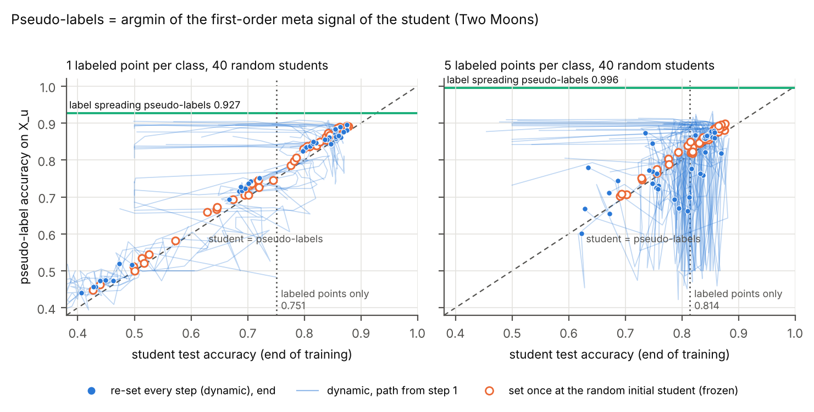

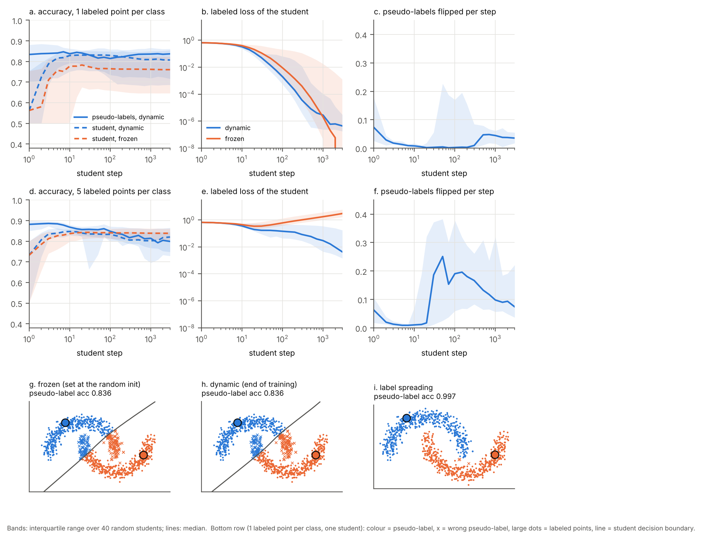

**Đọc kết quả.**
- **Pseudo-label tối ưu theo meta signal bậc một không phải là pseudo-label đúng.** Chúng đạt
  0.75 (1 nhãn/lớp) và 0.84 (5 nhãn/lớp), so với 0.93 và 0.996 của label spreading. Lỗi tập trung
  ở hai đầu mút, nơi hai mặt trăng lồng vào nhau (hình g, h). Tangent kernel của một MLP ngẫu
  nhiên đo độ giống nhau theo hình học của mạng, không theo đa tạp của dữ liệu.
- **Student chép pseudo-label.** Mọi điểm cuối nằm trên đường chéo: student đồng ý với PL ở 92–98%
  điểm, và accuracy của student thấp hơn PL 0.00–0.02. Student không tự sửa được PL sai.
- **Kết quả phụ thuộc mạnh vào student ngẫu nhiên.**
  - Với 1 nhãn/lớp, PL acc dao động 0.38–0.91 giữa các student.
  - 7/40 student cho PL acc ≤ 0.55. Chỉ một trong số đó dồn hết về một lớp; các student còn lại
    chia mặt phẳng theo cách không liên quan đến hai mặt trăng.
  - Tương quan giữa PL acc của student ban đầu và accuracy cuối là 0.93.
  - Lấy trung bình tín hiệu qua 64 student chỉ thêm 0.02 (1 nhãn/lớp) và 0.04 (5 nhãn/lớp).
- **Tối ưu lại PL trong lúc học không làm PL tốt hơn.**
  - 1 nhãn/lớp: student khớp hai điểm có nhãn trong khoảng 100 bước (L_l → 10⁻⁷), và meta signal
    tắt về độ lớn. Argmin không phụ thuộc độ lớn nên vẫn chọn được, nhưng lúc này nó chọn theo
    nhiễu số: 5% PL đổi mỗi bước, và PL acc chỉ tăng 0.015.
  - 5 nhãn/lớp: không có bộ PL nào làm student khớp đủ 10 điểm cùng lúc, nên argmin dao động.
    Tới 25% PL đổi mỗi bước quanh bước 30–50, vẫn còn 18% ở cuối, và PL acc giảm từ 0.839 xuống
    0.791.
- **Meta objective tốt hơn không có nghĩa là accuracy tốt hơn.** Với 5 nhãn/lớp:
  - dynamic giữ labeled loss của student ở 4·10⁻³, còn frozen để nó lên 2.9, vì student học PL
    sai gần các điểm có nhãn;
  - nhưng student dynamic lại kém student frozen 3.1 điểm, thua ở 26/40 cặp.

  Đây chính là overfit ở tầng meta: PL được chọn để student khớp vài điểm có nhãn, không phải để
  PL đúng.
- **Không quy tắc nào hơn student chỉ học trên điểm có nhãn** (0.751 và 0.814).

**Liên hệ với các thí nghiệm chính.** Meta signal bậc một chỉ dùng dữ liệu không nhãn thông qua
tangent kernel của mạng, không thông qua giả định cụm hay đa tạp. Trong FixMatch, phần khai thác
cấu trúc của dữ liệu không nhãn là consistency theo augmentation. Meta feedback chỉ thêm một phiếu
bầu kernel của residual trên nhãn, tức không mang thông tin mới về cấu trúc dữ liệu. Điều này phù
hợp với việc MPL / PBPL / EBPL không hơn FixMatch.

**Giới hạn.**
- Đây là toy: MLP ReLU, chỉ dùng tín hiệu bậc một (không có look-ahead θ'), và argmin cứng, tức
  giới hạn bước teacher lớn vô hạn. Phương pháp thật dùng pseudo-label mềm từ một teacher với λ_m
  nhỏ.
- Các biến thể pessimistic / expected chưa được thử trên toy này.

## 14. Toy Two Moons: hypergradient unroll K bước và IFT cho pseudo-label tự do

**Câu hỏi.** Signal bậc một ở Mục 13 chỉ là xấp xỉ. Nếu tính meta-gradient đúng hơn, bằng cách
unroll K bước của student hoặc dùng hypergradient ngầm (IFT) tại student đã hội tụ, thì
pseudo-label có đúng hơn không?

**Thiết kế** (`checks/toy_two_moons_unroll.py`, kết quả trong `results/toy-two-moons/unroll.json`).
Dữ liệu, student ngẫu nhiên và các lần rút nhãn giống hệt Mục 13. Mỗi cấu hình có 40 student
(8 khởi tạo × 5 lần rút).
- **Unroll:** F_K(t) = L_l(θ_K(t)), với θ_K là K bước SGD (η = 0.1) của student từ θ_0 trên
  (X_u, t). Signal g = dF_K/dt được lấy bằng backprop qua cả K bước, với K = 1, 2, 5, 10, 20, 50,
  100.
- **IFT (K = ∞):** g_i = J_i(θ*) v / N, với (H + λI) v = ∇L_l(θ*) và θ* là student học 1000 bước
  trên t.
  - H là ma trận Gauss–Newton (bản chính, nửa xác định dương) hoặc Hessian thật.
  - v được giải bằng conjugate gradient, với damping λ = ρ·λ_max(H).
  - Trong lúc tối ưu, θ* được warm-start thêm 100 bước sau mỗi bước của t.
- **Kiểm tra cài đặt.**
  - Backprop qua unroll khớp sai phân trung tâm ở float64, sai số tương đối ≤ 1.6·10⁻⁷ với K = 1,
    5, 20, 100.
  - Với K = 1, signal bằng (η/N) J(θ_0) ∇L_l(θ_1) tới 3.6·10⁻¹¹, sau khi trừ trung bình theo lớp.
  - Signal bậc một của Mục 13 có cos 0.9993 với signal K = 1.
  - Dấu đúng: dịch t về phía argmin làm F giảm, về phía argmax làm F tăng.
  - Tích Gauss–Newton nửa xác định dương, đối xứng, và trùng Hessian thật khi gần hội tụ
    (cos 0.9999).
- **Ba bộ pseudo-label cho mỗi K:**
  - argmin của signal tại t đều;
  - 30 bước mirror descent trên logit của t (bước 0.3, signal chuẩn hóa RMS), xuất phát từ t đều;
  - cùng phép tối ưu đó nhưng xuất phát từ nhãn thật.

  Một bản sao của cùng student được huấn luyện trên mỗi bộ, 1000 bước.

| 1 nhãn/lớp, trung vị | K = 1 | 5 | 20 | 50 | 100 | IFT |
|---|---|---|---|---|---|---|
| PL acc, argmin tại t đều | 0.786 | 0.826 | 0.833 | 0.823 | 0.763 | 0.641 |
| PL acc, tối ưu từ t đều | 0.835 | 0.837 | 0.841 | 0.789 | 0.658 | 0.582 |
| PL acc, tối ưu từ nhãn thật | 0.917 | 0.917 | 0.909 | 0.919 | 0.937 | 0.998 |
| F tại nhãn thật | 0.657 | 0.517 | 0.204 | 0.108 | 0.083 | 9.3·10⁻⁴ |
| F tại PL tối ưu từ t đều | 0.642 | 0.489 | 0.120 | 0.017 | 0.008 | 1.8·10⁻⁶ |

Với 5 nhãn/lớp, PL acc khi tối ưu từ t đều là 0.879, 0.889, 0.855, 0.798, 0.739 và 0.804; khi tối
ưu từ nhãn thật là 0.944, 0.942, 0.892, 0.829, 0.809 và 0.994 (cùng thứ tự K = 1, 5, 20, 50, 100,
IFT). Ở mọi K, kể cả IFT, và với cả hai số nhãn, pseudo-label tối ưu từ t đều cho F thấp hơn nhãn
thật ở **40/40** student.

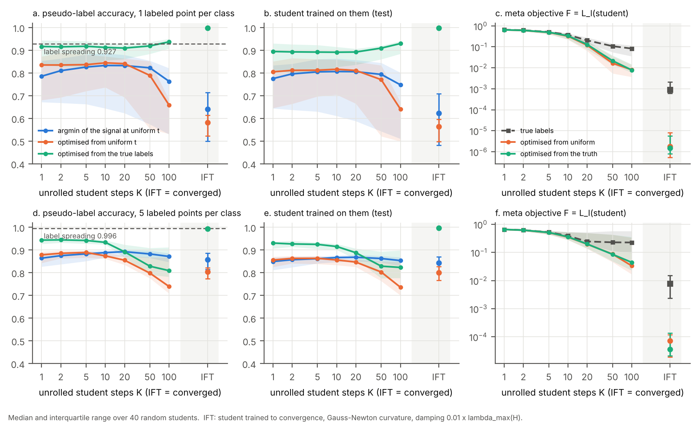

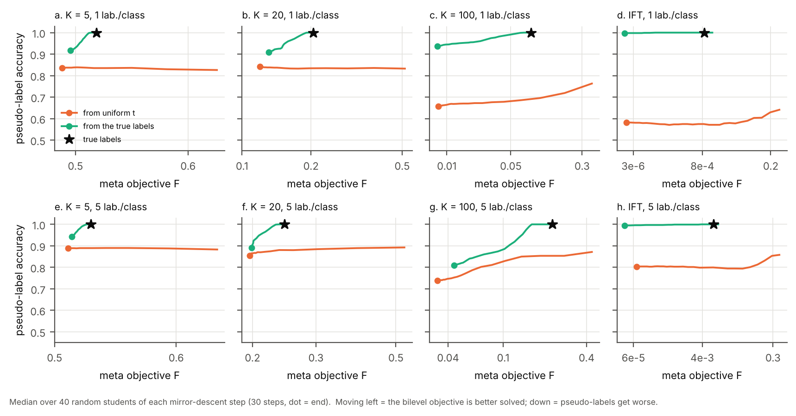

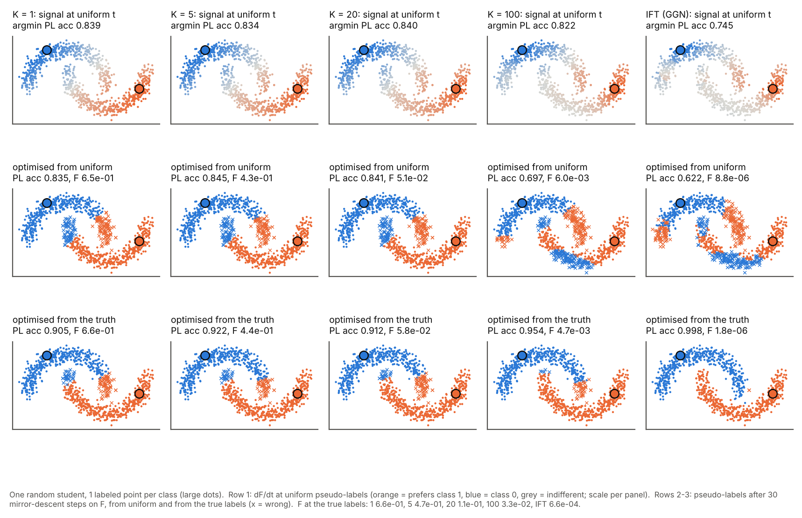

**Log IFT** (1 nhãn/lớp; 5 nhãn/lớp cho kết quả tương tự).
- **Thông số chung:** λ_max(H) ≈ 2.09. Student θ* đạt |∇L_u| = 2.9·10⁻⁴ tại t đều và 1.1·10⁻²
  tại nhãn thật.
- **Gauss–Newton và Hessian thật cho cùng kết quả** tại θ*(t đều), và không gặp độ cong âm ở điểm
  này. Bản thử trước đó gặp độ cong âm ở các t khác khi damping ≤ 10⁻³·λ_max, nên bản chính dùng
  Gauss–Newton.
- **Conjugate gradient** chạy 6 / 13 / 27 vòng với damping 0.1 / 0.01 / 0.001 × λ_max, residual
  tương đối khoảng 5·10⁻⁵.
- **Damping càng nhỏ, tức IFT càng "chính xác", thì argmin càng tệ:** 0.824 / 0.641 / 0.585.
- **IFT khớp unroll xuất phát từ θ*** khi K ≈ 1/(ηρλ_max), như lý thuyết dự đoán (cos 0.99 / 0.96
  / 0.90 trên đường chéo này).
- **Trong lúc tối ưu IFT**, conjugate gradient cần trung vị 20–24 vòng, residual ≤ 10⁻⁴, và θ*
  warm-start có |∇L_u| khoảng 10⁻².

**Đọc kết quả: giải bilevel đúng hơn không làm pseudo-label đúng hơn.**
- **K hữu hạn: thiên lệch tầm ngắn.** F_K đo việc student, xuất phát từ khởi tạo ngẫu nhiên, khớp
  điểm có nhãn nhanh đến đâu trong K bước. Nó ưu tiên cách gán nhãn dễ học, như một đường gần thẳng
  nằm giữa các điểm có nhãn, chứ không ưu tiên biên cong thật. Nhãn thật không phải cực tiểu của
  F_K: tối ưu xuất phát từ nhãn thật vẫn trôi ra xa (còn 0.91–0.94 với 1 nhãn/lớp, 0.81 với 5
  nhãn/lớp ở K = 100).
- **K = ∞: meta objective gần như phẳng.** IFT xuất phát từ nhãn thật giữ được 0.998, với F ≈
  1.5·10⁻⁶. IFT xuất phát từ t đều cũng đạt F ≈ 1.8·10⁻⁶ nhưng PL acc chỉ 0.582. Mọi cách gán nhãn
  cho phép student hội tụ khớp hai điểm có nhãn đều gần tối ưu, nên nghiệm phụ thuộc vào điểm xuất
  phát. Xuất phát từ t đều, vài bước IFT đầu tiên đã định hình cách gán nhãn: F giảm từ 0.70 xuống
  0.04 sau 5 bước, dùng một signal có trọng số nghịch đảo độ cong, nhiễu hơn khi damping nhỏ. Sau
  đó không còn signal để sửa.
- **Mục tiêu CE trên vài điểm có nhãn không xác định được nhãn thật.** Ở cả hai chế độ, meta
  objective thưởng cho độ tự tin của student tại điểm có nhãn, không thưởng cho tính đúng của nhãn
  ở chỗ khác.

## 15. Toy Two Moons: pseudo-label neo vào một teacher FixMatch bằng KL

**Câu hỏi.** Nếu meta signal không tự xác định được nhãn thật, liệu nó có sửa được pseudo-label
của một teacher tốt khi được neo vào teacher đó?

**Thiết kế** (`checks/toy_two_moons_anchor.py`, kết quả trong `results/toy-two-moons/anchor.json`).
- **Teacher:** mỗi lần rút nhãn có một teacher, huấn luyện bằng CE trên nhãn + FixMatch.
  - FixMatch dùng jitter Gauss yếu 0.03 và mạnh 0.3, ngưỡng 0.95, SGD momentum 0.9, 3000 bước.
  - PL acc của teacher: 0.628 / 0.911 / 0.897 / 0.961 / 0.964 với 1 nhãn/lớp, và 0.962–0.992 với
    5 nhãn/lớp.
- **Bài toán:** t* = argmin_t ⟨t, ĝ_K(t)⟩ + λ·KL(t ‖ q), với ĝ_K là signal unroll K bước (hoặc
  IFT, Gauss–Newton, damping 0.01) chuẩn hóa RMS.
  - Khi ĝ cố định, nghiệm là t ∝ q·exp(−ĝ/λ).
  - Với λ > 0, nghiệm được tìm bằng lặp điểm bất động có damping z ← ½z + ½(log q − ĝ(t)/λ), 20
    bước, xuất phát từ q.
  - λ = 0 là 20 bước mirror descent tự do từ q. Không có KL, nên chỉ số bước giới hạn mức dịch
    chuyển; λ = 0.1 đi tới điểm bất động và dịch xa hơn.
  - λ = ∞ là t = q.
- 20 student ngẫu nhiên mỗi số nhãn (4 khởi tạo × 5 lần rút). Mỗi lỗi lật nhãn so với teacher được
  tách thành *sửa* (teacher sai, t đúng) và *làm hỏng* (teacher đúng, t sai).

| trung bình 20 student | λ = 0 | λ = 0.1 | λ = 1 | λ = 10 | λ = ∞ (teacher) |
|---|---|---|---|---|---|
| 1 nhãn/lớp, K = 1: PL acc (sửa / làm hỏng) | 0.851 (3.1% / 5.2%) | 0.829 (3.2% / 7.5%) | 0.874 (0.9% / 0.7%) | 0.874 | 0.872 |
| 1 nhãn/lớp, K = 50 | 0.853 (0.7% / 2.6%) | 0.843 (0.7% / 3.6%) | 0.871 (0.4% / 0.5%) | 0.873 | 0.872 |
| 1 nhãn/lớp, IFT | 0.872 (0.2% / 0.3%) | 0.869 (0.2% / 0.5%) | 0.872 (0.1% / 0.1%) | 0.872 | 0.872 |
| 5 nhãn/lớp, K = 1 | 0.929 (0.1% / 4.8%) | 0.913 (0.1% / 6.4%) | 0.969 (0.0% / 0.7%) | 0.975 | 0.976 |
| 5 nhãn/lớp, K = 50 | 0.846 (0.6% / 13.6%) | 0.832 (0.4% / 14.9%) | 0.972 (0.5% / 0.9%) | 0.976 | 0.976 |
| 5 nhãn/lớp, IFT | 0.971 (0.5% / 1.0%) | 0.971 (0.5% / 1.0%) | **0.979 (0.3% / 0.1%)** | 0.977 | 0.976 |

Accuracy của student học trên t đi theo PL acc. Student học trên q đạt 0.864 (1 nhãn/lớp) và
0.973 (5 nhãn/lớp); ô tốt nhất là IFT với λ = 1 và 5 nhãn/lớp, đạt +0.002 (7 student tốt hơn, 3
kém hơn).

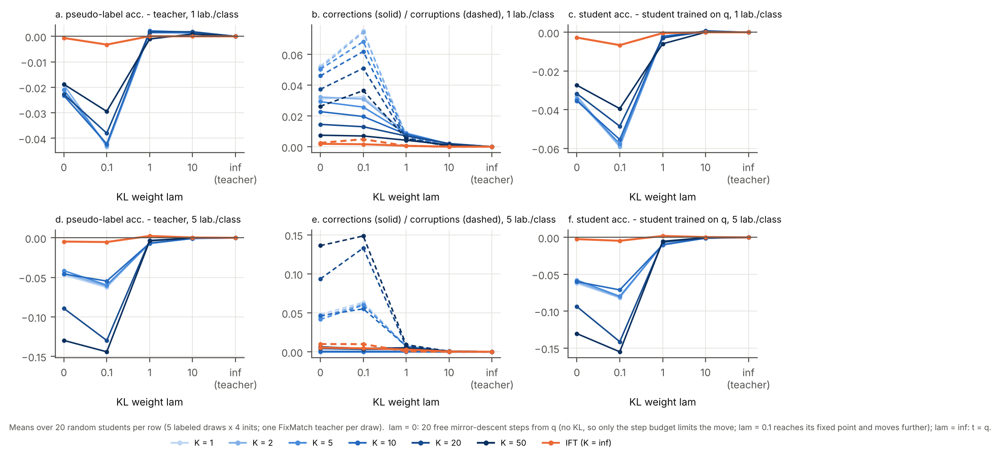

**Log.**
- **Phần dư điểm bất động** ở bước cuối có trung vị 1·10⁻⁶ với λ = 1 và 2·10⁻⁷ với λ = 10.
  - Với λ = 1, lớn nhất là 2.4·10⁻² (1 nhãn/lớp) và 0.44 (5 nhãn/lớp).
  - Với λ = 0.1, lớn nhất là 0.56 và 6.6: một vài run dao động, vì khi λ nhỏ thì phép lặp không còn
    là ánh xạ co.
- **IFT:** λ_max ≈ 1.9; conjugate gradient cần trung vị 11–13 vòng, residual ≤ 10⁻⁴; θ* có
  |∇L_u| khoảng (2–4)·10⁻³.
- **Teacher kém** (lần rút 0, 1 nhãn/lớp, PL acc 0.628): F_∞ tại q đã chỉ còn 5.7·10⁻³. IFT chỉ
  đưa PL acc lên 0.634 với λ = 0 và 0.631 với λ = 1. Cách gán nhãn sai của teacher đã đủ để student
  hội tụ khớp hai điểm có nhãn, nên meta signal không có gì để sửa.

**Đọc kết quả.**
- **Phần neo ngăn được tác hại.** Với λ ≥ 1, PL acc giữ ở mức teacher (±0.007 điểm). Với λ ≤ 0.1
  và K hữu hạn, meta signal làm hỏng nhiều hơn sửa ở mọi cấu hình. Với 5 nhãn/lớp và K = 50, nó làm
  hỏng 13.6–14.9% nhãn đúng mà chỉ sửa 0.4–0.6% nhãn sai, trong khi đưa F xuống thấp hơn cả teacher
  lẫn nhãn thật (0.09 so với 0.22 và 0.23).
- **Nhưng neo đủ mạnh để vô hại thì cũng làm meta signal hết tác dụng.** Ở λ = 1, số lỗi được sửa
  xấp xỉ số nhãn bị làm hỏng (0.1–0.9% mỗi loại). Ô dương duy nhất là IFT với λ = 1 ở 5 nhãn/lớp:
  +0.2 điểm, sửa 0.3% so với làm hỏng 0.1%.
- **Meta signal chỉ thấy được các lỗi của teacher làm hại labeled loss.** Với vài điểm có nhãn, phần
  lớn lỗi của teacher (ví dụ ở đầu mút của hai mặt trăng, xa các điểm có nhãn) không ảnh hưởng tới
  labeled loss sau khi student hội tụ. Chúng vô hình với meta signal: trường hợp teacher 0.628 không
  sửa được.
- **Hệ quả cho các phương pháp chính:** điều này phù hợp với việc MPL / PBPL / EBPL không hơn
  FixMatch. Phần neo (CE trên nhãn + FixMatch, cộng với việc pseudo-label là output của teacher)
  giữ cho meta feedback không gây hại, nhưng tín hiệu nó mang về tính đúng của nhãn là quá yếu so
  với nhiễu.

## 16. Accuracy pseudo-label của teacher trên X_u (10 seed, 40 nhãn)

Mọi run đều log `unl_ema`, tức accuracy của teacher EMA trên toàn bộ tập không nhãn X_u (accuracy
của pseudo-label dạng argmax). Bảng sinh bởi
`python3 analysis/tenseed_table.py results/fmnist-ssl-* --metric unl_ema`, vòng cuối, so cặp với
FixMatch, Holm qua 12 phép so sánh.

| biến thể | PL acc trên X_u | − FixMatch, thắng, p (t / Holm) |
|---|---|---|
| FixMatch | 73.20 | — |
| FixMatch tinh chỉnh | 74.15 | +0.95, 6/10, 0.085 / 0.85 |
| MPL hai mạng | 73.57 | +0.37, 6/10, 0.68 / 1.00 |
| PBPL hai mạng | 73.60 | +0.40, 7/10, 0.72 / 1.00 |
| EBPL hai mạng | 73.07 | −0.13, 6/10, 0.90 / 1.00 |
| MPL / PBPL / EBPL hai mạng + SAM | 75.10 / 74.09 / 73.63 | +1.90 / +0.88 / +0.43, n.s. |
| MPL một mạng | 75.11 | +1.91, 8/10, 0.038 / 0.42 |
| PBPL một mạng | 74.65 | +1.44, 8/10, 0.14 / 1.00 |
| FixMatch + SAM trên L_l | 76.30 | +3.10, 8/10, 0.015 / 0.18 |

Cùng seed, cùng cấu hình:
- PBPL − MPL = +0.03 (p = 0.98);
- EBPL − MPL = −0.50;
- PBPL − MPL ở cấu hình một mạng = −0.46;
- EBPL + SAM − MPL + SAM = −1.47 (2/10, p = 0.029).

Pseudo-label của teacher theo đúng thứ hạng của test accuracy: trust region pessimistic / expected
không làm pseudo-label đúng hơn, cả so với feedback optimistic lẫn so với FixMatch.

## 17. Bỏ loss FixMatch: labeled loss + MPL / PBPL / EBPL (wave7, 10 seed, 40 nhãn)

Mục đích: kiểm tra giả thuyết Sup + MPL < Sup + FM ≈ Sup + FM + MPL, tức meta objective (một
likelihood) không đứng được một mình nếu thiếu prior clusterability.

Thiết lập:
- Các ô có meta: `--base fixmatch --lam_u 0` cộng với cờ bilevel đã chọn ở Mục 4 (MPL λ_m 0.1;
  PBPL λ_m 0.1, r 0.1; EBPL λ_m 0.3, r 3.0; hai mạng, student held-out). Forward pass giữ nguyên như
  FixMatch: batch không nhãn (yếu + mạnh) vẫn đi qua BatchNorm, nhưng không có loss FixMatch.
- Hai đối chứng: `supbn` (cùng forward pass, không meta) và `sup` (`--base sup`, chỉ batch có nhãn).
- λ_m và bán kính giữ nguyên như khi chọn có FixMatch, không tinh chỉnh lại.
- Kernel rep-k (seed 1–5, cùng `sup` seed 4–5) và rep-l (seed 6–10). `sup` seed 1–3 có từ trước.
  Đủ 47/47 job, không job nào bị budget guard cắt.
- Lệnh: `python3 analysis/fm_meta_grid.py results/fmnist-ssl-*`, thêm `--metric unl_ema`
  (pseudo-label accuracy của teacher EMA trên X_u) hoặc `--metric test` (teacher live, không EMA).

Teacher EMA ở vòng cuối, test accuracy (pseudo-label accuracy trên X_u trong ngoặc), mean ± sd qua
10 seed:

| hàm mục tiêu teacher | không meta | + MPL | + PBPL | + EBPL |
|---|---|---|---|---|
| L_l, chỉ batch có nhãn (`sup`) | 57.66 ± 4.18 (57.73) | — | — | — |
| L_l, batch không nhãn qua BN (`supbn`, `supmpl`, …) | 48.30 ± 2.96 (48.51) | 59.49 ± 4.96 (59.69) | 59.24 ± 6.22 (59.40) | 59.52 ± 5.60 (59.74) |
| L_l + FixMatch | 72.75 ± 3.76 (73.20) | 73.28 ± 3.96 (73.57) | 73.32 ± 3.10 (73.60) | 72.74 ± 2.51 (73.07) |

Teacher live, test accuracy: 60.89 (`sup`); 54.42 / 57.29 / 57.84 / 58.77 (hàng giữa);
72.50 / 73.13 / 73.31 / 72.59 (FixMatch).

So cặp theo seed (n = 10; MPL / PBPL / EBPL):

| so sánh | teacher EMA | teacher live |
|---|---|---|
| Sup + meta − Sup + FM | −13.26 / −13.50 / −13.22, 0/10, Holm p < 0.001 | −15.21 / −14.67 / −13.74, 0/10, Holm p < 0.001 |
| Sup + meta − Sup (chỉ nhãn) | +1.83 / +1.59 / +1.87, 5–6/10, p ≥ 0.38 | −3.60 / −3.05 / −2.12, 2–3/10, p = 0.046 / 0.12 / 0.27, Holm ≥ 0.14 |
| meta − không meta, cùng forward pass (`supbn`) | +11.19 / +10.95 / +11.23, 9–10/10, Holm ≤ 0.005 | +2.86 / +3.41 / +4.34, 7–8/10, Holm 0.42 / 0.33 / 0.14 |
| meta − không meta, có FixMatch | +0.54 / +0.58 / −0.01, n.s. | +0.62 / +0.81 / +0.09, n.s. |
| PBPL − MPL, EBPL − MPL, không FixMatch | −0.25, +0.04, n.s. | +0.55, +1.48, n.s. |
| FixMatch − Sup (chỉ nhãn) | +15.09 ± 4.61, 10/10 | +11.62 ± 3.81, 10/10 |
| batch không nhãn qua BN − chỉ nhãn (không meta) | −9.36, 0/10 | −6.46, 0/10 |

Nhận xét:
- **Giả thuyết được xác nhận, và mạnh hơn dự kiến.** Sup + meta (59.2–59.5) thua Sup + FM (72.75)
  khoảng 13 điểm ở cả 10/10 seed, với cả ba biến thể và cả hai cách đo. Sup + FM + meta ≈ Sup + FM.
- **Không có FixMatch, likelihood chỉ ngang học thuần trên nhãn:** +1.6 đến +1.9 theo EMA, −2.1
  đến −3.6 theo live, không có ý nghĩa sau Holm. Khớp với toy Mục 13–14: student học trên
  pseudo-label tối ưu cho likelihood chỉ ở mức student học trên điểm có nhãn.
- **Pessimism / expectation không giúp** ở cả hàng không FixMatch lẫn hàng có FixMatch.
- **Bẫy đo: teacher EMA không ổn định khi không có loss nào trên X_u.**
  - Lớp `EMA` trong `ssl_fmnist.py` lấy trung bình trọng số nhưng chép nguyên buffer BatchNorm của
    mạng live.
  - Từ vòng 10k trở đi, test accuracy của EMA trong `sup` / `supbn` có độ lệch chuẩn 9–11 điểm
    giữa các lần đánh giá, biên độ 30–36 điểm, thấp nhất 10–12%. Mạng live chỉ dao động 1.3–1.7.
  - Có loss meta thì EMA ổn định (độ lệch chuẩn 1.0–1.7, cao hơn live 0.8–2.2 điểm). Có FixMatch
    thì EMA ≈ live (sd 0.5–0.6).
  - Hệ quả: hiệu ứng meta − `supbn` = +11 theo EMA bị phóng đại; theo live chỉ +3 đến +4. Hai so
    sánh chính (với Sup + FM và với Sup) cho cùng kết luận ở cả hai cách đo.
- **Riêng forward pass có batch không nhãn làm hại huấn luyện thuần nhãn 6.5 điểm (live).** Cơ chế
  chưa kiểm tra; nghi do thống kê BN của batch trộn (phần lớn là ảnh không nhãn, một nửa
  augmentation mạnh).
- **Giới hạn.** λ_m chưa tinh chỉnh lại cho hàng không có FixMatch. Toy (λ_m = ∞, chỉ likelihood,
  không có trọng số để tinh chỉnh) cho cùng kết luận.

## 18. Biến thể từ góc nhìn variational (wave8, seed 1–5, 40 nhãn)

Mục đích: thử các biến thể suy ra từ khung ELBO + cận sharpness trong `docs/bayes_view.md` (mục
"Từ MAP đến variational"). Mỗi biến thể nới một xấp xỉ của FixMatch: bước $q$ (một điểm, một quả cầu
cho $L_l$, hay một quả cầu cho cả likelihood) và bước $Y_u$ (pseudo-label đọc từ mạng nào). Thêm
nhóm thứ hai: SAM trên $L_l$ với các prior $-\log P(h \mid X)$ khác (không có $X_u$, Pseudo-Label,
Mean Teacher, FlexMatch). Dự đoán ghi trong `docs/bayes_view.md` trước khi chạy.

Thiết lập:
- Bán kính $\rho = 0.1$ (đã chọn cho SAM trên $L_l$ với FixMatch), không tinh chỉnh lại cho biến
  thể nào. Mean Teacher dùng `--lam_u 50` như baseline của Mục 4.
- Cờ: `fmsamfull` = `--base fixmatch --lab_reg samfull --radius 0.1`; `fmsamfulladv` thêm
  `--pl_src adv`; `labsamadv` = `--lab_reg sam --radius 0.1 --pl_src adv`; `fmemapl` =
  `--pl_src ema`; `supsam`, `plsam`, `mtsam`, `flexsam` = `--base {sup, pseudolabel, meanteacher,
  flexmatch} --lab_reg sam --radius 0.1`.
- Kernel rep-m và rep-n (tài khoản A). Đủ 46/46 job, không job nào bị budget guard cắt. Rep-n còn
  chạy `pseudolabel`, `meanteacher`, `flexmatch` seed 4–5; seed 1–3 của ba baseline này có từ main-a/b.
  `fixmatch`, `abl_labsam`, `sup` có sẵn từ các wave trước.
- Lệnh:

  ```bash
  python3 analysis/wave8_table.py results/fmnist-ssl-* [--metric test] [--ref_avg] [--traj]
  ```

  ```bash
  python3 analysis/wave8_figure.py results/fmnist-ssl-*
  ```

  `--ref_avg` thay mốc FixMatch và SAM trên $L_l$ bằng trung bình hai run mỗi seed
  (`fixmatch` + `fixmatchft`, `abl_labsam` + `labsamft`).

Test accuracy ở vòng cuối, mean ± sd qua seed 1–5:

| arm | teacher EMA | teacher live |
|---|---|---|
| FixMatch (`fixmatch`) | 70.96 ± 3.69 | 70.60 ± 3.37 |
| FixMatch + SAM trên $L_l$ (`abl_labsam`) | **75.05 ± 3.34** | 74.65 ± 3.51 |
| SAM trên $L_l + \lambda_u L_u$ (`fmsamfull`) | 74.16 ± 3.25 | 73.73 ± 3.22 |
| SAM-full, pseudo-label tại $\theta + \varepsilon^*$ (`fmsamfulladv`) | 74.88 ± 3.15 | **74.94 ± 3.11** |
| SAM trên $L_l$, pseudo-label tại $\theta + \varepsilon^*_l$ (`labsamadv`) | 74.36 ± 3.39 | 72.40 ± 3.51 |
| FixMatch, pseudo-label từ mạng EMA (`fmemapl`) | 72.49 ± 1.81 | 72.33 ± 2.02 |
| chỉ nhãn (`sup`) | 56.85 ± 1.45 | 59.58 ± 1.81 |
| chỉ nhãn + SAM (`supsam`) | 62.98 ± 0.84 | 63.56 ± 1.26 |
| Pseudo-Label (`pseudolabel`) | 62.12 ± 3.14 | 60.89 ± 4.50 |
| Pseudo-Label + SAM (`plsam`) | 70.71 ± 2.78 | 70.64 ± 2.93 |
| Mean Teacher (`meanteacher`) | 58.30 ± 2.63 | 58.70 ± 3.56 |
| Mean Teacher + SAM (`mtsam`) | 57.40 ± 3.39 | 57.68 ± 3.34 |
| FlexMatch (`flexmatch`) | 72.05 ± 2.15 | 71.92 ± 1.44 |
| FlexMatch + SAM (`flexsam`) | 71.38 ± 3.69 | 71.45 ± 3.68 |

Mốc hai run mỗi seed (teacher EMA): FixMatch 71.68 ± 2.38, SAM trên $L_l$ 74.88 ± 3.63.

So cặp theo seed (n = 5), họ 1: các bước $q$ và $Y_u$ của FixMatch. Holm qua 6 phép so sánh trong họ.
Với n = 5, p Wilcoxon hai phía nhỏ nhất là 0.062.

| so sánh | teacher EMA | teacher live | mốc hai run (EMA) |
|---|---|---|---|
| SAM-full − FixMatch | +3.20 ± 4.63, 3/5, p 0.20 | +3.13 ± 4.19, 3/5, p 0.17 | +2.48 ± 3.25, 4/5, p 0.16 |
| SAM-full − SAM trên $L_l$ | −0.89 ± 2.09, 1/5, p 0.39 | −0.92 ± 1.72, 1/5, p 0.30 | −0.72 ± 3.11, 1/5, p 0.63 |
| SAM-full adv − SAM-full | +0.72 ± 2.34, 3/5, p 0.53 | +1.21 ± 2.35, 3/5, p 0.31 | — |
| SAM-full adv − SAM trên $L_l$ | −0.17 ± 2.08, 3/5, p 0.87 | +0.29 ± 2.06, 3/5, p 0.77 | +0.00 ± 2.91, 2/5, p 1.00 |
| SAM trên $L_l$ adv − SAM trên $L_l$ | −0.69 ± 2.07, 1/5, p 0.50 | −2.25 ± 1.45, 0/5, p 0.025, Holm 0.15 | −0.52 ± 3.11, 1/5, p 0.73 |
| pseudo-label EMA − FixMatch | +1.53 ± 4.80, 2/5, p 0.52 | +1.73 ± 4.78, 2/5, p 0.47 | +0.81 ± 3.47, 3/5, p 0.63 |

Mọi Holm p trong họ 1 ≥ 0.15.

Họ 2: SAM trên $L_l$ − cùng phương pháp không SAM, theo từng prior. Holm qua 5 phép so sánh.

| prior | teacher EMA | teacher live |
|---|---|---|
| FixMatch (mốc) | +4.09 ± 3.65, 4/5, p 0.066, Holm 0.20 | +4.05 ± 3.40, 4/5, p 0.056, Holm 0.17 |
| không có $X_u$ | +6.13 ± 1.15, 5/5, p < 0.001, Holm 0.001 | +3.98 ± 1.77, 5/5, p 0.007, Holm 0.030 |
| Pseudo-Label | **+8.60 ± 2.38, 5/5, p 0.001, Holm 0.005** | **+9.75 ± 3.19, 5/5, p 0.002, Holm 0.012** |
| Mean Teacher | −0.90 ± 3.30, 3/5, p 0.58 | −1.01 ± 2.48, 2/5, p 0.41 |
| FlexMatch | −0.67 ± 3.38, 1/5, p 0.68 | −0.48 ± 2.98, 1/5, p 0.74 |

Với `sup`, đọc cột live: teacher EMA của run không có loss trên $X_u$ không ổn định (Mục 17), nên
+6.13 theo EMA bị phóng đại.

Chẩn đoán pseudo-label, trung bình qua 1/4 cuối huấn luyện. "Trùng" là tỉ lệ pseudo-label thực sự
dùng trùng với pseudo-label FixMatch tại mạng live, trên cùng batch.

| arm | mask | accuracy PL được dùng | accuracy PL trên cả batch | trùng |
|---|---|---|---|---|
| `fixmatch` | 0.905 | 0.741 | 0.709 | — |
| `abl_labsam` | 0.891 | 0.790 | 0.751 | — |
| `fmsamfull` | 0.876 | 0.787 | 0.743 | — |
| `fmsamfulladv` | 0.873 | 0.796 | 0.752 | 0.991 |
| `labsamadv` | 0.875 | 0.774 | 0.730 | 0.984 |
| `fmemapl` | 0.883 | 0.765 | 0.723 | 0.977 |
| `pseudolabel` | 0.891 | 0.638 | 0.610 | — |
| `plsam` | 0.857 | 0.757 | 0.708 | — |
| `meanteacher` | 1.000 | 0.579 | 0.579 | — |
| `mtsam` | 1.000 | 0.581 | 0.581 | — |
| `flexmatch` | 0.922 | 0.747 | 0.718 | — |
| `flexsam` | 0.918 | 0.744 | 0.713 | — |

Ở `fmsamfull`, bước ascent tăng loss tổng từ 0.072 lên 0.119 nats, nhưng labeled loss tại điểm nhiễu
chỉ 0.001. Ở mọi arm có SAM, labeled loss tại điểm nhiễu trung bình 0.54–0.58 trong 1000 vòng đầu và
≤ 0.02 từ vòng 2000 trở đi.

Quỹ đạo, SAM − không SAM (điểm phần trăm, trung bình 5 seed, không ghép cặp):

| prior | mask ở 1k (không SAM) | test live ở 1k / 4k / 20k | accuracy PL được dùng ở 2k / 20k |
|---|---|---|---|
| không có $X_u$ | — | +1.8 / +4.7 / +4.0 | — |
| FixMatch | 0.51 | +3.9 / +4.4 / +4.0 | +3.6 / +4.3 |
| Pseudo-Label | 0.30 | −0.4 / +6.4 / +9.7 | +4.1 / +12.7 |
| FlexMatch | 0.99 | +2.0 / −0.1 / −0.5 | −0.5 / −0.3 |
| Mean Teacher | 1.00 (không ngưỡng) | +6.1 / +4.6 / −1.0 | +5.6 / 0.0 |

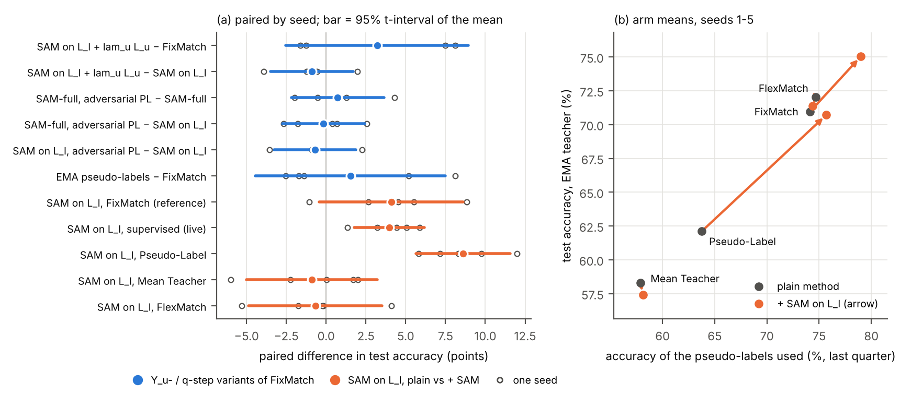

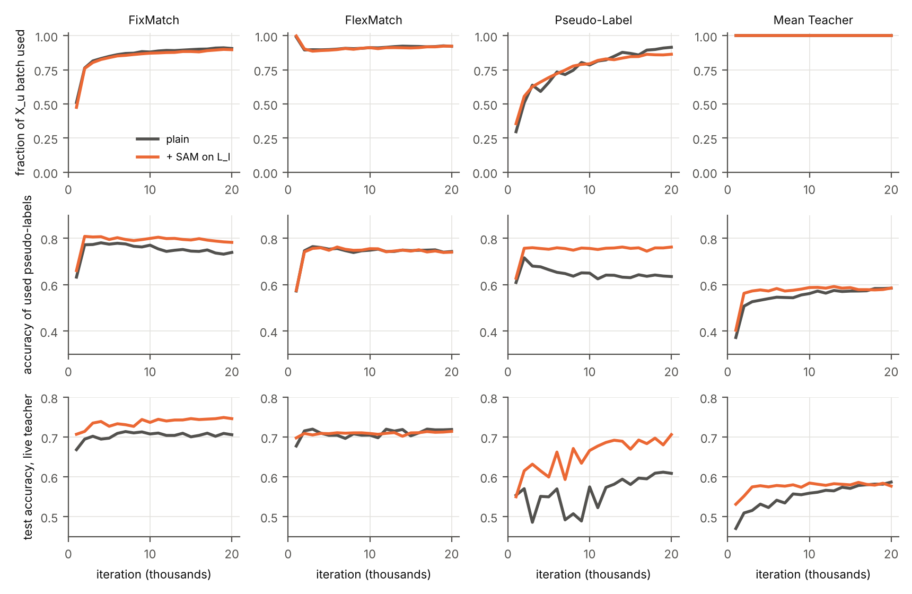

Đối chiếu với dự đoán ghi trước:

| arm | dự đoán | kết quả |
|---|---|---|
| `fmsamfull` | ≥ SAM trên $L_l$ nếu lợi ích là làm phẳng posterior; kém hơn nếu chỉ là chống học thuộc 40 nhãn | −0.9, 1/5, n.s.: nghiêng về vế sau, chưa phân biệt được ở n = 5 |
| `fmsamfulladv` | mask thấp hơn, pseudo-label giữ lại đúng hơn; accuracy chưa rõ | đúng hướng nhưng rất nhỏ (mask −0.3 điểm, PL +0.9 điểm, 99.1% trùng); accuracy +0.7, n.s. |
| `labsamadv` | gần SAM trên $L_l$ | 98.4% trùng; −0.7 (EMA), −2.3 (live, 0/5, Holm 0.15) |
| `fmemapl` | trong ±1 điểm quanh FixMatch | +1.5 (EMA), +0.8 so với mốc hai run; 97.7% trùng |
| `supsam` | tăng khoảng 3 điểm thì lợi ích không đặc thù cho SSL | +4.0 (live), 5/5: **lợi ích không đặc thù cho SSL** |
| `plsam`, `mtsam`, `flexsam` | tăng 2–4 điểm ở cả ba nếu lợi ích là chung | +8.6 / −0.9 / −0.7: **không chung, phụ thuộc prior** |

Nhận xét:
- **Các biến thể bước $q$ và bước $Y_u$ không đổi được gì đo được.**
  - Pseudo-label từ giả thuyết xấu nhất hay từ mạng EMA trùng 97.7–99.1% với pseudo-label điểm của
    FixMatch.
  - Cận trên đúng nghĩa (`fmsamfull`) không hơn $q$ hỗn hợp (SAM chỉ trên $L_l$); hướng ascent của
    nó do $L_u$ chi phối, và hầu như không làm tăng labeled loss.
  - Không biến thể nào của FixMatch vượt SAM trên $L_l$ (75.05, seed 1–5).
- **SAM trên $L_l$ là một regularizer cho phần khớp 40 nhãn, hoạt động chủ yếu trong 1–2k vòng đầu.**
  - Nó giúp cả học thuần trên nhãn: +4.0 điểm (live), 5/5 seed.
  - Sau vòng 2000, labeled loss tại điểm nhiễu ≤ 0.02, nên bước SAM gần như trùng bước thường.
- **Lợi ích còn lại đến cuối hay không tùy prior (quan sát, chưa kiểm định):**
  - Với hai prior có ngưỡng cố định τ = 0.95 (FixMatch, Pseudo-Label), lợi thế ban đầu giữ nguyên
    hoặc lớn dần. Ở vòng 20k, accuracy của pseudo-label được dùng hơn 4.3 điểm (FixMatch, mask gần
    như nhau) và 12.7 điểm (Pseudo-Label, mask thấp hơn khoảng 3 điểm). SAM chặn được sự suy giảm
    dần accuracy pseudo-label của Pseudo-Label (0.716 ở 2k xuống 0.636 ở cuối; có SAM giữ 0.76).
  - Với hai prior dùng gần như toàn bộ batch không nhãn ngay từ đầu (FlexMatch nhờ warm-up ngưỡng,
    Mean Teacher không có ngưỡng), lợi thế ở 1k (+2.0 và +6.1 điểm) mất hết trước vòng 20k.
  - Kiểm định post-hoc (nhóm chọn sau khi thấy dữ liệu, chỉ để sinh giả thuyết): lợi ích trung bình
    (FixMatch, Pseudo-Label) − (FlexMatch, Mean Teacher) = +7.1 ± 2.2, 5/5, p = 0.002 (EMA); +7.6,
    p = 0.008 (live).
- **Pseudo-Label + SAM (70.7) ngang FixMatch (71.0)** dù chỉ dùng augmentation yếu.
- **Giới hạn.**
  - 5 seed: với độ lệch chuẩn của hiệu cặp khoảng 3 điểm, n = 5 chỉ phát hiện được (power 80%)
    hiệu ứng từ khoảng 5 điểm. Các kết quả "≈ 0" trong họ 1 không loại được hiệu ứng 2–3 điểm.
  - ρ chưa tinh chỉnh lại cho SAM-full và cho các prior khác.
  - Seed 1–3 của ba baseline Pseudo-Label, Mean Teacher, FlexMatch chạy ở wave cũ, cùng đường code.

Việc có thể làm tiếp (chưa chạy):
- Kiểm định cơ chế "lợi thế sớm + ngưỡng khóa lại":
  - SAM chỉ trong 2k vòng đầu, với FixMatch và Pseudo-Label;
  - FixMatch với τ thấp (0.5 hoặc 0), có và không có SAM;
  - FlexMatch bỏ warm-up ngưỡng, có và không có SAM.
- Nâng `plsam` và `supsam` lên 10 seed.

## 19. Toy Two Moons: pseudo-label tối đa evidence P(Y_l, Ŷ_u | X) (khung variational, thuật bilevel so với supervised-only)

**Câu hỏi.** Trực giác: pseudo-label tốt phải giúp được nhiều mô hình, không chỉ một. Với mọi phân
phối q trên giả thuyết h,

$$\log P(Y_l, \hat Y_u \mid X) = \mathbb E_q[\log P(Y_l \mid X_l, h) + \log P(\hat Y_u \mid X_u, h)]
- \mathrm{KL}(q \,\|\, P(h \mid X)) + \mathrm{KL}(q \,\|\, P(h \mid X, Y_l, \hat Y_u)).$$

Bỏ số hạng KL cuối (≥ 0) thì được ELBO. Hai câu hỏi:
- khung này sinh ra những thuật toán nào (Pseudo-Label, Mean Teacher, FixMatch, MPL)?
- có thuật bilevel nào cho pseudo-label giúp student hơn student chỉ học trên điểm có nhãn
  (supervised-only) trên Two Moons không?

### 19.1 Phân tích (không phụ thuộc thí nghiệm)

- **Đẳng thức đúng với mọi q, nên vế phải là hằng theo q.**
  - Vì vậy "min theo (Ŷ_u, q)" của biểu thức có đủ ba số hạng chỉ là min theo Ŷ_u; q không có vai
    trò gì.
  - q chỉ có vai trò sau khi bỏ KL cuối: ELBO là cận dưới của log evidence, chặt khi q là posterior.
- **Nghiệm là mode đồng thời của posterior predictive.**
  - argmax theo Ŷ_u của P(Y_l, Ŷ_u | X) bằng argmax theo Ŷ_u của P(Ŷ_u | X, Y_l), vì P(Y_l | X)
    không phụ thuộc Ŷ_u.
  - Nếu prior trên h không phụ thuộc X_u, thì X_u chỉ đi vào qua một yêu cầu: một giả thuyết phải
    giải thích được cả bộ nhãn cứng cùng lúc. Vì thế mode đồng thời khác mode của từng điểm (tức nhãn
    supervised).
  - Nới nhãn thành số thực thì mất hiệu ứng này. Với GP hồi quy, nghiệm nới là trung bình posterior
    khi chỉ có Y_l, tức đúng là supervised.
- **Các thành viên: cực tiểu ELBO luân phiên.**
  - Hai bước luân phiên:
    - bước q: q = P(h | X, Y_l, Ŷ_u), tức học trên nhãn cộng pseudo-label;
    - bước Ŷ: ŷ_i = argmax_y E_q log p_h(y | x_i).
  - **Pseudo-Label:** q = δ_θ (self-training cứng). Tương đương cực tiểu
    L_l + Σ_i min_y CE(y, p_θ(x_i)), một dạng entropy minimization.
  - **FixMatch:** q = δ_θ; likelihood của Ŷ đánh giá trên view mạnh, bước Ŷ trên view yếu. Ngưỡng τ
    không suy ra từ ELBO; có thể xem nó cho phép Ŷ_u bỏ trống các điểm có max prob < τ.
  - **Mean Teacher:** chỉ gần đúng. q là trung bình EMA của quỹ đạo, bước Ŷ mềm (kỳ vọng thay cho
    argmax), và likelihood bình phương thay cho log-likelihood.
  - **MPL không phải thành viên của phép cực tiểu luân phiên này.** Nó đến từ một cách tách khác:
    log P(Y_l, Ŷ_u | X) = log P(Ŷ_u | X) + log P(Y_l | X, Ŷ_u).
    - MPL giữ số hạng thứ hai, với P(h | X, Ŷ_u) thay bằng một student sau một bước SGD trên Ŷ_u
      (student không thấy Y_l).
    - MPL bỏ log P(Ŷ_u | X), tức evidence của riêng bộ pseudo-label: một số hạng kiểu Occam.
- **Cấu trúc bilevel.**
  - **Suy biến khi tầng dưới khớp q với chính ELBO** (student học cả Y_l và Ŷ_u). Theo định lý
    envelope, hypergradient bằng đạo hàm riêng tại q cố định, tức hướng của bước Ŷ. Bài toán bilevel
    khi đó có cùng điểm dừng với cực tiểu luân phiên; không có tín hiệu meta. Hiện tượng này giống
    N2(a).
  - **Không suy biến khi tầng dưới khớp q chỉ với Ŷ_u** (student held-out).
    - ELBO tại q₁(Ŷ_u) = P(h | X, Ŷ_u) vẫn là cận dưới của log P(Y_l, Ŷ_u | X).
    - Hypergradient có thêm phần meta, đi qua q₁ vào số hạng có nhãn.
    - Đây là họ MPL. Lấy q₁ là một ensemble student thì đúng là "giúp nhiều mô hình".

### 19.2 Thiết kế

Script `checks/toy_two_moons_evidence.py`, kết quả trong `results/toy-two-moons/evidence.json`.
Dữ liệu, kiến trúc student (MLP 2-64-64-2 ReLU), các lần rút nhãn và lịch huấn luyện giống Mục 13–15.
Lần rút 0–9, với 1 và 5 nhãn mỗi lớp. Chạy 88 phút trên 4 tiến trình CPU.

- **A. Evidence chính xác: posterior GP dạng đóng thay cho tầng dưới.**
  - GP hồi quy trên nhãn ±1: log P(y | X) = −½ yᵀ(K + s²I)⁻¹y + const. Đặt f(y) = yᵀ(K + s²I)⁻¹y,
    tức f = −2 log evidence + const.
  - K là kernel NNGP của chính student MLP ở khởi tạo PyTorch (prior của student), hoặc RBF với
    ℓ = 0.3 trên input đã chuẩn hóa (đặt cố định từ prototype, không quét). Cả hai được chuẩn hóa
    về phương sai prior trung bình 1. s² ∈ {0.01, 0.1}.
  - Tìm nhãn cứng bằng ba cách, Y_l cố định:
    - lật từng điểm tham lam (ICM), xuất phát từ nhãn supervised của chính GP đó;
    - nới trên mặt cầu ‖y_u‖² = n_u (bài toán trust-region, giải toàn cục bằng phân rã riêng), làm
      tròn rồi ICM;
    - 10 điểm xuất phát ngẫu nhiên + ICM.
  - "best" là bộ nhãn có f nhỏ nhất trong ba cách; lựa chọn này chỉ dùng objective, không dùng nhãn
    thật.
  - Để tách objective khỏi phép tìm, log thêm f của nhãn thật và của ICM xuất phát từ nhãn thật.
- **B. Bilevel với student mạng nơ-ron (câu hỏi chính).**
  - Pseudo-label mềm tự do t = softmax(z) trên X_u.
  - Student held-out (không thấy Y_l): từ khởi tạo ngẫu nhiên θ₀ ~ P, K = 20 bước SGD toàn batch
    (lr 0.1) trên (X_u, t). Như vậy q là luật của student sau huấn luyện.
  - z đi 40 bước mirror descent, hypergradient chuẩn hóa RMS, bước 0.3 (như Mục 14), lấy bằng
    backprop qua K bước.
  - Mỗi biến thể chạy hai lần lặp với seed khác nhau.

  | biến thể | student | mục tiêu tầng trên |
  |---|---|---|
  | `mpl1` | một student cố định | CE trung bình trên Y_l (MPL với pseudo-label tự do, Mục 14) |
  | `ens` | 8 student rút lại mỗi bước | CE trung bình trên Y_l ("giúp nhiều mô hình") |
  | `ens_lme` | 8 student | −log mean_m exp(−Σ_l CE_m), ước lượng Monte Carlo của log P(Y_l \| X, Ŷ_u) |
  | `elbo_mean` | 8 student | CE trên Y_l + CE(t, p) trên X_u, cả hai lấy trung bình |
  | `elbo_sum` | 8 student | Σ CE trên Y_l + Σ CE(t, p) trên X_u + KL (trọng số của chính ELBO) |
  | `elbo_mean_sup` | 8 student | như `elbo_mean`, xuất phát từ nhãn của `sup_ens` |
  | `elbo_lab` | 8 student, học cả Y_l | như `elbo_mean`: q khớp với cả ELBO, nên dự đoán là suy biến |

  - KL trong `elbo_sum` là KL từ N(θ_K, s²I) tới N(θ₀, s²I), với s² = 1/(3·fan_in) của từng lớp (phương
    sai khởi tạo).
  - CE(t, p) tuyến tính theo t (không có entropy của t), tức là max cứng theo Ŷ_u.
- **C. Các thành viên khác và mốc so sánh.**
  - `sup_ens`: nhãn của 8 student học trên Y_l (argmax của log-prob trung bình); đây là bước q mà
    không có Ŷ_u.
  - `st1`, `st8`: cực tiểu ELBO luân phiên. Bước q là 1 hoặc 8 student mới học trên Y_l + Ŷ_u (1000
    bước); bước Ŷ là argmax_y E_q log p_h(y | x). 5 vòng, xuất phát từ nhãn supervised.
  - `fixmatch`: teacher FixMatch của Mục 15 (q = khối lượng điểm, likelihood nhất quán qua
    augmentation, có ngưỡng). PL acc ở lần rút 0–4 với 1 nhãn/lớp trùng Mục 15 tới ba chữ số.
  - `ls`: label spreading trên đồ thị kNN. `oracle`: nhãn thật.
- **Đánh giá.**
  - Mỗi lần rút có 8 student mới, không dùng trong bất kỳ phép tối ưu nào. Chúng học 3000 bước SGD
    toàn batch (lr 0.1) trên (X_u, pseudo-label).
  - So cặp với chính 8 student đó học trên điểm có nhãn (supervised-only).
  - Mỗi lần rút cho một hiệu (trung bình theo student và lần lặp). t-test, Wilcoxon, Holm qua 17 bộ
    nhãn (trừ oracle).
  - Học trên pseudo-label cộng điểm có nhãn cho kết quả trùng: lệch trung bình 0.0000 / +0.0001, lớn
    nhất 0.003 / 0.010. Vì vậy chỉ báo cáo bản học trên pseudo-label.
- **Dự đoán ghi trước khi chạy** (docstring của script):
  - P1: với s² = 0.01, nhãn thật có evidence cao hơn nhãn supervised ở hầu hết lần rút, với cả hai
    prior; các phép tìm của khung không tới được nó một cách ổn định.
  - P2: `ens` / `ens_lme` có PL acc ≥ `mpl1`, hơn supervised-only vài điểm (nhiều hơn khi 1
    nhãn/lớp), và dưới label spreading và FixMatch.
  - P3: `elbo_sum` sụp về một lớp; `elbo_mean` gần `ens`.
  - P4: `st1` / `st8` ở gần nhãn supervised (đó là điểm bất động của cực tiểu luân phiên);
    FixMatch ≫ supervised-only.

### 19.3 Kết quả

Bảng chính: hiệu test accuracy (điểm phần trăm) giữa student học trên pseudo-label và student
supervised-only, trung bình ± độ lệch chuẩn qua 10 lần rút. Supervised-only đạt 71.8% (1 nhãn/lớp)
và 83.0% (5 nhãn/lớp).

| nhóm | bộ nhãn | 1 nhãn/lớp: PL acc | − sup | thắng | Holm p | 5 nhãn/lớp: PL acc | − sup | thắng | Holm p |
|---|---|---|---|---|---|---|---|---|---|
| B | `mpl1` | 0.700 | −3.3 ± 7.9 | 6/10 | 1 | 0.854 | +0.9 ± 3.3 | 6/10 | 1 |
| B | `ens` | 0.706 | −2.7 ± 7.4 | 4/10 | 1 | 0.858 | +1.3 ± 2.5 | 7/10 | 1 |
| B | `ens_lme` | 0.707 | −2.5 ± 7.8 | 5/10 | 1 | 0.857 | +1.3 ± 2.4 | 7/10 | 1 |
| B | `elbo_mean` | 0.703 | −3.2 ± 10.7 | 7/10 | 1 | 0.869 | +2.1 ± 4.6 | 6/10 | 1 |
| B | `elbo_sum` | 0.548 | −17.3 ± 21.3 | 1/10 | 0.46 | 0.783 | −6.8 ± 14.8 | 5/10 | 1 |
| B | `elbo_mean_sup` | 0.746 | +1.1 ± 7.1 | 8/10 | 1 | 0.858 | +0.9 ± 3.1 | 5/10 | 1 |
| B | `elbo_lab` | 0.718 | −1.6 ± 9.1 | 6/10 | 1 | 0.861 | +1.4 ± 2.8 | 7/10 | 1 |
| A | `gp_nngp_sup` | 0.746 | +1.7 ± 4.3 | 6/10 | 1 | 0.862 | +2.1 ± 2.3 | 10/10 | 0.20 |
| A | `gp_nngp_icm` | 0.744 | +1.4 ± 4.5 | 5/10 | 1 | 0.869 | +2.8 ± 2.9 | 10/10 | 0.19 |
| A | `gp_nngp_best` | 0.764 | +3.4 ± 6.3 | 5/10 | 1 | 0.874 | +3.2 ± 3.5 | 10/10 | 0.21 |
| A | `gp_rbf_icm` | 0.753 | +2.3 ± 4.7 | 6/10 | 1 | 0.911 | +7.1 ± 2.7 | 10/10 | 2.9·10⁻⁴ |
| A | `gp_rbf_best` | 0.882 | **+15.8 ± 12.0** | 10/10 | **0.040** | 0.953 | **+12.0 ± 5.8** | 10/10 | **0.0015** |
| C | `sup_ens` | 0.733 | +0.2 ± 2.5 | 7/10 | 1 | 0.844 | +0.1 ± 1.0 | 3/10 | 1 |
| C | `st1` | 0.725 | −0.6 ± 4.3 | 3/10 | 1 | 0.843 | −0.2 ± 1.0 | 3/10 | 1 |
| C | `st8` | 0.735 | +0.4 ± 1.7 | 5/10 | 1 | 0.848 | +0.4 ± 2.1 | 5/10 | 1 |
| C | `fixmatch` | 0.747 | +2.7 ± 17.6 | 7/10 | 1 | 0.975 | +14.4 ± 4.8 | 10/10 | 9.1·10⁻⁵ |
| C | `ls` | 0.926 | +20.4 ± 15.1 | 10/10 | 0.036 | 0.994 | +16.4 ± 4.8 | 10/10 | 3.2·10⁻⁵ |
| C | `oracle` | 1.000 | +28.2 ± 17.2 | 10/10 | — | 1.000 | +17.0 ± 4.3 | 10/10 | — |

`gp_nngp_*` và `gp_rbf_*` dùng s² = 0.01. Với student bilevel (nhóm B), không ô nào vượt
supervised-only có ý nghĩa, kể cả trước hiệu chỉnh (t-test p nhỏ nhất 0.12, của `ens` ở 5
nhãn/lớp).

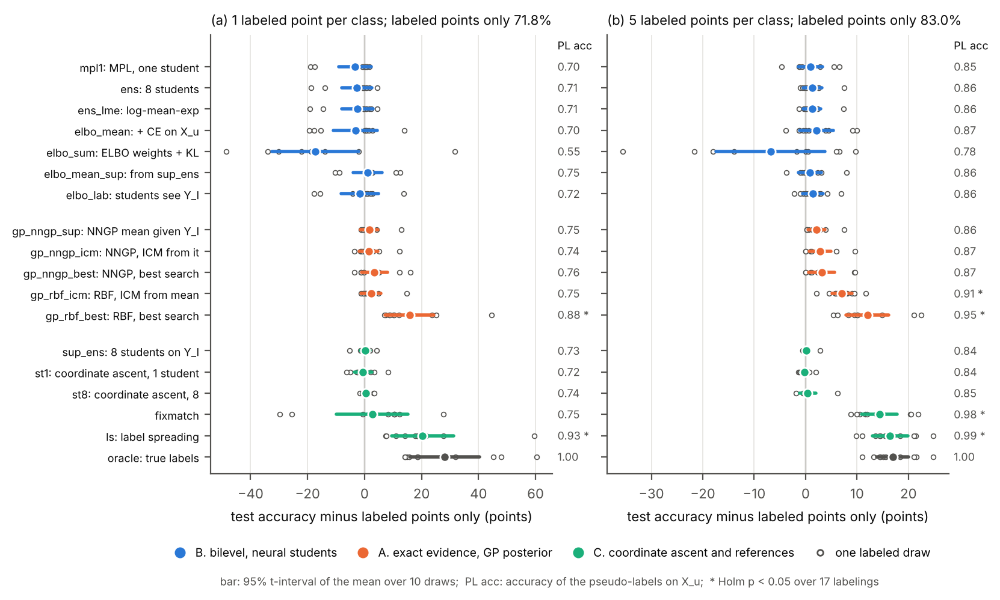

**Snapshot.** Lần rút 8 với 1 nhãn/lớp và lần rút 3 với 5 nhãn/lớp, lần lặp 0 của mỗi biến thể
bilevel. Các bộ nhãn được tính lại với cùng seed, và PL acc trùng run chính ở mọi bộ nhãn.
- Mọi biến thể bilevel cho gần đúng bộ nhãn của `sup_ens`: một biên gần thẳng nằm ngang, sai ở hai
  đầu mút lồng vào mặt trăng kia.
- `elbo_sum` ở lần rút 8: lần lặp 0 gán một lớp cho cả X_u; lần lặp 1 trùng biên của `sup_ens`.
- Evidence với prior RBF sửa phần lớn hai đầu mút; với prior NNGP chỉ sửa một phần.

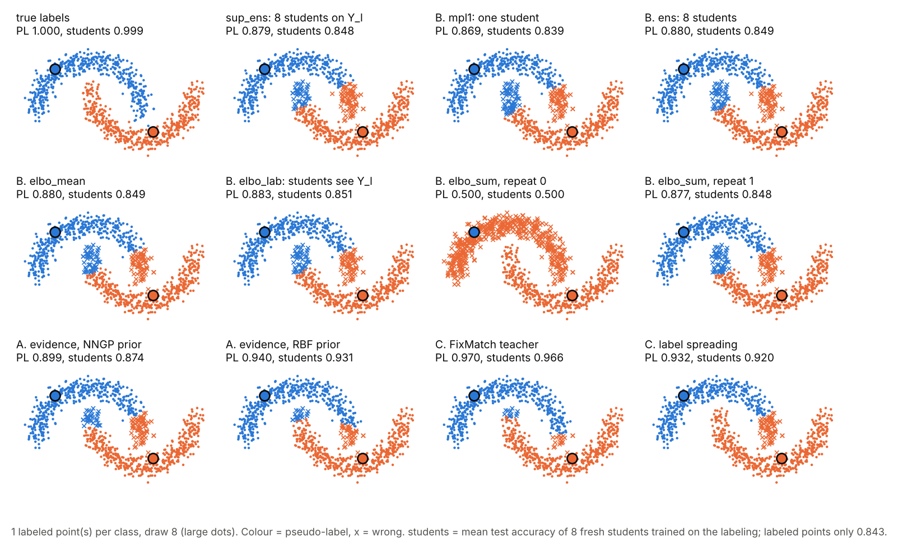

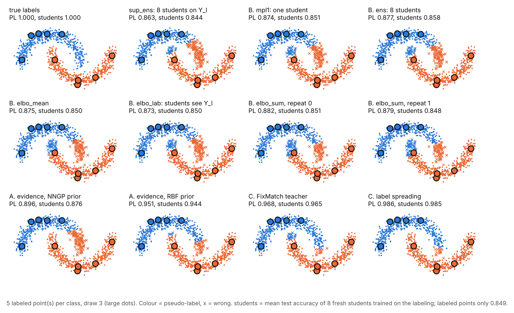

**Evidence chính xác.** Δf = f(bộ nhãn) − f(nhãn thật), với f = −2 log evidence + const; Δf > 0
nghĩa là nhãn thật có evidence cao hơn. Accuracy là trung bình, Δf là trung vị qua 10 lần rút.

| prior | nhãn | sup: acc, Δf | thật > sup | acc: ICM từ sup / mặt cầu / ngẫu nhiên | best: acc, Δf | best kém nhãn thật | ICM từ nhãn thật: acc, Δf | best > ICM từ nhãn thật |
|---|---|---|---|---|---|---|---|---|
| NNGP, s² = 0.01 | 1 | 0.746, +1671 | 10/10 | 0.744 / 0.750 / 0.523 | 0.764, +377 | 8/10 | 0.997, −250 | 0/10 |
| RBF, s² = 0.01 | 1 | 0.751, +1473 | 10/10 | 0.753 / 0.882 / 0.540 | 0.882, +669 | 10/10 | 0.998, −124 | 0/10 |
| NNGP, s² = 0.1 | 1 | 0.750, +32 | 7/10 | 0.763 / 0.747 / 0.729 | 0.798, −184 | 0/10 | 0.985, −66 | 9/10 |
| RBF, s² = 0.1 | 1 | 0.751, +174 | 10/10 | 0.753 / 0.882 / 0.573 | 0.882, +82 | 10/10 | 0.998, −17 | 0/10 |
| NNGP, s² = 0.01 | 5 | 0.862, +925 | 10/10 | 0.869 / 0.851 / 0.714 | 0.874, +553 | 8/10 | 0.997, −250 | 0/10 |
| RBF, s² = 0.01 | 5 | 0.910, +850 | 10/10 | 0.911 / 0.953 / 0.582 | 0.953, +307 | 9/10 | 0.998, −124 | 0/10 |
| NNGP, s² = 0.1 | 5 | 0.863, −25 | 3/10 | 0.867 / 0.865 / 0.771 | 0.871, −115 | 2/10 | 0.986, −66 | 8/10 |
| RBF, s² = 0.1 | 5 | 0.909, +101 | 10/10 | 0.912 / 0.952 / 0.620 | 0.948, +40 | 9/10 | 0.998, −17 | 0/10 |

- Với RBF, "best" luôn là nghiệm nới trên mặt cầu (10/10 lần rút, trừ 2/10 ở s² = 0.1 với 5 nhãn/lớp).
  Với NNGP và s² = 0.01, best là ICM từ nhãn supervised ở 6/10 và 9/10 lần rút.
- Khi "best" có evidence cao hơn nhãn thật (cột "best kém nhãn thật" < 10/10) ở s² = 0.01, nó vẫn
  thấp hơn cực trị gần nhãn thật (cột cuối 0/10).

**Tách phần đóng góp** (so cặp giữa các bộ nhãn, cùng student đánh giá, t-test chưa hiệu chỉnh):

| hiệu | so sánh | 1 nhãn/lớp | 5 nhãn/lớp |
|---|---|---|---|
| `gp_rbf_best − gp_rbf_icm` | tìm evidence so với nhãn supervised của cùng prior, RBF | +13.5 ± 12.2, 9/10, p = 0.006 | +4.9 ± 4.1, 9/10, p = 0.004 |
| `gp_nngp_best − gp_nngp_sup` | như trên, NNGP | +1.8 ± 4.6, 5/10, p = 0.25 | +1.0 ± 1.9, 7/10, p = 0.11 |
| `gp_nngp_sup − sup_ens` | trung bình posterior NNGP chính xác so với 8 student SGD, cùng chỉ dùng Y_l | +1.4 ± 6.0, 3/10, p = 0.48 | +2.0 ± 2.6, 8/10, p = 0.040 |
| `ens − mpl1` | 8 student so với một | +0.7 ± 2.2, 5/10, p = 0.36 | +0.4 ± 2.8, 6/10, p = 0.64 |
| `ens_lme − ens` | log-mean-exp so với trung bình | +0.2 ± 0.9, 5/10, p = 0.58 | −0.1 ± 0.2, 3/10, p = 0.23 |
| `elbo_mean − ens` | thêm CE trên X_u | −0.6 ± 6.2, 6/10, p = 0.78 | +0.8 ± 2.8, 6/10, p = 0.41 |
| `elbo_lab − elbo_mean` | student thấy cả Y_l (bilevel suy biến) | +1.6 ± 15.2, 5/10, p = 0.75 | −0.8 ± 2.1, 3/10, p = 0.29 |
| `elbo_mean_sup − sup_ens` | bilevel xuất phát từ nhãn supervised, so với chính nhãn đó | +0.8 ± 5.0, 6/10, p = 0.61 | +0.8 ± 3.1, 6/10, p = 0.46 |
| `st8 − sup_ens` | cực tiểu luân phiên so với điểm xuất phát | +0.2 ± 1.7, 2/10, p = 0.75 | +0.3 ± 1.2, 6/10, p = 0.45 |
| `gp_rbf_best − ls` | evidence chính xác tốt nhất so với label spreading | −4.6 ± 14.8, 3/10, p = 0.35 | −4.4 ± 4.3, 0/10, p = 0.009 |
| `gp_rbf_best − fixmatch` | so với FixMatch | +13.1 ± 22.5, 6/10, p = 0.10 | −2.4 ± 4.6, 3/10, p = 0.14 |

**Log.**
- **Quỹ đạo bilevel.** Mọi biến thể đạt PL acc cuối trong 10 bước ngoài đầu tiên, rồi đứng yên hoặc
  giảm nhẹ. Ví dụ `ens`: 0.709 ở bước 10 và 0.706 ở bước 40 (1 nhãn/lớp); 0.865 và 0.858 (5
  nhãn/lớp).
  - CE trên Y_l của student đánh giá trong bài toán bilevel: 0.16–0.27 (`elbo_lab` 0.04).
  - Riêng `elbo_sum`: 0.72–1.42, tức student của nó sai cả trên điểm có nhãn.
  - Mỗi lần chạy mất 3 giây (`mpl1`) đến 15–18 giây (8 student).
- **Kết cục của `elbo_sum`** (20 lần chạy mỗi số nhãn = 10 lần rút × 2 lần lặp):
  - 1 nhãn/lớp: một lớp ở 10 lần; PL acc 0.86–0.88 ở 5 lần; đảo lớp (PL acc 0.12–0.13) ở 2 lần; còn
    lại 3 lần.
  - 5 nhãn/lớp: một lớp ở 5 lần; PL acc 0.87–0.88 ở 15 lần.
  - Đường thẳng tốt nhất trên X_u đạt 0.909, nên các bộ nhãn 0.86–0.88 là biên gần thẳng.
- **Cực tiểu luân phiên dừng ngay.** PL acc của `st1` / `st8` qua 5 vòng: 0.724 → 0.725 / 0.734 →
  0.735 (1 nhãn/lớp) và 0.841 → 0.843 / 0.849 → 0.848 (5 nhãn/lớp). Ở vòng cuối, ≤ 0.08% nhãn đổi.
- **Student chép pseudo-label.** Trên 250 cặp (lần rút, bộ nhãn) mỗi số nhãn, tương quan giữa PL acc
  và accuracy student là 0.997 / 0.991. Student kém pseudo-label của nó trung bình 1.2 / 1.3 điểm.
- **Các lần rút khó với 1 nhãn/lớp.**
  - Supervised-only ở lần rút 0, 5, 7 chỉ đạt 0.52, 0.55, 0.39.
  - Teacher FixMatch có PL acc 0.54 / 0.12 / 0.51 ở lần rút 5, 7, 9. Ở lần rút 7, lớp bị đảo gần
    hết, vì hai điểm có nhãn nằm ở đầu mút gần mặt trăng còn lại.
  - Các biến thể bilevel kém supervised-only 14–19 điểm ở lần rút 0 và 5. `gp_rbf_best` hơn 12, 45
    và 25 điểm ở lần rút 0, 5, 7.

**Đối chiếu với dự đoán ghi trước:**

| | dự đoán | kết quả |
|---|---|---|
| P1 | s² = 0.01: nhãn thật có evidence cao hơn nhãn supervised; phép tìm không tới được nó ổn định | **đúng**: 10/10 với cả hai prior và cả hai số nhãn; best kém nhãn thật ở 8–10/10; ICM từ nhãn supervised đổi PL acc ≤ 0.007. Không dự đoán được: nới trên mặt cầu với RBF tới 0.88 / 0.95 |
| P2 | `ens` ≥ `mpl1`; hơn supervised-only vài điểm, nhiều hơn ở 1 nhãn/lớp; dưới LS và FixMatch | **sai phần chính**: PL acc ≥ `mpl1` (+0.6 / +0.4 điểm) nhưng −2.7 / +1.3 so với supervised-only, n.s., và ngược chiều dự đoán theo số nhãn. Dưới LS và FixMatch: đúng |
| P3 | `elbo_sum` sụp về một lớp; `elbo_mean` ≈ `ens` | **đúng một phần**: một lớp ở 10/20 và 5/20 lần chạy, còn lại phần lớn là biên gần thẳng. `elbo_mean − ens` = −0.6 / +0.8, n.s.: đúng |
| P4 | `st1` / `st8` ≈ nhãn supervised; FixMatch ≫ supervised-only | `st`: **đúng** (≤ 0.08% nhãn đổi). FixMatch: đúng ở 5 nhãn/lớp (+14.4, Holm 9·10⁻⁵); **sai** ở 1 nhãn/lớp (+2.7 ± 17.6), vì teacher hỏng ở 3/10 lần rút |

### 19.4 Đọc kết quả

**Trả lời câu hỏi.**
- **Các thuật bilevel với student mạng nơ-ron mà khung này sinh ra đều không vượt supervised-only.**
  Bảy biến thể đã thử: MPL một student, ensemble 8 student, log-mean-exp, ELBO trọng số trung bình,
  ELBO với trọng số của chính nó, xuất phát từ nhãn supervised, và student thấy cả Y_l.
  - 1 nhãn/lớp: −3.3 đến +1.1 điểm. 5 nhãn/lớp: +0.9 đến +2.1 điểm.
  - Không ô nào có ý nghĩa, kể cả trước Holm.
  - ELBO với trọng số của chính nó (`elbo_sum`) sụp: −17.3 / −6.8 điểm.
- **Dạng chính xác của khung có vượt, nhưng chỉ với prior RBF.** Dạng chính xác là posterior GP dạng
  đóng thay cho tầng dưới, và tối đa evidence chính xác trên nhãn cứng.
  - Với RBF: +15.8 điểm (1 nhãn/lớp, 10/10, Holm 0.040) và +12.0 điểm (5 nhãn/lớp, 10/10, Holm
    0.0015).
  - Với prior NNGP của chính student: +3.4 / +3.2 điểm, Holm ≥ 0.2.
  - Dù vậy, nó vẫn kém label spreading 4.6 / 4.4 điểm (ở 5 nhãn/lớp: 0/10, p = 0.009), và ở 5
    nhãn/lớp kém FixMatch 2.4 điểm (n.s.).

**Vì sao.**
- **Objective đúng, nhưng chỉ khi tính chính xác.**
  - Với s² = 0.01, evidence GP ưu tiên nhãn thật hơn nhãn supervised ở 10/10 lần rút, với cả hai
    prior. Trung vị Δf là 850–1671, tức hơn 425–835 nat.
  - ICM xuất phát từ nhãn thật dừng ở accuracy 0.997–0.998, với evidence còn cao hơn nhãn thật.
  - Không bộ nhãn nào tìm được vượt cực trị gần nhãn thật này (0/10).
- **Phần khó là phép tìm trên nhãn cứng.**
  - ICM từ nhãn supervised đổi PL acc ≤ 0.007: nhãn supervised là một cực trị địa phương.
  - Điểm xuất phát ngẫu nhiên còn tệ hơn: 0.52–0.77.
  - Chỉ nghiệm nới trên mặt cầu tìm ra vùng tốt, và chỉ với RBF. Nghiệm này được giải toàn cục, và
    chủ yếu nằm trên các vector riêng ứng với trị riêng nhỏ nhất của khối (K + s²I)⁻¹ trên X_u, tức
    các hướng trơn nhất dưới prior. Với RBF cục bộ, các hướng đó gần như hằng trên từng mặt trăng,
    giống phân cụm phổ.
- **Prior quyết định.**
  - So với nhãn supervised của chính prior đó, tìm evidence thêm +13.5 / +4.9 điểm với RBF (9/10,
    p = 0.006 / 0.004), nhưng chỉ +1.8 / +1.0 với NNGP (n.s.).
  - Với NNGP và s² = 0.1, objective còn sai: ở 9/10 và 8/10 lần rút, nó ưu tiên một bộ nhãn xa nhãn
    thật hơn cực trị gần nhãn thật. Ở lần rút 7 (1 nhãn/lớp), một bộ nhãn PL acc 0.50 có evidence
    cao hơn cực trị đó khoảng 290 nat.
  - Thứ làm evidence chính xác hoạt động là kernel nối các điểm gần nhau, tức giả định cụm nằm trong
    prior. Mạng ReLU ở khởi tạo (NNGP) gần như không có giả định này; FixMatch có được nó qua
    augmentation.
- **Bilevel với student mạng nơ-ron không thấy được thứ evidence chính xác thấy.** Ở đây q là luật
  của student sau K bước SGD.
  - Số hạng có nhãn E_q log P(Y_l | X_l, h) chính là meta objective của Mục 13–14. Nó thưởng cho bộ
    nhãn giúp student khớp nhanh vài điểm có nhãn, mà gần như mọi bộ nhãn nhất quán quanh các điểm
    có nhãn đều làm được.
  - Ensemble chỉ lấy trung bình theo khởi tạo, không đổi thứ được đo: `ens − mpl1` = +0.7 / +0.4
    (n.s.); log-mean-exp thêm ≤ 0.2 điểm.
  - Số hạng Occam log P(Ŷ_u | X) bị thay bằng "học được trong K bước + KL tham số". Nó ưu tiên bộ
    nhãn đơn giản (một lớp, một đường gần thẳng) chứ không ưu tiên bộ nhãn theo cụm.
  - Với trọng số của chính ELBO, tổng trên 1000 điểm không nhãn lấn át 2–10 điểm có nhãn. Đó là lý
    do `elbo_sum` sụp hoặc ra biên gần thẳng, có lúc đảo lớp.
- **Suy biến hay không suy biến không quan trọng ở đây.**
  - `elbo_lab` (suy biến) và `elbo_mean` (held-out) cho cùng kết quả: +1.6 / −0.8, n.s.
  - Cực tiểu luân phiên (`st1`, `st8`) dừng ngay tại nhãn supervised, đúng như dự đoán: nhãn
    supervised là điểm bất động của bước Ŷ khi q được khớp trên chính nó.
- **Dấu hiệu duy nhất của "giúp nhiều mô hình" đến từ trung bình Bayes chính xác, không từ X_u.**
  - Nhãn của trung bình posterior NNGP khi chỉ có Y_l hơn nhãn của 8 student SGD 2.0 điểm (5
    nhãn/lớp, 8/10, p = 0.040 chưa hiệu chỉnh).
  - Ensemble SGD thì không hơn: `sup_ens` +0.1.

**Hệ quả cho FashionMNIST.**
- Thành viên bilevel của khung (MPL, MPL với ensemble student) gặp lại đúng giới hạn của Mục 13–17.
  Số hạng có nhãn quá yếu, còn số hạng Occam theo student thì ưu tiên sự đơn giản chứ không ưu tiên
  cụm.
- Dạng chính xác chỉ ra thứ cần có: một prior nối các điểm (kernel hoặc augmentation) và một phép tìm
  toàn cục trên nhãn cứng. Prior của chính student không cung cấp điều đó.
- Một hướng (chưa chạy) là dùng evidence của một kernel trên embedding của teacher cho bước Ŷ.
  Hướng này gần với các phương pháp lan nhãn trên đồ thị đặc trưng đã có, nên cần đối chiếu tài liệu
  trước.

**Giới hạn.**
- Toy 2D, 10 lần rút, một kiến trúc student.
- K = 20, M = 8, 40 bước ngoài và bước mirror descent chưa tinh chỉnh (lấy theo Mục 14).
- GP hồi quy trên ±1, không dùng likelihood phân loại.
- s² và ℓ đặt cố định; chọn ℓ theo evidence sẽ là bản Bayes đầy đủ hơn.
- Bảng chính hiệu chỉnh Holm qua 17 bộ nhãn; các phép so cặp phụ chưa hiệu chỉnh.
