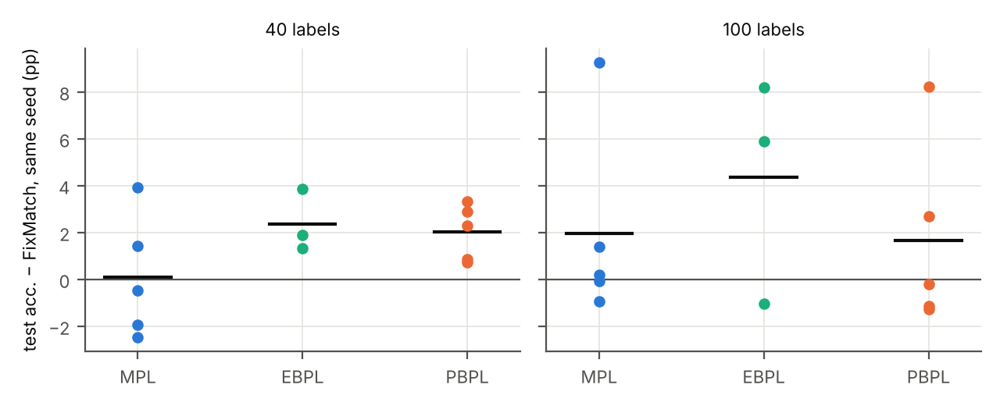

# Báo cáo: trust-region bilevel pseudo-labeling (PBPL / EBPL) trên FashionMNIST

> Trạng thái: bảng chính (60 run), chẩn đoán suy biến, ablation, lưới tinh chỉnh FixMatch,
> Figure 1 và đợt nhân bản seed 6–10 (PBPL, MPL, FixMatch, FixMatch tinh chỉnh; `rep-a`,
> `rep-b`) đã xong. Đợt cuối (`rep-c`, `rep-d`: EBPL, các đối chứng SAM và cặp một mạng
> lên 10 seed, phép thử thang meta-gradient chính xác) đang chạy. Mọi số liệu lấy từ `results/`.
>
> **Kết luận đến thời điểm này (Mục 10):** ở 40 nhãn, trên 10 seed, PBPL, MPL, FixMatch và
> FixMatch tinh chỉnh cách nhau dưới 1 điểm, không khác biệt nào có ý nghĩa thống kê. Ưu thế
> của PBPL ở seed 1–5 (+2.02, p = 0.019) không được nhân bản.

## 1. Thiết lập thực nghiệm

**Dữ liệu.** FashionMNIST (60k train / 10k test). Từ 60k ảnh train: 5 000 ảnh làm tập
validation (chỉ dùng để chọn siêu tham số, không bao giờ huấn luyện), 55 000 ảnh còn lại là
tập không nhãn; tập có nhãn gồm $n$ ảnh/lớp lấy cân bằng từ 55 000 ảnh đó ($n=4$: 40 nhãn,
$n=10$: 100 nhãn). Seed quyết định cả tập có nhãn; seed 0 dùng để chọn siêu tham số, seed 1–5
dùng để báo cáo (FixMatch, MPL, PBPL: 5 seed; các phương pháp khác: seed 1–3), seed 6–10 là
đợt nhân bản quyết định *sau* khi xem bảng chính và được báo cáo riêng. Kết quả là accuracy trên 10k ảnh test của mô hình EMA tại vòng lặp
cuối cùng (không chọn checkpoint theo test).

**Mô hình và huấn luyện (chung cho mọi phương pháp).** CNN kiểu VGG 6 lớp conv + BN +
LeakyReLU, 0.157M tham số. SGD Nesterov momentum 0.9, lr 0.03 cosine (lịch FixMatch), weight
decay 5e-4, batch 64 ảnh có nhãn + 448 ảnh không nhãn ($\mu=7$), 20 000 vòng lặp, EMA 0.999,
fp16 autocast. Augment trên GPU: yếu = dịch ngẫu nhiên 4px + lật ngang; mạnh = yếu +
RandAugment(2 phép, mỗi phép xác suất 0.5, cường độ 0.1–0.9) + Cutout 14px.

**Baseline.** Supervised (chỉ dữ liệu có nhãn), Pseudo-Label (ngưỡng 0.95), Mean Teacher
(MSE, $\lambda=50$, warm-up tuyến tính 40%), FixMatch ($\tau=0.95$, $\lambda_u=1$), FlexMatch
(ngưỡng theo lớp, warm-up). Siêu tham số baseline lấy mặc định từ bài gốc / USB, không tinh
chỉnh.

**Phương pháp đề xuất.** Teacher = mô hình triển khai, huấn luyện bằng CE + FixMatch +
$\lambda_m L_{\rm meta}$; student phụ cùng kiến trúc, không bao giờ thấy ảnh có nhãn, học từ
pseudo-label mềm của teacher trên ảnh augment mạnh. $L_{\rm meta}$ là feedback bilevel một
bước (Mục 3 của `docs/theory.md`):
- **MPL** (optimistic): $v=\nabla L_l(\theta')$;
- **PBPL** (pessimistic, bán kính cứng $r$): $v=\nabla L_l(\theta'+\varepsilon)$, $\varepsilon$
  là adversary giữ trạng thái trên fiber của student;
- **EBPL** (expected): $v=\nabla L_l(\theta'+\xi)$, $\xi$ nhiễu đẳng hướng được co về fiber.

Siêu tham số của ba biến thể bilevel ($\lambda_m$, $r$, cách chuẩn hóa feedback) được chọn
theo accuracy validation ở seed 0, 40 nhãn, 10k vòng lặp, cùng ngân sách cho cả ba.

**Ablation (40 nhãn).** SAM-feedback ($\varepsilon$ reset mỗi bước = một bước SAM từ 0, mù
với $X_u$), PBPL một mạng (look-ahead của chính teacher), FixMatch + fiber-SAM (PBPL tâm tại
teacher, một mạng), FixMatch + SAM trên labeled loss, PBPL + FlexMatch.

**Chẩn đoán suy biến (Prop. N2 trên CNN thật, `checks/degeneracy_static.py`).** Huấn luyện
một mạng chỉ trên dữ liệu có nhãn; tại các checkpoint $w_k$ lập cặp supervised-only
(teacher = student = $w_k$, input sạch, 448 ảnh không nhãn không giao tập có nhãn, BN dùng
thống kê của chính batch như feedback lúc huấn luyện), nên cặp tự nhất quán chính xác
($\theta'=\theta$). Đo chuẩn meta-gradient của teacher $\|g_T\|$ khi $w_k$ khớp dần nhãn, cho:
optimistic ($\varepsilon=0$); pessimistic ($\varepsilon$ = iterate *chấp nhận được* tốt nhất của
60 bước ascent-rồi-co, K = 5 bước co, KL trung bình tới anchor trên $X$ ≤ 2·10⁻³, $r\in\{0.1,0.3\}$);
expected (16 hướng ngẫu nhiên bán kính 3 co về fiber); và đối chứng SAM không ràng buộc
($\varepsilon=r\,g/\|g\|$, rời fiber). 3 seed, 100 nhãn, checkpoint 250…8000 vòng. Bản động
(khởi đầu từ cặp supervised-only rồi chạy động học với meta-gradient không chuẩn hóa,
$\lambda_m=30$) đã bị loại: bước meta quá lớn phá teacher ngay sau warm-up ở cả ba biến thể.

## 2. Pilot và ba lỗi thiết kế được phát hiện

1. **Feedback không held-out.** Bản đầu cho student dùng toàn bộ tập không nhãn (chứa cả 40
   ảnh có nhãn, theo quy ước FixMatch). Student học thuộc chúng qua pseudo-label đúng của
   teacher, labeled loss của student xuống 0.015 và feedback MPL triệt tiêu; ảnh có nhãn
   cũng ghim fiber nên PBPL mất "khoảng pessimistic". Kết quả (40 nhãn, seed 0, 20k vòng):
   FixMatch 72.5%, MPL 71.4%, PBPL 68.3%. Sửa: nhánh student loại ảnh có nhãn
   (`--stu_excl_lab 1`, Remark 2.6 trong `docs/theory.md`).
2. **Bộ giải bài toán trong.** Một bước ascent chuẩn hóa trên $L_l-\beta\,\mathrm{KL}$ không
   tìm được nghiệm trên fiber: trên toy MLP, cos với hướng nghiệm đúng chỉ 0.10–0.46 (β = 10…1000).
   Bộ giải "ascent rồi co về fiber" (K bước giảm KL với bước Rayleigh) đạt cos 0.61–0.68 với
   KL tới anchor 6·10⁻⁶ (`checks/check_nondegeneracy.py`).
3. **Chẩn đoán tĩnh phải ở lại trên fiber.** Bản đầu của chẩn đoán suy biến dùng BN ở eval
   mode và K = 2: adversary "pessimistic" rời fiber (KL tới anchor 0.11 với $r=0.1$, 1.17 với
   $r=0.3$), tức không còn là student chấp nhận được, nên bị hủy. Với BN theo batch (như lúc
   huấn luyện) và K = 5, mọi iterate $r=0.1$ đều có KL ≤ 2·10⁻³ (thử trên 1 seed: KL
   7–8·10⁻⁴); với K = 2 chỉ 13–19% iterate chấp nhận được. Lúc huấn luyện K = 2 là đủ vì
   adversary được giữ trạng thái qua các vòng lặp (KL ≈ 2·10⁻³ trong bảng sàng lọc).

## 3. Chọn siêu tham số (validation, seed 0, 40 nhãn, 10k vòng)

| cấu hình | val | test | pseudo-label đúng (trong mask) |
|---|---|---|---|
| FixMatch | 74.08 | 74.87 | 78.4 |
| FlexMatch | 73.48 | 73.57 | 75.4 |
| MPL, λ_m = 0.1 (tốt nhất trong 6 cấu hình) | 73.80 | 74.08 | 79.9 |
| **PBPL, λ_m = 0.1, r = 0.1 (tốt nhất trong 12)** | **76.50** | **75.12** | **80.6** |
| EBPL, λ_m = 0.3, r = 3 (tốt nhất trong 6) | 73.40 | 72.10 | 77.5 |

Xu hướng rõ nhất: λ_m ≥ 0.3 làm hại cả ba biến thể (ví dụ PBPL r = 0.3: 73.9 → 72.3 → 68.5 khi
λ_m = 0.1 → 0.3 → 1.0); thang meta-gradient chính xác (không chuẩn hóa) kém hơn chuẩn hóa
RMS chạy. Bán kính quá lớn (r = 1) đẩy adversary ra khỏi fiber (KL 0.1–0.2, labeled loss của
student pessimistic tăng tới 3.4). Trên một seed, ưu thế của PBPL trên test chỉ +0.25 điểm;
vì vậy bảng chính dùng 5 seed và so sánh cặp.

Chẩn đoán khớp lý thuyết: với PBPL, labeled loss held-out của anchor giảm 0.86 → 0.10 trong
khi labeled loss của student pessimistic ($r=0.1$) dừng ở ≈ 0.30 — feedback optimistic gần
như tắt, feedback pessimistic thì không. Với EBPL ($r=3$) nhiễu ngẫu nhiên gần như không đổi
labeled loss (0.04 so với 0.04) và feedback gần trùng MPL (cos 0.90): biến thể expected yếu
như dự đoán bậc $s^2$.

## 4. Kết quả chính (20k vòng, mô hình EMA ở vòng lặp cuối)

FixMatch, MPL và PBPL chạy 5 seed (1–5) để so sánh cặp; các phương pháp còn lại 3 seed (1–3).
Dữ liệu: `results/fmnist-ssl-main-{a,b}`; bảng sinh bởi `analysis/main_table.py`
(`docs/main_table.md`).

| phương pháp | 40 nhãn | 100 nhãn |
|---|---|---|
| Supervised | 56.88 ± 1.23 (n=3) | 69.50 ± 0.70 (n=3) |
| Pseudo-Label | 64.18 ± 1.29 (n=3) | 74.71 ± 1.32 (n=3) |
| Mean Teacher | 58.16 ± 0.59 (n=3) | 67.45 ± 1.08 (n=3) |
| FixMatch | 70.96 ± 3.69 (n=5) | 79.68 ± 3.76 (n=5) |
| FlexMatch | 71.11 ± 2.32 (n=3) | 77.88 ± 1.55 (n=3) |
| MPL + FixMatch (optimistic) | 71.06 ± 4.11 (n=5) | 81.65 ± 3.35 (n=5) |
| **EBPL + FixMatch (expected)** | **73.00 ± 3.49** (n=3) | **81.88 ± 1.54** (n=3) |
| **PBPL + FixMatch (pessimistic)** | **72.98 ± 3.38** (n=5) | 81.34 ± 4.08 (n=5) |

Độ lệch chuẩn giữa các seed lớn (3–4 điểm) vì seed quyết định *tập có nhãn*; so sánh có ý
nghĩa là so sánh cặp trên cùng seed:

| so với FixMatch, cùng seed | 40 nhãn | 100 nhãn |
|---|---|---|
| MPL (optimistic) | +0.10 ± 2.62, thắng 2/5, p = 0.94 | +1.97 ± 4.16, 3/5, p = 0.35 |
| EBPL (expected) | +2.36 ± 1.32, thắng 3/3, p = 0.09 | +4.36 ± 4.80, 2/3, p = 0.26 |
| **PBPL (pessimistic)** | **+2.02 ± 1.18, thắng 5/5, p = 0.019** | +1.66 ± 3.99, 2/5, p = 0.41 |
| FlexMatch | +0.46 ± 3.54, 1/3 | +0.36 ± 2.72, 1/3 |

(p: t-test cặp hai phía; với 5/5 seed, sign test hai phía cho p = 0.0625.) **Dòng PBPL ở 40
nhãn không được nhân bản:** trên seed 6–10 chênh lệch là −0.87 ± 3.87 (2/5), gộp 10 seed
+0.58 ± 3.10 (7/10, p = 0.57); xem Mục 9. Các baseline cổ
điển kém xa: tính theo trung bình (không cặp), PBPL hơn Pseudo-Label 8.8 / 6.6 điểm, Mean
Teacher 14.8 / 13.9, Supervised 16.1 / 11.8 điểm (40 / 100 nhãn).

Đọc kết quả:

- **40 nhãn.** PBPL + FixMatch hơn FixMatch trên cả 5 seed (+0.7 đến +3.3 điểm). EBPL hơn
  trên cả 3 seed. MPL (cùng kiến trúc hai mạng, cùng λ_m, chỉ khác quy tắc feedback) thì
  không (+0.1, 2/5). So trực tiếp PBPL với MPL: +1.93 ± 3.64 (3/5, p = 0.30); EBPL với MPL:
  +2.86 (3/3, p = 0.14). Hướng đúng như lý thuyết, nhưng với 5 seed thì chưa có ý nghĩa thống kê,
  và **đợt nhân bản không xác nhận cả hai điều**: trên seed 6–10, PBPL kém FixMatch 0.87 điểm
  và kém MPL 1.84 điểm (Mục 9).
- **100 nhãn.** Cả ba biến thể bilevel hơn FixMatch trung bình 1.7–4.4 điểm, nhưng phần lớn
  nhờ seed 3, nơi FixMatch chỉ đạt 75.0 (mọi biến thể bilevel +8 điểm). Ở các seed còn lại
  PBPL và MPL nằm trong khoảng −1.3 đến +2.7 điểm; EBPL +5.9 ở seed 2, −1.0 ở seed 1. PBPL không hơn MPL (−0.31, 1/5). Ở mức 100 nhãn, lợi ích
  (nếu có) là của *bilevel feedback nói chung*; không thấy riêng phần pessimistic.
- **Chi phí** (một T4, 20k vòng): FixMatch 11.3 phút, MPL 27.9, EBPL 37.9, PBPL 40.6
  (3.6× FixMatch). Phần thêm là student phụ, JVP và K = 2 bước co về fiber mỗi vòng lặp.

### 4.1 Lợi thế ở 40 nhãn đến từ đâu: chống suy giảm cuối huấn luyện

Trung bình 5 seed, FixMatch (40 nhãn) đạt đỉnh 72.8% ở vòng 7k rồi giảm còn 71.0% ở vòng
20k. Accuracy của pseudo-label vượt ngưỡng giảm từ 78.1% xuống 73.9%: đây là confirmation
bias. Mức giảm từ đỉnh đến cuối theo từng seed là 2.9 / 9.1 / 2.8 / 0 / 0 điểm. PBPL không
suy giảm như vậy: giảm trung bình 1.0 điểm, pseudo-label giữ ở 77%, test tăng đến cuối. EBPL
giảm 0.2 điểm. MPL ít suy giảm (0.9) nhưng đỉnh thấp hơn (71.1%).

Hệ quả cần nói rõ: nếu được phép **dừng sớm theo validation** (chọn checkpoint có val
accuracy cao nhất trên 5 000 ảnh validation có nhãn), FixMatch đạt 73.84 ± 3.99 so với
73.90 ± 3.44 của PBPL ở 40 nhãn. Chênh lệch +0.05, thắng 3/5, p = 0.98, nên lợi thế biến mất
(100 nhãn: +1.46, 3/5, p = 0.35; `main_table.py --select val`). Vậy ở 40 nhãn, PBPL **không
nâng đỉnh accuracy** mà **giữ được đỉnh đến cuối huấn luyện**. Trong SSL thật không có tập
validation có nhãn lớn gấp 125 lần tập huấn luyện để dừng sớm, nên giao thức vòng lặp cuối
(như FixMatch/USB) là giao thức chính. Dù vậy, cách diễn giải đúng là "ổn định hơn", không
phải "tốt hơn ở mọi giao thức".

**Cập nhật sau nhân bản (Mục 9):** ngay cả "ổn định hơn" cũng không đứng vững. Trên 10 seed,
mức giảm từ đỉnh đến cuối trung bình là FixMatch 1.84, PBPL 1.24, FixMatch tinh chỉnh
($\lambda_u=2$) 0.79, MPL 0.63 điểm. Mức giảm lớn của FixMatch tập trung ở seed 1–5 (2.96 điểm
trung bình, so với 0.72 ở seed 6–10), tức đúng nhóm seed mà bảng chính dùng.

### 4.2 Feedback trong lúc huấn luyện

- **PBPL** (cam): labeled loss held-out của student pessimistic dừng ở khoảng 0.2–0.3 sau
  vòng 5k, trong khi của anchor giảm còn 0.07 (40 nhãn) / 0.11 (100 nhãn). Chuẩn feedback thô
  $\|c_{\rm pess}\|/\|c_{\rm opt}\|$ (cùng anchor) tăng từ 1.2 (vòng 1k) lên 2.8 (vòng 20k) ở
  40 nhãn (100 nhãn: 1.1 → 1.8). Cosine giữa feedback pessimistic và optimistic giảm từ 0.95
  xuống 0.77 (100 nhãn: 0.95 → 0.88). Đúng như Prop. N3:
  khi anchor khớp dần dữ liệu có nhãn, phần feedback mà MPL không có (gradient của phần
  labeled gradient "vô hình" với dữ liệu không nhãn) ngày càng chiếm ưu thế.
- **MPL** (xanh dương): chuẩn feedback thô giảm từ 22 xuống 12.5 ở 40 nhãn (100 nhãn: không
  giảm, 24 → 25), không triệt tiêu. Student held-out không bao giờ khớp hết nhãn (labeled loss 0.05 ở vòng 20k), nên
  huấn luyện thật còn xa điểm bất động chính xác của Prop. N2. Phép thử sạch là chẩn đoán
  tĩnh ở Mục 5.
- **EBPL** (xanh lá): labeled loss của student nhiễu ≈ của anchor (0.036 so với 0.025), cosine
  với feedback optimistic 0.84–0.97. Tín hiệu bậc $s^2$ nhỏ như dự đoán, nên **cơ chế
  không suy biến không giải thích được** việc EBPL bằng PBPL về accuracy (3 seed). Các khác
  biệt khác với MPL là λ_m = 0.3 (gấp 3 MPL; feedback đã chuẩn hóa RMS nên đây là bước meta
  lớn gấp 3) và nhiễu ngẫu nhiên trong hướng feedback. Chưa có ablation tách hai yếu tố này.

## 5. Chẩn đoán suy biến trên CNN thật (Prop. N2, tĩnh)

Giao thức ở Mục 1 (`checks/degeneracy_static.py`, 3 seed, chạy CPU; dữ liệu
`results/local/degeneracy_static_s{1,2,3}.json`). Giá trị trung bình 3 seed:

| vòng | $L_l(w_k)$ | $\|g_T\|$ opt | pess r=0.1 | KL | pess r=0.3 | tỉ lệ iterate hợp lệ (r=0.3) | exp r=3 | KL | SAM r=0.1 | KL |
|---|---|---|---|---|---|---|---|---|---|---|
| 250 | 2.0e-02 | 0.411 | 0.968 | 7.1e-04 | 0.65 | 0.05 | 0.411 | 6.1e-03 | 3.49 | 0.13 |
| 500 | 1.2e-03 | 0.0243 | 0.86 | 6.5e-04 | 0.0447 | 0.04 | 0.0324 | 9.2e-03 | 2.32 | 0.15 |
| 1000 | 4.4e-04 | 0.0185 | 2.06 | 1.2e-03 | 0.06 | 0.03 | 0.113 | 2.5e-02 | 3.70 | 0.16 |
| 2000 | 2.4e-04 | 0.0312 | 5.55 | 1.5e-03 | 0.043 | 0.03 | 0.239 | 3.6e-02 | 25.5 | 0.41 |
| 4000 | 1.9e-04 | 0.00888 | 1.54 | 1.6e-03 | 0.0354 | 0.04 | 0.0147 | 9.6e-03 | 5.13 | 0.21 |
| 8000 | 1.1e-04 | 0.0139 | 1.28 | 1.7e-03 | 0.0175 | 0.03 | 0.584 | 3.1e-02 | 39.9 | 0.39 |

- **Optimistic suy biến như Prop. N2(a).** Khi $L_l(w_k)$ giảm từ 2·10⁻² xuống 1·10⁻⁴,
  $\|g_T\|$ optimistic giảm từ 0.16–0.71 (vòng 250) xuống 0.003–0.03 (vòng 8000) theo
  $\|\nabla L_l\|$.
- **Pessimistic không suy biến như N2(b)**, với student *chấp nhận được* (KL tới anchor
  ≤ 2·10⁻³). Ở $r=0.1$, $\|g_T\|$ giữ ở 0.4–9 suốt quá trình (trừ một ngoại lệ dưới đây). Sau vòng 250, tỉ lệ so với
  optimistic là 24–679 lần ở 14/15 cặp (seed, checkpoint), trung vị 134 lần. Ngoại lệ là
  seed 3 ở vòng 8000: chỉ 7% iterate của bộ giải hợp lệ, iterate hợp lệ tốt nhất nằm gần
  điểm xuất phát, tỉ lệ chỉ 2 lần. Đây là giới hạn của bộ giải (fiber cong mạnh, K = 5 bước co
  không đủ), không phải feedback triệt tiêu.
- **r = 0.3 không kiểm định được N2(b).** Chỉ 2–8% iterate hợp lệ, iterate hợp lệ tốt nhất
  gần điểm xuất phát (một điểm ngẫu nhiên trên fiber), tỉ lệ 1–6 lần. Bán kính này vượt quá
  vùng mà bộ giải ascent-rồi-co giữ được trên fiber, phù hợp với việc sàng lọc chọn r = 0.1
  (Mục 3: r = 1 cho KL 0.1–0.2).
- **Expected nhỏ như N2(d)** (bậc $s^2$): trung vị 2.4 lần optimistic. Mẫu chỉ hợp lệ xấp xỉ
  (KL 5·10⁻³–6.5·10⁻²); các giá trị lớn (ví dụ 55 lần ở seed 3, vòng 8000) đi kèm KL lớn,
  tức có rò rỉ ra khỏi fiber.
- **Đối chứng SAM không ràng buộc** cho $\|g_T\|$ lớn nhất (1.3–107) nhưng KL 0.09–0.73. Nó
  đổi dự đoán của student trên $X$ rất nhiều, nên không phải student chấp nhận được. Đây
  chính là feedback "mù với $X_u$" mà ràng buộc fiber loại bỏ (lỗ hổng A4 của review).

Tóm lại, trên CNN thật, tại các cặp supervised-only (điểm bất động của MPL), feedback
pessimistic trên fiber lớn hơn feedback optimistic hai bậc độ lớn và không giảm khi mạng khớp
nhãn. Đây là phiên bản thực nghiệm của định lý không suy biến, với điều kiện bộ giải trong ở
lại trên fiber.

## 6. Ablation (40 nhãn, seed 1–3)

Dữ liệu `results/fmnist-ssl-ablate-{a,b}`; bảng sinh bởi `analysis/ablation_table.py` (đỉnh,
mức giảm cuối, chẩn đoán trung bình 3 lần đánh giá cuối) và `analysis/main_table.py --ref pbpl`
(so sánh cặp). Seed 4–5 của SAM-feedback và PBPL một mạng không vừa ngân sách của `rep-b`
và được chạy trong `rep-c`, cùng các seed 4–10 của hai đối chứng SAM (`rep-d`).

| biến thể (40 nhãn, seed 1–3) | cuối | đỉnh | giảm cuối | chọn theo val | − FixMatch (cặp) | − PBPL (cặp) | $L_l$ student bị đẩy | cos(c, c_opt) | phút/run |
|---|---|---|---|---|---|---|---|---|---|
| FixMatch | 70.65 | 72.54 | 1.90 | 72.54 | — | −2.36 ± 1.32, 0/3 | — | — | 11.3 |
| MPL (optimistic) | 70.15 | 71.22 | 1.07 | 71.18 | −0.50 ± 1.96, 1/3 | −2.86 ± 3.08, 1/3 | 0.082 (= anchor) | 1 | 27.7 |
| **PBPL** | 73.01 | 74.02 | 1.01 | 73.98 | +2.36 ± 1.32, 3/3, p = 0.09 | — | 0.271 (anchor 0.124) | 0.83 | 40.5 |
| SAM-feedback ($\varepsilon=r\,g/\|g\|$ reset mỗi bước, không co về fiber) | 74.06 | 74.18 | 0.12 | 74.14 | +3.41 ± 0.41, 3/3, p = 0.005 | +1.05 ± 1.37, 2/3, p = 0.31 | 0.457 (anchor 0.150) | 0.80 | 29.2 |
| PBPL một mạng (look-ahead của chính teacher) | 73.37 | 74.37 | 1.00 | 74.37 | +2.72 ± 1.39, 3/3, p = 0.08 | +0.36 ± 0.72, 2/3, p = 0.47 | 0.057 (anchor 0.0016) | 0.33 | 38.9 |
| FixMatch + SAM trên labeled loss (một mạng, không bilevel, $r=0.1$) | 74.74 | 74.83 | 0.08 | 74.62 | +4.10 ± 4.95, 2/3, p = 0.29 | +1.74 ± 5.01, 2/3, p = 0.61 | teacher 0.0017 | — | 13.6 |
| FixMatch + fiber-SAM (bước pessimistic trên fiber, tâm tại teacher, không student) | 75.09 | 75.18 | 0.10 | 75.08 | +4.44 ± 6.17, 2/3, p = 0.34 | +2.08 ± 6.07, 2/3, p = 0.61 | teacher 0.0013 | — | 22.7 |
| PBPL + FlexMatch (so với FlexMatch 71.11) | 73.59 | 75.06 | 1.46 | 75.02 | +2.48 ± 5.96 so với FlexMatch, 2/3, p = 0.55 | +0.59 ± 3.77, 2/3, p = 0.81 | 0.295 (anchor 0.128) | 0.83 | 38.9 |

Đọc kết quả:

- **Ràng buộc fiber không cần cho accuracy.** Ở SAM-feedback, student được đẩy một bước bán
  kính $r=0.1$ theo hướng gradient labeled loss, reset mỗi vòng lặp và không co về fiber, tức
  *không* phải student chấp nhận được. Biến thể này ít nhất bằng PBPL (+1.05 ± 1.37 điểm,
  2/3 seed, p = 0.31), rẻ hơn (29 so với 41 phút) và cũng không suy giảm cuối huấn luyện
  (giảm 0.12 điểm). Vậy ở 40 nhãn, cái chống suy giảm là *lấy feedback tại một student bị đẩy
  về phía labeled loss cao hơn*, không phải tính chấp nhận được mà định nghĩa pessimistic đòi
  hỏi. Điều này khớp với chẩn đoán tĩnh (Mục 5): SAM-feedback cũng không triệt tiêu tại các cặp
  supervised-only, chỉ là nó rời fiber. Trong huấn luyện, việc rời fiber với $r=0.1$ không gây hại.
- **Một mạng là đủ.** PBPL dạng look-ahead của chính teacher (không có student phụ) ngang PBPL
  hai mạng (+0.36 ± 0.72). Ở đây anchor là teacher đã thấy dữ liệu có nhãn, nên labeled loss
  của anchor chỉ 0.0016: đúng vùng feedback optimistic suy biến (Prop. N2a). Feedback
  pessimistic lớn gấp 39 lần và gần trực giao với optimistic (cos 0.33). Đối chứng optimistic
  một mạng (`abl_selfopt`) là phép thử trực tiếp lập luận không suy biến *trong lúc huấn
  luyện*, vì ở cấu hình hai mạng student held-out không bao giờ khớp hết nhãn (Mục 4.2). Kết
  quả ở Mục 6.1: bản optimistic tốt hơn.
- Nếu chọn checkpoint theo validation, mọi biến thể có feedback bị đẩy (PBPL, SAM-feedback,
  một mạng) nằm trong 73.98–74.37, hơn FixMatch 1.4–1.8 điểm (2/3 hoặc 3/3 seed, p ≥ 0.24).

- **Một regularizer không bilevel làm được điều tương tự.** SAM trên labeled loss của chính
  teacher không có student, không có feedback qua pseudo-label, chi phí 1.2× FixMatch. Nó đạt
  74.74 trung bình và không suy giảm cuối huấn luyện (0.08 điểm), cao hơn PBPL 1.7 điểm. Phương
  sai lớn: theo seed, so với FixMatch là +4.5 / +8.8 / −1.1 điểm, còn PBPL là +0.8 / +3.3 / +2.9.
  Fiber-SAM (bước pessimistic có ràng buộc fiber nhưng tâm tại teacher) cho kết quả gần như SAM
  thường (+4.3 / +10.6 / −1.7). Ba seed không đủ để xếp hạng ba phương pháp. Điều chắc chắn là
  **dữ liệu không cho phép quy lợi ích của PBPL ở 40 nhãn cho feedback bilevel**: một bước SAM
  trên labeled loss, rẻ hơn 3 lần, cho lợi ích ít nhất tương đương. Kiểu lợi ích cũng khác nhau.
  SAM giúp nhiều nhất ở seed FixMatch sụp đổ (seed 2: 65.9 → 74.7), còn PBPL đều hơn giữa các seed.
  SAM trên labeled loss được chạy thêm seed 4–10 (`rep-c`) để so với PBPL trên 10 seed.
- **PBPL + FlexMatch** hơn FlexMatch +2.48 ± 5.96 điểm (2/3 seed). Regularizer chuyển được sang
  base khác, cùng lưu ý về phương sai; ở seed 2 nó kém FlexMatch (66.0 so với 70.4).

### 6.1 Đối chứng optimistic một mạng: phép thử lý thuyết trong lúc huấn luyện

`abl_selfopt` giống hệt PBPL một mạng (`abl_self`), chỉ khác quy tắc feedback: $v=\nabla
L_l(\theta')$ thay cho $\nabla L_l(\theta'+\varepsilon)$, cùng $\lambda_m=0.1$ và cùng chuẩn
hóa. Dữ liệu `results/fmnist-ssl-rep-b`. Chỉ seed 1–2 vừa ngân sách kernel; seed 3–10 chạy
trong `rep-c`/`rep-d`.

| một mạng, 40 nhãn, seed 1–2 | cuối | đỉnh | giảm cuối | chọn theo val | $L_l$ anchor (vòng 20k) | $\|c\|$ thô, vòng 1k → 20k | phút/run |
|---|---|---|---|---|---|---|---|
| optimistic (`abl_selfopt`) | 75.90 | 75.98 | 0.08 | 75.86 | 3–7·10⁻⁴ | 8.6 → 0.44 (s1); 7.8 → 0.27 (s2) | 27.6 |
| pessimistic (`abl_self`) | 72.42 | 73.93 | 1.51 | 73.93 | 5–7·10⁻⁴ | 42 → 32 (s1); 16 → 41 (s2) | 39.0 |
| FixMatch (tham chiếu) | 70.32 | 73.17 | 2.85 | 73.16 | — | — | 11.3 |

Optimistic − pessimistic = +3.47 ± 0.86 điểm (seed 1: 78.9 so với 76.0; seed 2: 72.9 so với
68.9).

- **Về độ lớn feedback, lý thuyết đúng.** Ở cấu hình một mạng anchor khớp nhãn (labeled loss
  3–7·10⁻⁴), và chuẩn feedback optimistic thô giảm 20–30 lần trong lúc huấn luyện, đúng như
  N2(a). Feedback pessimistic thì không giảm: ở vòng 20k nó lớn gấp 50–65 lần feedback
  optimistic tính trên cùng anchor.
- **Về accuracy, kết quả ngược với điều lý thuyết gợi ý.** Bản optimistic hơn bản pessimistic
  3.47 điểm trên cả 2 seed và gần như không suy giảm cuối huấn luyện (0.08 so với 1.51 điểm).
  Hai seed là quá ít để xếp hạng, nhưng đủ để thấy feedback optimistic suy biến không làm
  phương pháp sụp về FixMatch.
- **Giải thích phù hợp với log: chuẩn hóa RMS chạy (`--meta_norm 2`).** Feedback được chia cho
  RMS chạy của chính nó trước khi vào $L_{\rm meta}$. Cách chuẩn hóa này được chọn ở Mục 3 vì
  tốt hơn thang meta-gradient chính xác. Khi feedback optimistic co lại, RMS chạy co theo,
  nên bước meta vẫn có độ lớn cỡ 1: từ vòng 9k đến 20k, $L_{\rm meta}$ sau chuẩn hóa nằm
  trong khoảng −0.5 đến +0.1 ở cả hai biến thể (trung vị −0.08 / −0.11 với optimistic,
  −0.07 / −0.15 với pessimistic, seed 1 / 2), dù chuẩn thô chênh nhau 20–100 lần (optimistic
  0.27–6.2, pessimistic 8.4–64). Như vậy chuẩn hóa xóa đúng
  thứ mà N2(a) nói tới (độ lớn tiến về 0). Chỉ còn *hướng* của feedback, và hướng gradient
  labeled loss tại một mạng gần khớp nhãn vẫn mang thông tin. Với cài đặt này, định lý không
  suy biến không phân biệt được hai biến thể về accuracy.
- **Phép thử còn lại.** Ở thang chính xác (`--meta_norm 0`), feedback optimistic thực sự tắt
  dần. Một lượt sàng lọc cặp một mạng ở thang này (seed 0, 10k vòng, $\lambda_m\in\{3, 10\}$)
  nằm trong `rep-d`. Ở cấu hình hai mạng, thang chính xác với $\lambda_m$ = 10–100 làm hỏng mọi
  biến thể (val 0.64–0.69 so với 0.74 của FixMatch, Mục 3), nên cần $\lambda_m$ nhỏ hơn.

## 7. Tinh chỉnh FixMatch: đối chứng công bằng

Bảng chính dùng FixMatch mặc định ($\tau=0.95$, $\lambda_u=1$), trong khi PBPL được chọn trong 12
cấu hình. Để cân bằng, lưới $\tau\in\{0.8, 0.9, 0.95\}\times\lambda_u\in\{1, 2\}$ (6 cấu hình,
gồm mặc định) được chạy theo đúng giao thức đã dùng để chọn PBPL: seed 0, 40 nhãn, 10k vòng,
chọn theo val ở vòng cuối.

| cấu hình (seed 0, 40 nhãn, 10k vòng) | val | test |
|---|---|---|
| **FixMatch, τ = 0.95, λ_u = 2** | **78.04** | **77.71** |
| PBPL đã chọn (λ_m = 0.1, r = 0.1; phần FixMatch mặc định) | 76.50 | 75.12 |
| FixMatch, τ = 0.8, λ_u = 2 | 74.46 | 75.06 |
| FixMatch, τ = 0.9, λ_u = 2 | 74.42 | 75.25 |
| FixMatch, τ = 0.8, λ_u = 1 | 74.32 | 75.25 |
| FixMatch, τ = 0.95, λ_u = 1 (mặc định, bảng chính) | 74.08 | 74.87 |
| FixMatch, τ = 0.9, λ_u = 1 | 72.52 | 72.43 |

Trên chính giao thức đã dùng để chọn PBPL, FixMatch với $\lambda_u=2$ vượt cấu hình PBPL được
chọn (val +1.5, test +2.6 điểm). Đây chỉ là một seed, trong khi độ lệch giữa các seed ở 40
nhãn là 3–4 điểm, nên chưa đủ để kết luận. Nhưng nó cho thấy bảng chính đặt PBPL đã tinh chỉnh
cạnh FixMatch chưa tinh chỉnh. Cấu hình này ("FixMatch tinh chỉnh") đã chạy theo giao thức
chính trên seed 1–10 (`results/fmnist-ssl-rep-b`):

| 40 nhãn, seed 1–10 | vòng cuối | chọn theo val | giảm cuối | phút/run |
|---|---|---|---|---|
| FixMatch mặc định ($\lambda_u=1$) | 72.75 ± 3.76 | 74.52 ± 3.46 | 1.84 | 11.1 |
| FixMatch tinh chỉnh ($\lambda_u=2$) | 73.71 ± 3.66 | 74.41 ± 3.68 | 0.79 | 10.9 |
| PBPL + FixMatch mặc định | 73.32 ± 3.10 | 74.46 ± 2.93 | 1.24 | 40.3 |

- **FixMatch tinh chỉnh − FixMatch:** +0.96 ± 1.52 điểm ở vòng cuối (6/10, p = 0.078); theo
  val −0.10 ± 1.98 (5/10). Tinh chỉnh không nâng đỉnh mà giảm suy giảm cuối huấn luyện (1.84 →
  0.79 điểm). Đây đúng là kiểu lợi ích mà Mục 4.1 từng gán cho PBPL, nhưng với chi phí của
  FixMatch.
- **PBPL − FixMatch tinh chỉnh:** −0.38 ± 3.43 (5/10, p = 0.73); theo val +0.05 ± 3.54 (6/10,
  p = 0.97).
- PBPL trên base đã tinh chỉnh ($\lambda_u=2$, giữ $\lambda_m$, $r$) không được chạy. PBPL đã
  không hơn chính base của nó trên 10 seed, nên ngân sách đợt cuối được dành cho việc đưa các
  biến thể còn lại lên 10 seed (Mục 10).

## 8. Figure 1 của bản thảo theo giao thức của review

`checks/figure1_fmnist.py` (giao thức Sec. 6.2 của review; dữ liệu
`results/fmnist-ssl-ablate-b/results/figure1.json`; 161 phút trên một T4):

1. pseudo-label = nhãn thật, lật ngẫu nhiên một tỉ lệ ρ, làm mềm (độ tin 0.9);
2. anchor $a$ huấn luyện *chỉ* trên $L_u$ từ một init cố định (1 500 bước Adam, 2 000 ảnh không nhãn);
3. student pessimistic / optimistic = projected ascent / descent trên $\pm L_l-\beta L_u$
   ($\beta=10$) trong $B(a, r)$, $r=0.3\,\|a-\theta_0\|$, 2 lần khởi động × 300 bước;
4. chỉ nhận iterate có $L_u\le 2\,L_u(a)$.

3 seed × 6 mức ρ. 3/18 ô có anchor không khớp pseudo-label ($L_u(a)$ = 0.14–2.4) bị loại, vì
ở đó dung sai $2L_u(a)$ nhận cả những student xa fiber.

- Labeled loss của anchor tăng đều theo ρ (0.61 → 1.83). Nhiễu pseudo-label truyền sang
  labeled loss của trajectory student như dự đoán.
- **Khoảng pessimistic–optimistic gần như bằng 0:** $L_l$(pess) − $L_l$(opt) = 2–7·10⁻³ nats ở
  mọi ρ, và iterate được nhận cách anchor 0–0.24, tức ≤ 6% bán kính. Với dung sai $2L_u(a)$
  ($L_u(a)\approx 10^{-3}$), tập chấp nhận được mà bộ giải bậc nhất nhìn thấy gần như chỉ là
  chính anchor. Hình 1 của bản thảo (khoảng cách lớn giữa student pessimistic và optimistic,
  tăng theo ρ) **không tái lập được** với giao thức này.
- Điều này không mâu thuẫn với Mục 5. Không suy biến là về *gradient* của giá trị pessimistic:
  nó khác 0 với mọi $r>0$, kể cả khi giá trị chỉ tăng chút ít. Mục 5 cũng dùng dung sai lỏng hơn
  (KL tới anchor ≤ 2·10⁻³ trên batch, BN theo batch) và bộ giải ascent-rồi-co. Ở đây dùng bộ giải
  penalty của review, bộ giải mà pilot (Mục 2, lỗi 2) đã thấy là không đáng tin. Chưa thử giao
  thức này với bộ giải ascent-rồi-co.

## 9. Nhân bản trên seed 6–10 (40 nhãn)

Seed 6–10 chưa từng được xem trước khi quyết định đợt này; cấu hình giữ nguyên như bảng chính.
Dữ liệu `results/fmnist-ssl-rep-a` (PBPL, MPL) và `results/fmnist-ssl-rep-b` (FixMatch,
FixMatch tinh chỉnh). Bảng: `main_table.py ... --seeds 6-10` và `--seeds 1-10`.

| 40 nhãn, vòng cuối | seed 6 | 7 | 8 | 9 | 10 | trung bình |
|---|---|---|---|---|---|---|
| FixMatch | 71.4 | 74.2 | 79.8 | 72.7 | 74.6 | 74.54 ± 3.20 |
| FixMatch tinh chỉnh ($\lambda_u=2$) | 71.2 | 75.5 | 80.6 | 72.7 | 74.4 | 74.88 ± 3.60 |
| MPL (optimistic) | 74.5 | 72.4 | 77.8 | 74.8 | 78.1 | 75.51 ± 2.43 |
| PBPL (pessimistic) | 70.5 | 71.9 | 73.6 | 73.6 | 78.8 | 73.67 ± 3.14 |

Gộp seed 1–10, so sánh cặp (điểm phần trăm):

| 40 nhãn, 10 seed | vòng cuối | chọn checkpoint theo val |
|---|---|---|
| PBPL − FixMatch | +0.58 ± 3.10, thắng 7/10, p = 0.57 | −0.05 ± 3.77, 7/10, p = 0.97 |
| PBPL − FixMatch tinh chỉnh | −0.38 ± 3.43, 5/10, p = 0.73 | +0.05 ± 3.54, 6/10, p = 0.97 |
| PBPL − MPL | +0.04 ± 3.47, 4/10, p = 0.97 | +0.68 ± 2.92, 7/10, p = 0.48 |
| MPL − FixMatch | +0.54 ± 2.54, 5/10, p = 0.52 | −0.74 ± 2.33, 2/10, p = 0.34 |
| FixMatch tinh chỉnh − FixMatch | +0.96 ± 1.52, 6/10, p = 0.078 | −0.10 ± 1.98, 5/10, p = 0.88 |

Trung bình 10 seed (cuối / đỉnh / giảm cuối): FixMatch 72.75 / 74.58 / 1.84; FixMatch tinh
chỉnh 73.71 / 74.50 / 0.79; MPL 73.28 / 73.91 / 0.63; PBPL 73.32 / 74.57 / 1.24.

- **Kết quả chính của Mục 4 ở 40 nhãn không được nhân bản.** Trên seed 6–10, PBPL − FixMatch
  = −0.87 ± 3.87 điểm (2/5, p = 0.64). Gộp 10 seed, mọi khác biệt giữa FixMatch, FixMatch
  tinh chỉnh, MPL và PBPL đều dưới 1 điểm và không cái nào có ý nghĩa thống kê, ở cả hai giao
  thức. Ưu thế +2.02 (5/5, p = 0.019) ở seed 1–5 trùng với nhóm seed mà FixMatch suy giảm mạnh
  cuối huấn luyện (2.96 điểm trung bình, so với 0.72 ở seed 6–10). Ở seed 6–10, FixMatch không
  có suy giảm nào đáng kể để PBPL sửa.
- **PBPL không hơn MPL.** Trên seed 6–10, PBPL − MPL = −1.84 ± 2.21 điểm (thắng 1/5, p = 0.14).
  Gộp 10 seed: +0.04 ± 3.47 (4/10, p = 0.97). Hướng "pessimistic > optimistic" ở seed 1–5
  (+1.93) là nhiễu.
- **Lần này PBPL suy giảm cuối huấn luyện** (đỉnh − cuối = 1.51 điểm trung bình; 2.7 điểm ở
  seed 7), còn MPL thì không (0.40). Vì vậy "PBPL chống được suy giảm cuối huấn luyện" (Mục 4.1)
  cũng không đứng vững như một tính chất riêng của PBPL. FixMatch tinh chỉnh còn ổn định hơn
  PBPL trên 10 seed (giảm 0.79 so với 1.24 điểm).
- Chẩn đoán feedback giống seed 1–5: labeled loss của student pessimistic 0.25 so với anchor
  0.07, $\|c\|/\|c_{\rm opt}\|$ = 2.5, cos 0.80, KL tới anchor 1.6·10⁻³. Feedback pessimistic
  vẫn không suy biến và khác hẳn feedback optimistic. Chỉ là sự khác biệt đó không chuyển thành
  accuracy.
