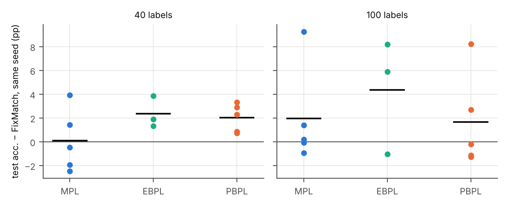
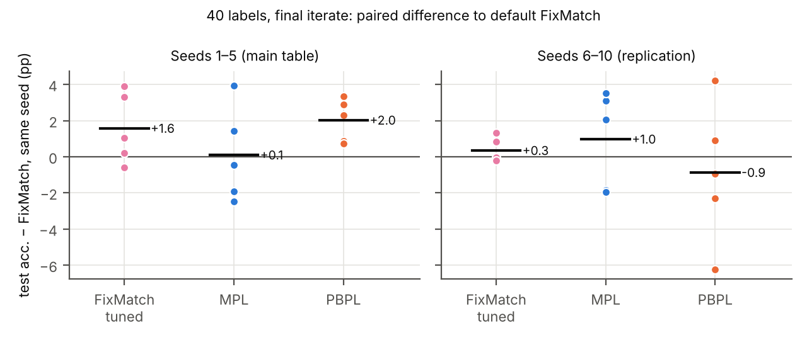
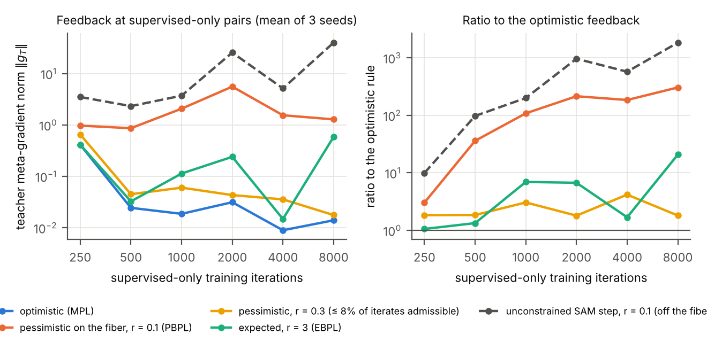

# Tóm tắt kết quả chính: PBPL / EBPL trên FashionMNIST

> Tổng hợp từ `docs/report.md` (trạng thái hiện tại; đợt `rep-c`, `rep-d` còn đang chạy).
> Accuracy test của mô hình EMA ở vòng lặp cuối, CNN 0.157M tham số, 20k vòng, 40 / 100 nhãn.

## Kết luận một dòng

Lý thuyết **không suy biến** được kiểm chứng số ở cả ba mức, nhưng về accuracy, **PBPL không vượt
FixMatch, FixMatch tinh chỉnh hay MPL ở mức có ý nghĩa thống kê**: trên 10 seed ở 40 nhãn, mọi
khác biệt dưới 1 điểm. Ưu thế ban đầu ở seed 1–5 (+2.02, p = 0.019) không được nhân bản.

## 1. Bảng chính (seed 1–5; Supervised, Pseudo-Label, Mean Teacher, FlexMatch, EBPL: seed 1–3)

| phương pháp | 40 nhãn | 100 nhãn | − FixMatch, 40 nhãn (cặp) | phút/run (T4) |
|---|---|---|---|---|
| Supervised | 56.88 ± 1.23 | 69.50 ± 0.70 | −13.77, 0/3 | 2.3 |
| Pseudo-Label | 64.18 ± 1.29 | 74.71 ± 1.32 | −6.47, 0/3 | 5.2 |
| Mean Teacher | 58.16 ± 0.59 | 67.45 ± 1.08 | −12.49, 0/3 | — |
| FixMatch | 70.96 ± 3.69 | 79.68 ± 3.76 | — | 11.3 |
| FlexMatch | 71.11 ± 2.32 | 77.88 ± 1.55 | +0.46, 1/3 | — |
| MPL + FixMatch (optimistic) | 71.06 ± 4.11 | 81.65 ± 3.35 | +0.10, 2/5 | 27.9 |
| EBPL + FixMatch (expected) | 73.00 ± 3.49 | 81.88 ± 1.54 | +2.36, 3/3, p = 0.09 | 37.9 |
| PBPL + FixMatch (pessimistic) | 72.98 ± 3.38 | 81.34 ± 4.08 | +2.02, 5/5, p = 0.019 | 40.6 |

- Phương pháp bilevel hơn các baseline cổ điển 6.6–16.1 điểm, nhưng phần lớn khoảng cách này là
  của FixMatch (phần base).
- Ở 100 nhãn, lợi ích của các biến thể bilevel chủ yếu đến từ seed 3 (FixMatch chỉ đạt 75.0);
  PBPL không hơn MPL (−0.31, 1/5).
- Chọn checkpoint theo validation thì ưu thế của PBPL ở 40 nhãn biến mất (+0.05, p = 0.98):
  PBPL không nâng đỉnh, chỉ giảm suy giảm cuối huấn luyện ở seed 1–5.

## 2. Nhân bản seed 6–10 và gộp 10 seed (40 nhãn)

| 40 nhãn, seed 6–10 | trung bình |
|---|---|
| FixMatch | 74.54 ± 3.20 |
| FixMatch tinh chỉnh ($\lambda_u=2$) | 74.88 ± 3.60 |
| MPL | 75.51 ± 2.43 |
| PBPL | 73.67 ± 3.14 |

| so sánh cặp, 10 seed | vòng cuối | chọn theo val |
|---|---|---|
| PBPL − FixMatch | +0.58 ± 3.10, 7/10, p = 0.57 | −0.05, p = 0.97 |
| PBPL − FixMatch tinh chỉnh | −0.38 ± 3.43, 5/10, p = 0.73 | +0.05, p = 0.97 |
| PBPL − MPL | +0.04 ± 3.47, 4/10, p = 0.97 | +0.68, p = 0.48 |
| FixMatch tinh chỉnh − FixMatch | +0.96 ± 1.52, 6/10, p = 0.078 | −0.10, p = 0.88 |

- Seed 6–10: PBPL − FixMatch = −0.87 (2/5), PBPL − MPL = −1.84 (1/5).
- Ưu thế ở seed 1–5 trùng với nhóm seed FixMatch suy giảm mạnh cuối huấn luyện (2.96 điểm so với
  0.72 ở seed 6–10).
- Mức giảm từ đỉnh đến cuối (10 seed): FixMatch 1.84, PBPL 1.24, FixMatch tinh chỉnh 0.79, MPL
  0.63. "Chống suy giảm" không phải tính chất riêng của PBPL.

## 3. Kiểm chứng lý thuyết không suy biến

- **CNN thật, chẩn đoán tĩnh tại cặp supervised-only:** feedback optimistic co theo
  $\|\nabla L_l\|$ (0.41 → 0.014); feedback pessimistic trên fiber ($r=0.1$) giữ ở 0.4–9, lớn hơn
  optimistic **trung vị 134 lần** (14/15 cặp). Expected chỉ ~2.4 lần (bậc $s^2$). SAM không ràng
  buộc lớn nhất nhưng rời fiber (KL 0.09–0.73).
- **Trong lúc huấn luyện hai mạng:** $\|c_{\mathrm{pess}}\|/\|c_{\mathrm{opt}}\|$ tăng 1.2 → 2.8, cosine
  0.95 → 0.77; nhưng student held-out không khớp hết nhãn nên feedback MPL không triệt tiêu.
- **Một mạng:** feedback optimistic thô co 20–30 lần, pessimistic thì không (lớn gấp 50–65 lần ở
  vòng 20k).

## 4. Ablation và đối chứng (40 nhãn, seed 1–3)

| biến thể | vòng cuối | − FixMatch | − PBPL | phút/run |
|---|---|---|---|---|
| PBPL | 73.01 | +2.36, 3/3 | — | 40.5 |
| SAM-feedback (không co về fiber) | 74.06 | +3.41, 3/3, p = 0.005 | +1.05 | 29.2 |
| PBPL một mạng | 73.37 | +2.72, 3/3 | +0.36 | 38.9 |
| FixMatch + SAM trên labeled loss | 74.74 | +4.10, 2/3 | +1.74 | 13.6 |
| FixMatch + fiber-SAM | 75.09 | +4.44, 2/3 | +2.08 | 22.7 |
| PBPL + FlexMatch | 73.59 | +2.48 so với FlexMatch | +0.59 | 38.9 |

- Ràng buộc fiber không cần cho accuracy; một mạng là đủ.
- Một regularizer **không bilevel** (SAM trên labeled loss, chi phí 1.2× FixMatch) cho lợi ích ít
  nhất tương đương PBPL.
- Cặp một mạng (seed 1–2): **optimistic hơn pessimistic +3.47 điểm**. Lý do khả dĩ: chuẩn hóa RMS
  chạy của feedback xóa đúng sự co về 0 mà định lý nói tới.

## 5. Các kết quả phụ

- **FixMatch tinh chỉnh** ($\tau=0.95$, $\lambda_u=2$): trên seed 0 vượt cấu hình PBPL đã chọn
  (val +1.5, test +2.6); trên 10 seed ngang PBPL và giảm suy giảm cuối huấn luyện (1.84 → 0.79).
- **Figure 1 của bản thảo không tái lập được** theo giao thức của review: khoảng pessimistic –
  optimistic chỉ 2–7·10⁻³ nats ở mọi mức nhiễu ρ.
- **Chi phí:** PBPL 3.6×, EBPL 3.4×, MPL 2.5× FixMatch.

## 6. Giới hạn và hướng tiếp

- Một tập dữ liệu, CNN nhỏ, 20k vòng; phương sai giữa seed 3–4 điểm, nên 10 seed chỉ phát hiện
  được hiệu ứng ≳ 2–3 điểm.
- Siêu tham số chọn trên một seed; bán kính bị bộ giải giới hạn ở $r=0.1$.
- Đang chạy: EBPL và các đối chứng SAM lên 10 seed (`rep-c`), sàng lọc thang meta-gradient chính
  xác cho cặp một mạng (`rep-d`).
- Hướng đi: giữ độ lớn feedback (không chuẩn hóa RMS), dùng cấu hình một mạng, thử bài toán có
  confirmation bias mạnh và ổn định hơn (ví dụ CIFAR-10, 40 nhãn, huấn luyện dài).
